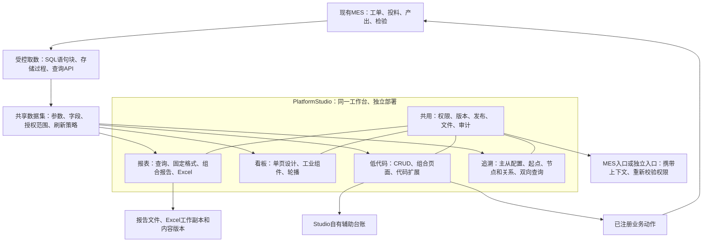

# PF-08 / PF-09 四类建模、设计工具与开源交付评估

**2026-10-21最新入口：** 已编写[实施11：Low Code](../implementation/11-Industrial%20Platform%20Low%20Code开发实施方案.md)、[实施12：Dashboard / Report / Traceability](../implementation/12-Industrial%20Platform%20Dashboard%20Report开发实施方案.md)；[本轮复核记录](2026-10-21-platformstudio-review-and-todo.md)列出旧范围纠正和待验证项。当前要求为可调整的默认1920×1080看板、平台自适应工作台、完整行跳转/目标查询映射、同宽主从明细带、动态电子记录及长HTML续排、追溯拖拽与模态框明细。本文下方v4.0及此前结论作为历史评估保留；最新任务与需求以新清单为准。生产引擎PoC、实施11/12完整规格、许可及现场验收未完成，开发未派遣；本轮浏览器复验连接超时，未标通过。

日期：2026-10-19。仓库基线：`56f7e24ca40fac5ebcb8c7ba795f2b158739b9bd`，`develop`；开始评估时工作树无已报告改动。

最新需求纠正：2026-10-20，见§16。**电子记录必须支持数据驱动的动态组装**：以工单、工序/执行为上下文，根据实际返回的数据匹配子报表模板、生成重复区块并排序，再紧凑连续排版。五类子报表只是用户MES的例子，不是固定结构或数量上限。整份电子记录由主模板统一选择横向或纵向；此前将电子记录解释为横纵混排已撤回。简单组合继续单独保留。当前会话概念为v4.0，四个独立菜单、看板1920×1080、页面共享接口响应、图形组件及追溯起点/关系链配置同时覆盖；概念待用户评审，正式引擎和现有MES验收仍未完成。

状态：第一轮仓库与官方资料评估完成；详细设计待细化、技术候选未准入、PoC未执行、生产开发未派遣。本文不是实施11/12，也不把资料核查等同于集成或许可验收。

输入：[用户提供的“低代码看板报表建议”](chatgpt-conversation://6aa0f91d-bc20-83e8-ba7a-768fa5055718)、当前蓝图18/21/22/32、总Todo、公开源码与依赖清单。已读取对话最新追溯追加讨论及用户现有SQL Server项目概要。用户在本会话要求增加第四部分追溯图谱建模；产品组织更新为低代码、看板、报表（含Excel）、追溯。引用对话中助手的技术建议仍只作为评估输入，不冒充用户逐项批准；其中“Excel独立配套”“平台只用PostgreSQL”等旧说法不覆盖本会话已确认的Report归属与主平台支持矩阵。现有客户项目的代码、表结构和脱敏配置尚未提供。

## 1. 本轮结论

1. 保留蓝图32的宿主安排：PF08创建PlatformStudio，PF09加入Dashboard/Report；新增第四部分Traceability纳入当前设计评估，建议同宿主承载通用追溯配置与查询，不新增核心Host、不恢复MES阶段。当前源码尚无Studio或Trace生产模块，不能按“已有骨架”估算工作量。
2. 平台负责受控数据、动作、授权、发布快照与业务生命周期；设计器分能力选择。优先复用查询、表格、表单容器和元数据，不建设另一套平台外壳。
3. FormCreate表单、GoView看板、Meta2d工艺图、pdfme文档输出均作为有条件候选。技术上适合进入隔离验证，不代表允许直接纳入开源仓库。
4. 普通xlsx导出已有实现，ClosedXML调整为复杂格式/类型/多工作表的候选；当前没有ECharts依赖，不能把它算作现有能力。
5. 按用户新增要求，产品建模扩为低代码、看板、报表（含Excel）、可配置追溯四部分。在线Excel及两类组合报表纳入首期：简单组合保留报告选择/排序/输出；电子记录组合按SOP组织人工填写、HTML页面和系统操作记录，不能以简单组合替代。编辑引擎仍需单独评估。追溯面向多行业，参考现有项目的主从配置、图形设计、可选起点、任意节点双向查询和SQL/存储过程取数，详见§10、§13、§14；不照搬客户代码或推断必须只有两张物理表。
6. **开源可发布性是选型前置条件。** 基础低代码、看板、查询报表应能在无商业许可证时构建和运行。没有明确授权的代码、模板、字体、图元和发行包不进入平台交付物；平台自身许可证本轮不选定。
7. **独立部署与完全离线安装/运行均为首期要求，部署兼容范围继承主平台。** 用户已确认覆盖登录、低代码、看板、报表和浏览器Excel编辑，新增追溯继承同一约束；编辑服务在内网部署，必要程序、依赖与静态资源提前备齐。主平台支持的部署环境本产品必须支持，不另行缩减或重复征求操作系统选择。此项是交付及验收条件，当前尚未实现或验证。

## 2. 当前仓库事实与差距

以下为源码/清单核查；“已有”仅表示找到实现，不追加本轮运行通过的结论。

| 能力 | 当前事实及证据 | 对PF08/09的意义 |
| --- | --- | --- |
| 技术基线 | [前端package.json](../../src/frontend/package.json)、[锁文件](../../src/frontend/pnpm-lock.yaml)：Vue 3.5.41、Element Plus 2.14.4、vxe-table 4.15.13、Pinia 3.0.4、Vite 8.2.1；[后端构建](../../Directory.Build.props)目标net10.0 | 验证候选必须使用当前基线；第三方旧演示可启动不代表能合入 |
| PlatformStudio | `src/backend/src/Services`目前为Identity、SystemData、ReferenceData、Collaboration；[UnifiedHost目录](../../src/backend/src/Hosts/IndustrialPlatform.UnifiedHost/UnifiedHostModuleCatalog.cs)也仅注册这四项 | DataSource/Dataset/LowCode/Dashboard/Report/Publishing为规划能力，须新建服务模块、初始化、权限与入口 |
| Trace与图形库 | [蓝图18](../blueprint/18-Trace%20Service详细设计.md)是事件驱动关系投影规划；当前Services及UnifiedHost未有Trace或Traceability实现，前端清单/锁文件未见G6/X6、Vue Flow、LogicFlow、Cytoscape | 客户已有项目的经验与本仓库状态分开记录；可配置追溯查询须补合同，旧事件投影不能直接当作已实现的图形设计器 |
| 页面组件 | [黄金页](../../src/frontend/src/pages/pc/identity/IdentityUsersPage.vue)使用[AppQueryPanel](../../src/frontend/src/components/management/AppQueryPanel.vue)、[AppDataTable](../../src/frontend/src/components/management/AppDataTable.vue)、[AppFormDrawer](../../src/frontend/src/components/management/AppFormDrawer.vue) | 复用查询、动作、表格与业务表单容器；独立编辑页可复用同一表单内容，不强制塞入抽屉 |
| 表格合同 | [AppDataTable.ts](../../src/frontend/src/components/management/AppDataTable.ts)已有字段、固定列、过滤、排序、loader、total及服务端exporter；本地快速导出与服务端全量导出分开 | 可以作为查询报表运行底座；尚不是可视化报表设计器，也未定义报表的全结果聚合与统计口径 |
| 查询白名单 | [QueryResourceDefinition](../../src/backend/src/BuildingBlocks/IndustrialPlatform.Querying/Schema/QueryResourceDefinition.cs)、[QueryLimits](../../src/backend/src/BuildingBlocks/IndustrialPlatform.Querying/Validation/QueryLimits.cs)、[前端QueryDescriptor](../../src/frontend/src/querying/types.ts)已有字段/操作及分页约束，当前MaxTop=100 | 可复用筛选排序校验；缺Dataset版本、参数、单位、时间含义、聚合预算、字段授权和多来源执行合同。不能把查询语法校验当成行列授权 |
| xlsx导出 | Identity和SystemData均有`Api/Export/StreamingXlsxWriter.cs`；[Identity实现](../../src/backend/src/Services/Identity/IndustrialPlatform.Identity.Api/Export/StreamingXlsxWriter.cs)用ZipArchive顺序写OpenXML，单工作表、单元格为inlineStr；[用户控制器](../../src/backend/src/Services/Identity/IndustrialPlatform.Identity.Api/Controllers/UsersController.cs)接服务端查询 | 已能生成真实xlsx；数值/日期类型、丰富格式、公式、多工作表仍是能力差距。不能跨域引用另一个服务的Api内部类；需要复用时只提取纯文件写出能力 |
| 元数据 | [MetadataContracts](../../src/backend/src/Services/ReferenceData/IndustrialPlatform.ReferenceData.Contracts/Metadata/MetadataContracts.cs)已有字段类型、精度、字典、单位版本、发布检查和有效Schema | 作为字段描述输入；不把ReferenceData扩成任意业务数据存储，也不把它的Revision直接当页面发布版本 |
| File | [FileContracts](../../src/backend/src/Services/SystemData/IndustrialPlatform.SystemData.Contracts/Files/FileContracts.cs)、[FilePorts](../../src/backend/src/Services/SystemData/IndustrialPlatform.SystemData.Application/Files/FilePorts.cs)、[FileService](../../src/backend/src/Services/SystemData/IndustrialPlatform.SystemData.Application/Files/FileService.cs)已有续传、完整性确认、扫描、下载、引用、删除与保全；未见WOPI、编辑锁、逻辑文档内容版本或覆盖保存公开端口 | 可以承接产物文件；`WriterEpoch`是上传写入者世代，`FileBindingV1.Version`是引用版本，均不是Office内容版本 |
| 跨模块文件使用 | File的BindReference要求Conversation/Message/Attachment，OwnerService写为collaboration；LegalHold也绑定该OwnerService | 这些合同不能直接套给Report/BatchRecord。新用途须补公开产物绑定、访问授权与保留合同，不伪造聊天标识，不直读File表 |
| Scheduler | [公开Handler合同](../../src/backend/src/Services/SystemData/IndustrialPlatform.SystemData.Contracts/Scheduler/SchedulerContracts.cs)及[接入说明](../implementation/details/PF07-业务Job接入说明.md)已有参数校验、TenantNId、OperationKey、取消与结果状态 | 可承接报表任务；Report自己保存产物与幂等状态。现有Handler注册方式不等于已实现跨进程远程执行 |
| 外部嵌入 | [DEPLOYMENT](../../src/frontend/DEPLOYMENT.md)的single模式明确只开放用户管理页；另有Collaboration专属嵌入实现 | 可借鉴入口隔离，不能宣称Studio已支持任意MES。临时account入口不提升为Studio可信身份标准 |
| 候选依赖 | 前端清单与锁文件未见FormCreate、GoView、Meta2d、pdfme、ECharts、Univer；[中央NuGet清单](../../Directory.Packages.props)未见ClosedXML/FastReport；根目录未见平台LICENSE/NOTICE | 全部候选都需要真实接入验证；当前核查不是整个仓库的开源合规审计 |

已有相关测试文件可作为后续回归入口，如`tests/BuildingBlocks/IndustrialPlatform.BuildingBlocks.Tests/QueryDescriptorTests.cs`、`tests/SystemData/IndustrialPlatform.SystemData.Tests/Application_FileServiceTests.cs`及`src/frontend/tests/components/AppDataTable.spec.ts`。本轮未运行这些测试，不以测试文件存在证明功能通过。

## 3. 技术候选、许可证据与准入状态

“有条件候选”表示可继续技术与授权核查，**不是已采用或可直接复制**。分支manifest上的版本只是本次观察值；正式接入前必须固定tag/commit、实际包与锁文件、许可证和资产清单。免费使用、源码可见、允许商用、允许开源再分发是不同结论。

| 能力/候选 | 本次证据与版本范围 | 评估结论与前置条件 |
| --- | --- | --- |
| FormCreate＋Designer | 官方[设计器仓库](https://github.com/xaboy/form-create-designer)、[next分支manifest](https://raw.githubusercontent.com/xaboy/form-create-designer/next/packages/element-ui/package.json)显示Designer 3.5.0、Vue peer `^3.5`、Element Plus依赖；[该分支LICENSE](https://raw.githubusercontent.com/xaboy/form-create-designer/next/LICENSE)为MIT；[渲染器仓库](https://github.com/xaboy/form-create)另行维护 | **表单首选验证候选**。锁定设计器/渲染器的兼容组合，核对富文本等间接依赖；验证自定义组件、校验及保存往返。关闭或替换任意事件代码/请求配置能力，导入模板同样校验。不默认接入其AI功能 |
| GoView开源版 | 官方[GitHub说明](https://github.com/dromara/go-view)指向[Gitee主仓](https://gitee.com/dromara/go-view)优先更新；GitHub manifest是2.2.6，Gitee [master manifest](https://gitee.com/dromara/go-view/blob/master/package.json)为1.3.2，页面另列v2.2.8等tag；主仓页面声明MIT | **有条件候选，先确定来源和分支**。不能仅比较版本数字；Gitee manifest仍有NaiveUI、Pinia2、i18n9、Vite4及GSAP/地图/图标等依赖。需明确整包许可、素材来源、数据接入改造和样式隔离成本，不能整仓搬入 |
| Meta2d | [官方仓库](https://github.com/le5le-com/meta2d.js)声明MIT并提供Vue3示例；[core manifest](https://raw.githubusercontent.com/le5le-com/meta2d.js/main/packages/core/package.json)观察为1.1.19，声明MIT | **工艺图有条件候选**。引擎许可不覆盖未核验的商业编辑器、在线素材库或另购图元。罐/泵/阀/管线等先使用来源明确且允许分发的图元；缺少的由平台自行制作。只承接工艺图内部编辑与状态展示 |
| AntV G6 / X6 | [G6官方仓库](https://github.com/antvis/G6)提供关系图可视化；[X6官方仓库](https://github.com/antvis/X6)提供图编辑与Vue节点扩展，当前仓库均声明MIT；未锁tag/commit、未安装或验证包 | **追溯图形能力候选**。保留流程图式建模需求，先用同一模型/运行图样例验证单库能否覆盖两态，不预设必须同时安装两套引擎。精确包、插件、素材、离线资源及Vue基线兼容仍须准入验证；库本身不提供业务追溯语义 |
| 查询报表配置层 | 当前平台查询/Table能力可复用；ECharts尚未安装 | **推荐采用现有组件组成配置层的路线**。图表引擎仍须独立锁版本与许可。工程师需要配置UI，不能以要求手写JSON代替设计功能 |
| pdfme | [6.2.6发布页](https://github.com/pdfme/pdfme/releases/tag/6.2.6)、[该tag许可证](https://raw.githubusercontent.com/pdfme/pdfme/6.2.6/LICENSE.md)可核查，MIT；[UI main清单](https://raw.githubusercontent.com/pdfme/pdfme/main/packages/ui/package.json)表明React UI，但main不等于该tag依赖清单 | **文档输出首选验证候选**，6.2.6可作PoC版本起点，尚未安装。必须核对同版本ui/common/schemas/generator和字体；Vue封装及Node正式生成增加部署成本。不可因MIT跳过插件、间接依赖或字体核查 |
| FastReport | [官方仓库](https://github.com/FastReports/FastReport)明确区分MIT引擎、非MIT的Designer Community Edition及单独的Online Designer产品 | **对照备选**。不能将免费桌面设计器或商业在线设计器打入开源基础包。只有pdfme实际样表不满足时，再比较完整授权和部署成本 |
| ClosedXML | [0.105.1发布](https://github.com/ClosedXML/ClosedXML/releases/tag/0.105.1)和[该tag LICENSE](https://raw.githubusercontent.com/ClosedXML/ClosedXML/0.105.1/LICENSE)为MIT；官方[README](https://github.com/ClosedXML/ClosedXML)给出大文件内存与线程安全限制 | **按需候选**。普通流式导出继续复用现有能力；有数值/日期、样式或多工作表需求再测。按任务独立工作簿，不共享可变实例；官方基准不能替代本平台负载测试 |
| Collabora Online / CODE | [源码COPYING](https://github.com/CollaboraOnline/online/blob/main/COPYING)为MPL-2.0；官方[许可页](https://www.collaboraonline.com/terms/collabora-online-mplv2/)明确区分源码与附加发行条款，并列字体等第三方内容；[FAQ](https://www.collaboraonline.com/faqs/)将CODE定位为开发/测试版本 | **可选外部服务候选，暂不纳入发行包**。可评估平台WOPI适配代码，但具体镜像/安装包、品牌、源码提供与客户再分发条件须分别确认。未确定版本/digest及交付权，不承诺开源安装包可捆绑它；生产支持另评估 |
| Univer | 官方[导入导出文档](https://docs.univer.ai/en-US/guides/sheets/features/import-export)标注Univer Pro及服务端依赖 | **备选**。基础表格核心的许可不能推导出文件导入导出/协作全链可开源交付；本轮未核验完整发行包，暂不接入 |
| LibreOffice Headless | 对话中的可选转换路线，本轮未选发行版、未做部署核查 | **暂缓**。确有Office转PDF需求再验证；在线Excel、报表查询不以它为前置 |
| TMom | [项目页面](https://gitee.com/thgao/tmom)列出SQL/API查询报表与GoView集成；同时出现MIT文字和“未经开发者授权，本产品及衍生产品不得用于任何形式的商业用途”声明。独立LICENSE文件此次未成功读取 | **仅作产品思路参考**。许可表述不一致时不推断已获复制/商用/再分发权，不复制源码、模板、截图或素材进平台。本轮未审计其实现，不认定其具备本平台所需的授权/发布/归档语义 |

pdfme的具体限制已由[动态表格文档](https://pdfme.com/docs/tables)和[支持能力说明](https://pdfme.com/docs/supported-features)确认：动态重排/自动跨页要求空白`basePdf`尺寸对象；已有PDF底稿保持固定页面。真实样表必须分别验证这两类，不能先承诺任何既有纸表都能自动跨页。正式渲染建议由平台先取受权数据和资源，再给渲染器提供内容，避免渲染器自行访问业务库或任意URL。

## 4. 开源交付准入规则

用户最新要求落实为以下选型边界，适用于本阶段新增代码与资产，不据此重写整仓许可证。

| 类别 | 可进行的工作 | 纳入平台的条件 |
| --- | --- | --- |
| 许可清楚的开源候选 | 阅读、隔离试验、核对适配 | 指定版本的源码/包/依赖/资产允许拟定开源与客户交付方式，保留所需版权、许可、NOTICE与修改说明；完成实际包核验后才准入 |
| 仅参考项目 | 归纳公开产品能力与交互问题，依据平台需求独立设计 | 不复制受限实现、模板和素材；后续确需复用须先取得明确许可 |
| 商业组件或带额外条款发行包 | 比较功能、成本，评估外部适配 | 作为显式可选能力；没有授权时基础版仍能构建运行。隔离进程/iframe不自动消除其分发条件 |
| 许可不明或声明冲突 | 留作待核查来源 | 不进入依赖锁、vendor目录、容器镜像、示例资产或客户安装包 |

准入同时检查三种产物：公开源码仓库、构建后的前端/后端包、客户安装包/容器镜像。只检查npm顶层许可证不足以覆盖打包后的依赖与字体/图元。记录来源、精确版本或commit、包摘要、许可证文件、修改范围及分发方式；不能仅记录一个“MIT”标签。

用户已确认完全离线部署，技术准入还须验证离线安装、首次启动及日常运行：必要资源可在允许的许可范围内预先准备并交付，功能不依赖公网CDN、SaaS渲染/编辑服务、在线激活或持续联网校验。支持本地运行不等于获得安装包再分发权，两项分别核验；不能为满足首期Excel而未经核查采用商业发行包。

平台开源许可证仍未决定；本轮不写入Apache-2.0或其他平台LICENSE。当前候选核查是证据收集，既不保证完整交付包已通过审核，也不把copyleft许可一概当作不可使用；按拟采用方式确认义务与兼容性。

## 5. 共享基础与最小契约缺口

以下是详细设计输入，不是已存在的API或最终表结构。

| 归属 | 最小需要明确的合同 | 复用与限制 |
| --- | --- | --- |
| DataSource | 注册来源类型、公开能力标识、凭据引用、可用状态、访问范围 | 已确认首期包含注册API及受控只读数据库接入；新增追溯评估明确包含授权工程师配置的SQL查询语句块与存储过程，不局限于单条SELECT。查询定义经登记/验证/发布，运行用户只传声明参数；不接受运行接口提交任意SQL。平台域数据走公开Application/API，业务写入走所属业务API，凭据只在服务端；先用自建模拟源，生产接入由用户后续完成，详见§10.4 |
| Dataset | 参数类型/必填/默认、字段类型/精度/单位/时间语义、分页/排序、允许聚合、版本、行列授权、超时/行数/并发预算 | 复用QueryDescriptor白名单；敏感字段不仅不能显示，也不能借筛选/排序/统计间接泄漏。浏览器不得传权威租户或任意URL/凭据 |
| 页面数据实例 | 名称、Dataset及版本、参数映射、刷新间隔、状态、数据时标、最后成功时间 | 同页面相同实例共享一次请求；缓存包含租户/权限上下文/参数/版本。取消或丢弃旧上下文回包；错误/过期与业务值0分开 |
| 业务动作 | 稳定ActionKey、输入Schema、所属模块权限、幂等与结果合同 | 仅注册已有业务动作；不让配置跨模块写表。组件事件引用动作标识，不携带可执行JS |
| Publishing | 草稿、不可变Revision、发布指向、依赖版本及兼容检查、发布/回滚授权 | 保留引擎原生模板并记录引擎/格式版本；外层记录数据绑定和依赖。回滚发布指向不等于回滚已产生业务数据或重建物理表 |
| Report | 查询定义、组合类型、报告项/参数/顺序、SOP/记录模板修订、步骤/重复/条件区块、来源映射、HTML绑定及内容/资源版本、页面母版/页码规则、Run/授权/产物/失败处理 | 简单组合按所选报告及顺序输出；电子记录组合按执行上下文组织人工填写、HTML及系统操作记录，使用统一页头/页脚和最终页码，详见§13.2.1、§14。查询/合计/导出同权限；固定实际模板/数据版本及参数。必要内容缺失或生成失败不得标记完整成功；生成完整与业务执行/审核完整分别表达，不给简单组合套用工单完整性规则 |
| File消费 | Report产物绑定、用户/用途授权、服务端生成文件接收、可用确认和保留策略 | 调用公开端口并保留扫描/隔离语义；现有聊天专用绑定不直接复用。产物已生成但未通过必要检查时不能显示可下载 |
| Office编辑 | 稳定逻辑文档标识、不可变内容版本、编辑会话/令牌、冲突校验、保存确认 | 可评估“逻辑文档版本指向新File对象”的方案，避免原地覆盖。写入失败保留上一版本；扫描/校验完成后才更新有效版本，重复保存和并发保存须有明确定义 |
| 后台生成 | 已注册Handler、执行身份、OperationKey、超时取消、产物提交和重试 | 复用PF07；定时执行身份不使用已过期的浏览器JWT。定时触发与任务执行能力分开，所选异步执行路径关闭时须拒绝相应操作，不伪装已排队 |

### 产品与部署边界

根据用户最新要求，按下表划分四个产品入口和领域模型，Excel仍归Report。建议四部分共用PlatformStudio宿主及受控数据/发布基础，各自拥有领域合同；不因入口数量拆分Host、数据集或用户体系。下面列的是概念对象，尚不是最终实体、表数或接口承诺。

| 产品部分 | 用户配置和使用的对象 | 建议的概念模型与边界 |
| --- | --- | --- |
| 低代码（PF08） | 应用、列表/表单/详情/组合页面、操作与导航；通过注册扩展接入代码组件和完整代码页 | 应用、页面定义/修订、组件配置、数据绑定、动作绑定；用户已确认支持配置字段和页面、保存自有业务登记记录，见§8。以配置发布后运行作为当前设计方向，不额外扩入源码生成平台 |
| 看板（PF09） | 单页大屏、图表、工艺图、命名数据实例、参数与轮播列表 | 看板定义/修订、组件与属性绑定、播放列表/播放项；看板显示和授权钻取使用公开能力，工艺图不引入现场设备控制业务 |
| 报表（PF09，含Excel） | 查询统计、文档模板、简单组合、电子记录组合、运行记录/产物，以及导出、上传和编辑Excel的入口 | 简单组合配置报告项/参数/顺序；电子记录组合配置SOP步骤/记录区块、HTML与业务操作映射及页面母版；共用生成任务/产物能力。两类同属报表独立菜单下的组合功能，见§8、§14。工作簿及内容版本/编辑会话纳入首期，保留独立文件打开入口 |
| 追溯Traceability（新增设计评估） | 多行业模型主档、流程图式对象/关系设计、可选起点、起点查询条件/列、任意节点查来源/去向、关系证据 | 模型定义/修订、对象类型/标识/粒度、关系语义、起点配置、查询绑定/参数/结果映射、适用行业场景/工厂及查询结果。复用DataSource/Dataset/Publishing，不拥有客户原始事实，不把MES事件投影作为独立运行前置；半导体是行业样例，不是核心模型限制 |

共享基础包括DataSource、Dataset、业务动作注册和Publishing，以及平台已有身份/租户、权限、File、Audit、Scheduler的公开能力。DataSource/Dataset管理可作为Studio公共设置入口；各产品只拥有自身配置和运行状态。Publishing复用发布流程及依赖检查，页面修订、看板修订、报表模板修订、工作簿内容版本仍各自表达真实生命周期，不用一个通用Version字段混代。

跨产品复用通过公开的资源标识、参数和授权运行入口完成：低代码页可以嵌入看板或报表，看板可钻取到低代码详情或报表；运行时只加载实际使用的能力。PF09不因复用Dataset而被迫依赖低代码设计器，跨产品也不直接读取对方内部表。

报表内部需要区分三种数据路径：

1. **查询与导出**：受权Dataset执行得到结果，生成PDF/xlsx等产物；导出不依赖在线Excel编辑器。
2. **工作簿编辑**：用户上传文件，或从报表产物创建工作副本；修改保存为工作簿新内容版本。更改公式、数值或单元格不会更新原Dataset或业务原始记录，也不会修改报表设计模板。
3. **正式归档**：业务流程选定最终产物后，通过公开合同保留不可变文件及必要版本信息；后续编辑必须形成新的工作副本。报表负责文件生成与产物记录，工单业务负责完整性和正式归档判定。

- **PF08**：用户已确认支持配置字段和页面后保存、修改、查询自有业务登记记录（辅助台账），纳入首期设计范围；低代码需要自己拥有记录、Schema演进、授权和事务，不能用ReferenceData配置值代存。已有MES业务仍经其公开业务接口处理。组合页面和代码注册扩展继续按评估方向细化。设计器以PC为主，PC/PDA/Mobile运行能力逐组件定义，移动端不自动引入另一整套设计器。
- **PF09 Dashboard**：单页设计与播放列表分开；列表保存看板引用、参数、顺序、停留时间，同页不同参数可重复播放。工艺图作为看板组件，两个引擎不共同控制整张画布。数据刷新与轮播分开，切页释放定时器/订阅，明细返回恢复播放位置。
- **PF09 Report**：可视化查询配置与按需文档模板分别定义；普通流水报表不强制纸张模板，固定版式输出不用浏览器截图代替。查看、导出、管理、设计/发布、工作簿编辑分别授权。用户已确认在线Excel作为本产品首期必交能力，不另列第四产品；不能以普通导出或离线编辑代替交付。
- **报告组合与BatchRecord**：首期支持简单组合和电子记录组合，单报告仍可独立查看/生成。简单组合按所选报告、参数及顺序输出，不强制绑定生产工单。电子记录组合按SOP配置步骤/记录区块、重复及条件展示、人工填写/HTML页面与系统操作记录映射，呈现执行状态、人员、时间和证据，统一页头/页脚及最终连续页码。MES等来源系统负责执行事实、更正、业务完整性、审核及正式归档判定，Report忠实组织并显式表达缺失内容。流程页面设计、填写和HTML存储属于后续生产工单模块，本次只定义消费合同并用模拟内容验证。固定模板/数据版本与最终文件，PDF生成成功不等于业务记录完整或已审核。
- **在线Excel**：产品归属Report，首期提供浏览器打开上传文件或报表工作副本、修改单元格/公式/格式、保存新内容版本及重新打开核对。保存不回写业务原始表，归档产物不可被普通编辑覆盖。编辑服务及File版本/会话/保存适配纳入原生与独立部署的首期交付清单，具体引擎待许可和实际往返验证；运行时可关闭编辑功能，但不据此取消首期交付要求。Collabora编辑、LibreOffice转换和客户端离线编辑分别处理；在线编辑不可用时不影响查询和普通导出。

平台原生形态先接入现有可信身份/租户、权限、UI/菜单、初始化、Audit及所需File。PF09运行需要受控Dataset，不强制加载低代码设计器。Studio默认按服务持久化生命周期组织初始化，并列出可装配模块。用户已明确平台必须能独立部署；上述约束覆盖低代码、看板、报表（含Excel）及新增追溯整体，保留同一套核心代码与数据合同，不复制另一套产品。

独立部署的设计目标是：提供独立入口、安装初始化、登录/管理员引导及权限管理，携带所选功能必需的身份、文件、审计和持久化能力，复用现有公共模块或其公开适配，不要求启动完整Industrial Platform或接入生产MES。精确最小安装清单、初始化裁剪与公共能力依赖须在实施11/12细化，并在无主平台运行的隔离环境中验收；当前尚未实现或验证。独立Host通过公开API/事件消费其他宿主，同进程走公开Application合同，不新增内部HTTP来模拟模块隔离。

用户已确认该独立形态须能完全离线安装和运行。这里的离线指隔绝公网而保留工厂局域网：浏览器、应用、数据库、报表生成和Excel编辑服务均在内网完成通信。离线材料提前包含已核验许可的程序、必要运行时/服务安装材料或镜像、字体/图标/模板及前端静态资源，并附版本清单、完整性校验、初始化与证书配置说明；安装阶段不得临时访问公网拉取依赖，首次启动不得依赖公网激活。用户明确部署环境兼容范围沿用主平台，平台支持什么，本产品就必须支持什么；操作系统不再作为待选项。具体物料及安装步骤由主控按平台现有部署规范细化，不用开发机环境替代目标环境验收。

部署兼容要求覆盖Excel编辑、报表生成等新增必要服务的整体运行链。候选引擎如限制平台已支持的部署环境，须评估替代或提供符合平台规范的适配方案，不能通过缩窄支持范围满足验收；不能把“需要另一台不同系统的服务器”默认为已获用户接受。验证结果仍逐环境如实记录，平台已有未测项或当前模块缺少实测不能写成已通过；支持要求与验证证据分别维护。设计器以PC为主、运行端按已有约定划分的功能边界保持不变。

外部MES嵌入是在独立运行基础上的集成形态，另外验证身份发行者/票据、主体和租户映射、授权、退出/续期、主题/语言与导航。当前接入数据表由开发自行模拟，提供模拟表/视图、示例数据和数据源映射说明；实际生产连接、凭据及映射由用户后续处理，不作为本轮开发前置，也不计作已验证。基础查询/看板不依赖Collabora或文档渲染进程；选择pdfme后台输出时增加Node辅助运行单元，选择在线Excel时增加编辑服务，分别列入部署清单及故障边界。

## 6. 最小验证范围与通过标准

所有项目当前均为**未执行**。PoC只在隔离目录/数据中验证已核验许可的候选，不安装到主应用、不改现有服务配置。先记录版本、依赖锁、许可/资产来源和机器配置；合成样例只能证明机制，真实样表/文件验收另记。

| 编号 | 输入及执行范围 | 通过标准 | 环境/失败后的处理 |
| --- | --- | --- | --- |
| V0 数据接入 | 隔离测试库中的工单、产量、设备状态模拟表/视图及示例数据；注册模拟API；只读数据账号 | API与实际数据库适配均能生成受控Dataset；允许字段/过滤/聚合与分页正确；未授权对象和写语句被拒绝；模拟源可通过配置替换，不将表名、连接或凭据硬编码到组件 | 使用已选支持矩阵内的测试数据库；模拟业务数据仍走真实数据库查询链。交付示例初始化与映射说明；不连接生产，不把模拟接入算作生产通过 |
| V1 表单与CRUD | 一份自有辅助台账示例；独立新增/编辑/详情页＋表格/Tab组合；字典、附件、自定义业务选择器；保存模板、加载、发布与回滚 | 无手写JSON也能配置；重新加载值/校验/绑定一致；错误保留输入；并发更新明确冲突；无权动作和导入脚本配置被服务端拒绝；中英/明暗及三端目标运行验证 | 当前Vue/Element基线、隔离数据与权限账号；若FormCreate需长期侵入式改造，保留共享页面组件，重新评估表单候选，不自行缩减需求 |
| V2 看板与组态 | 生产概览/设备状态两个命名实例；罐体液位、状态、颜色独立绑定；同一看板分别带产线A/B进入播放列表 | 一个刷新周期内同一实例只取一次；断线显示失败/过期而非0；参数切换无旧回包覆盖；30次切换后无持续增加的定时器/订阅；明细跳转权限与返回位置正确 | 可控延迟/失败数据端口＋浏览器网络计数；先验证GoView边界；不满足时比较另一许可清楚的设计器，不移入其账号/后端 |
| V3 查询报表 | 脱敏流水样表或明确标注的合成替身；参数、列、单位、分组、钻取；2个权限范围；超过一页及10万行样本 | 本页/全部合计口径清楚；查询/合计/导出同过滤同权限；数值/时间语义与样本一致；全量导出无重复漏行；隐藏字段不能通过筛选/统计泄漏；峰值内存与时长记录在案 | 当前Querying/表格＋测试Dataset；10万行为测量点，不是已承诺容量。与现有流式xlsx对比；复杂格式再比较ClosedXML |
| V4-S 简单组合（V4分项） | 三份可独立生成的报告、各自参数及修订，分别选择/排除、调整顺序并组合；设置连续页码，制造一份报告生成失败 | 输出范围、内容和顺序准确，页码/总页数按最终页数重算，必要报告失败明确报错；单报告保持可用；不要求创建工单或SOP执行实例，也不声称组合文件证明生产完整 | 共用受权生成与产物能力；验证既有页眉页脚/页码的保留或覆盖策略不会叠印。未执行，不替代下项电子记录组合验证 |
| V4 SOP生产电子记录与文档输出 | 一份SOP及对应完成生产记录样本，含人工填写、系统业务操作记录、多次执行、条件步骤和缺失反例；HTML填写页面含中文长文、合并单元格、图片、已填值/勾选状态及样式；跨页明细（0/1/200行）、固定底稿及独立/组合输出 | SOP要求与实际记录逐项对应，顺序/重复次数/人员/时间/来源正确；未执行、缺失、不适用不伪装成正常或0。HTML按版式渲染而非源码/纯文本，填写值和选中状态完整；A4跨页无截断、重叠、漏行，图片/表头/页码正确。字体可分发；预览、后台PDF及打印核对一致；HTML及资源有固定版本依据，断公网仍可输出。必要内容/资源缺失或渲染失败不能呈现完整/已审核；脚本不执行，异常内容不静默删掉后标成功 | 原有pdfme候选须重新验证HTML记录区块和分页，尚未选定；不能将“支持PDF模板”当作满足HTML渲染。已提供批记录版式PDF节选，实际HTML及完整批记录数据尚未提供；先用模拟HTML验证，不开发生产工单录入，不作整份现场记录通过结论。能力不足时重新比较候选，不缩减完整记录目标 |
| V5 在线Excel往返 | 一份真实xlsx副本（公式、合并、格式），只读和编辑账号，两个并发编辑会话 | 授权打开→修改→服务端确认保存→版本更新→重开/下载核对；过期、撤权、断线、保存失败和并发冲突不静默丢失；归档文件不可覆盖；不回写业务源 | 已核验发行条款的CODE/其他目标发行版＋独立WOPI适配＋HTTPS/WSS；版本/digest与生产条款未定。失败时保留下载/上传副本，不能将此降级当在线编辑验收通过 |
| V6 发布与部署 | V1至V5及V7的最小产物；新库/升级库；平台原生装配、无主平台运行且隔绝公网的独立安装，以及按明确契约建立的外部MES测试宿主 | 使用预备离线材料，在无已有依赖缓存的目标环境完成安装/初始化/首次登录，验证低代码保存、模拟数据查询、看板、报告组合PDF、Excel打开/编辑/保存/重开及追溯建模/双向查询；浏览器及各服务无功能必需的公网请求。发布固定依赖，不兼容组件/数据集阻止发布；回滚保留业务数据；PF09运行无需设计器；嵌入另验身份/权限与文件链 | 服务器系统、数据库Provider及部署兼容要求继承主平台支持矩阵，不再单独选择或缩减；新增编辑/生成服务纳入同一环境的完整链验证。明确最小模块/进程/存储、离线物料、内网证书配置及备份恢复说明。只禁用浏览器公网或利用预热缓存不算离线安装通过；模拟宿主不算生产集成通过；完整主平台依赖不算独立部署通过 |

UI管理页继续使用黄金页的查询/表格/动作位置和共享弹窗偏好；设计器专属画布单独验证。后续正式规格应逐页补线框、加载归属、菜单可达、错误/空态与验收映射，而不是现在凭候选截图冻结页面。

新增 **V7可配置追溯**（未执行）：覆盖两个工厂差异及两类结构显著不同的行业样本，建议采用流程批次与离散序列号装配，以同一运行核心验证对象、关系、粒度及字段映射可配置；不只更换行业名称。原料、包材、半成品、成品及装配对象均可配置入口；从中间节点双向展开；SQL语句块与存储过程分别取数；验证拆分/合并/多次消耗、装配/拆卸、循环与重复展开、设备/容器重复使用、证据查询、权限与伪造参数、数据缺失/超限/取消、发布版本切换及断公网运行。使用自建模拟表/过程/API，不接生产；见§10.6、§13.3，具体行业样本属于建议验证输入。

## 7. 文档整改建议与执行顺序

本轮只记录评估和状态入口，不将候选写成已批准依赖、不提前生成可派遣工作包。

| 文档 | 待调整的精确范围 |
| --- | --- |
| [蓝图18](../blueprint/18-Trace%20Service详细设计.md) | 增补可配置模型/查询与既有MES事件投影的职责衔接；保留原业务事实来源，取消“必须先有事件投影才能用追溯界面”的推断，不整体改写或恢复MES开发 |
| [蓝图21](../blueprint/21-低代码配置平台设计.md) | §4/5宿主旧称；§7.2 EntityDefinition与自有辅助记录边界；§8/9页面和表单设计；§16旧industrial_lowcode及PG-only示例；§20/23设计/发布/运行分离与三端范围。补引擎版本、依赖快照、授权与开源准入；历史流程/规则不恢复为首期 |
| [蓝图22](../blueprint/22-工业数据分析平台设计.md) | §16/18单页、共享数据实例、工艺图与轮播；§21查询报表和文档输出分工；§22批记录消费边界；§25查询/聚合/导出统一授权；§28首期与远期分开。IoT/TimescaleDB/OEE仍不变成前置 |
| [蓝图32](../blueprint/32-Industrial%20Platform%20Service%20Host与内部模块边界.md) | §2.1/2.2已记录独立部署、完全离线及首期Excel/报告组合要求；继续补精确必需/可选依赖与最小装配，保留PlatformStudio归属。Office适配位置及BatchRecord消费合同继续细化，不因为编辑引擎增加核心Host |
| 实施11（待创建） | 平台共享契约、自有记录范围、完整表/字段/类型/索引、页面/修订/发布事务、组件和动作白名单、源代码扩展、三端线框、升级/回滚、开源物料与验收 |
| 实施12（待创建） | Dashboard与Report分章，Excel归入Report；Traceability细化多行业对象/关系/粒度/映射及主从合同/画布/起点/双向展开/SQL与过程接入。首期在线Excel及两类组合报表分别验收：保存往返、简单组合选项/顺序/输出、电子记录组合的SOP/HTML/分页/统一页头页脚页码及来源依据；另验独立部署，MES Trace/BatchRecord消费边界分列 |
| 总Todo/实施索引/派遣标准/CURRENT | 如实登记已进入评估、未完成详细设计；关联本文，保持开发未派遣，不改变阶段顺序 |

原四项首期产品范围已由用户逐项确认。下一步细化**受控Dataset/动作合同＋独立部署约束与最小装配**，同时准备V0模拟源和V1/V2/V4/V5的样例与许可可核查的版本；随后只做消除选型未知所需的隔离验证，再回写实施11/12。后续工作先平台原生闭环，再完成必须的独立部署验收；生产数据接入由用户后续处理。

## 8. 已确认范围与后续输入

已确认：用户在了解“辅助台账”是配置字段和页面即可建立、保存和查询业务登记记录后，明确回复“这个可以”。低代码自有业务登记能力纳入首期设计；物理存储、字段变更和事务方案仍需详细设计，不能把能力确认等同于具体表结构批准。用户要求后续一次只问一个问题。

已确认：首期同时支持API与受控只读数据库接入，限定允许查询的表/视图和参数，业务新增修改仍通过业务API。接入表与数据由开发先行模拟，生产接入由用户后续完成。用户同时明确平台必须支持独立部署，作为设计及交付要求，具体边界见§5。

已确认：用户要求在线Excel首期支持，包含在浏览器中打开上传文件或报表工作副本、修改单元格/公式/格式并保存。工作簿内容版本、编辑会话、保存冲突及失败处理、独立部署所需编辑服务、许可核验均进入本期设计与验证；具体技术候选尚未批准或实施。查询与普通导出仍可独立运行。

已确认：首期组合报表分为简单组合、电子记录组合两类，各报告仍可单独查看和生成。简单组合配置报告、参数及顺序后输出；电子记录组合按SOP组织完整生产记录，包含人工填写、HTML页面及系统业务操作记录、重复执行和条件展示，采用统一页头/页脚及最终页码。不能取消简单组合，也不能用简单组合代表电子记录组合已完成。填写页面的设计/填写/存储属于后续生产工单，本次只纳入HTML消费、版本、组织及分页输出合同。MES等来源系统保留执行、更正、业务完整性/审核/归档规则；Report呈现依据并核查文档所需记录。样式参考及验收分项见§14。

已确认：独立部署须支持完全离线的工厂内网安装和运行，覆盖登录、低代码、看板、报表及Excel编辑，所需编辑服务在内网部署；具体物料与断网验收见§4至§6。

已确认：部署兼容范围跟随主平台，用户明确“平台支持什么，这个就要支持什么”。不再征求Windows/Linux的独立选择，也不为候选组件收窄已定平台范围；具体版本/安装物料与验收组合从平台既有规范提取，支持要求和已完成实测分别记录。

此前四个范围问题及独立/离线部署要求均已确认，新增第四类产品建模Traceability按本轮用户要求进入评估；两处“四”分别指澄清事项数量和产品分类，不能混为审批状态。功能范围确认不等于技术候选、具体存储方案或完整详细设计已经通过。已有平台结论的共性事项直接继承，后续只在业务行为或平台规范未覆盖且实质影响方案的问题上逐项澄清。

对应技术验证仍需代表性样例：一份中文跨页/固定格式样表、一份含公式/合并单元格的Excel文件。当前可准备明确标注的合成样例开展机制验证；实际业务样表未提供时不作业务通过结论。目标部署运行条件按平台既有规范核对，不将操作系统选择重新列为用户输入。

平台最终许可证、第三方发行包/资产的再分发条件在引入依赖及公开发行前闭合，不阻断纯自有设计。产品划分、通过iframe或分进程集成均不代替许可核验；源码、客户SQL/存储过程、模板、字体、图元、安装包仍按§4处理。客户项目经验只用于归纳配置方式；尚未获准公开的实现或业务资产不复制到开源仓库。

这些事项不重复否定参考对话已经澄清的功能含义；只在影响对应设计或试验时集中处理。

## 9. 验证记录与限制

本轮完成：仓库结构、依赖清单/锁文件、共享组件、Querying、Metadata、File与Scheduler公开合同、嵌入文档及蓝图目标章节核查；官方候选资料和部分指定版本许可证核查。检索排除构建产物，未读取或输出私有配置。

未完成：候选安装/编译/浏览器试验、性能测量、真实样表/Excel往返、完整间接依赖与资产许可证审核、客户发行包授权、生产支持确认。部分源码URL不可读取：TMom独立LICENSE、FormCreate渲染器所尝试manifest路径、pdfme 6.2.6 UI manifest；不能用main分支清单冒充已锁tag依赖。

本轮只改文档；不运行后端Release/业务测试，不创建任务、不启动服务、不做迁移，不提交或推送。文档验证以相对链接存在、事实与建议状态区分、索引一致及`git diff --check`为准；最终结果在当前会话交付时说明。

## 10. 第四部分：可配置追溯设计与查询

### 10.1 新输入与仓库差异

本轮重新读取引用对话，重点读取用户追加第四部分及其现有项目概要，以及紧随其后的整理建议。用户描述的现有项目使用SQL Server：主表含编号、名称、版本、描述、状态和流程图式追溯设计；原料、辅料、包材、半成品、成品等可作为自定义起点，每个节点可继续正反向追溯；子表含起点数据源SQL、数据源列、查询条件，取数可配置为语句块或存储过程。这是设计参考，不代表本仓库已经实现。未列出的节点/连线/参数存储方式属于未知，不据概要认定现有项目缺功能；未读取客户代码或完整表结构。

仓库蓝图18偏重TraceRecord/TraceNode/TraceRelation及业务事件投影，源码Services与UnifiedHost尚无Trace。此次需要补的是通用模型设计、查询绑定和运行展开合同。当前平台配置持久化遵循主平台数据库支持矩阵；外部SQL Server仅是业务数据源，两者独立选择，不要求迁移客户数据或把T-SQL翻译成其他数据库方言。

### 10.2 产品和领域归属建议

建议PlatformStudio的Traceability拥有通用模型、起点配置、查询绑定、图形设计与受权展开；共享DataSource/Dataset提供受控执行，Publishing固定模型及查询依赖版本。模型可由工厂分别维护或复制后调整映射，首期不建立多层继承框架。

MES Trace保留业务事件形成的关系投影职责；生产、库存、称量等原始事实及更正仍归所属业务模块。未来Trace公开查询合同可以成为Traceability的一种数据来源，外部SQL/API也可以直接成为来源。通用查询无需先同步全部事实、建立图数据库或启用MES；不直接跨模块查平台业务表，不把运行图当作低代码自有台账保存。

新增产品入口和领域建模不增加核心Host；建议在当前PF08/PF09设计材料中独立列章，最终字段/接口和任务归属随实施11/12细化，不据此派开发或重排MES阶段。

### 10.3 概念模型与使用链

沿用主从配置的用户心智，先定义合同，再决定子表或设计JSON，暂不承诺只有两张表或预建大量独立聚合。

| 概念 | 需要表达的内容 |
| --- | --- |
| 追溯模型主档 | 编号、名称、说明、状态、适用工厂/产品范围、当前发布修订；设计画布保存节点布局及关系定义 |
| 起点配置 | 可用入口节点、查询定义/版本、输入条件、显示列、排序分页和隐藏的关联键；来源列与关联键分别配置并授权 |
| 节点定义 | 对象类型、主键映射、标签/显示字段、图标及明细入口；运行对象身份包含租户/来源系统/工厂/对象类型/源记录键，不能仅用名称或批次文字去重 |
| 关系定义 | 来源/目标节点类型、真实业务方向、关系类别、上游与下游查询绑定、参数及结果映射、证据记录字段；可使用两份查询，也可共用带方向参数的过程 |
| 查询绑定 | 受控SQL语句块、具名存储过程或API/Dataset引用；来源Provider、类型化参数、服务端工厂/租户范围、返回字段、预算和取消；配置版本与执行权限分开 |
| 运行图与展开状态 | 当前对象节点、真实关系与证据、已展开方向、续取位置、查询版本/时间、缺失/失败/截断状态；不把图上布局修改当作事实更正 |

使用链：选择模型及允许的起点类型 → 填写配置的查询条件 → 查询结果列表选择具体记录 → 展示对象图 → 选择任意节点查来源或去向 → 查看关系依据或进入有权访问的详情/报表。模型设计保留流程图式画布；配置表单可作为属性面板，不能以列表配置代替图形化建模需求。

反向查询只改变查找方向，不颠倒“原料被工序消耗”等业务含义，也不假设SQL能自动反转。运行查询固定已发布模型与查询绑定版本；布局/颜色修改不重建业务关系。固定配置版本不等于固定源数据快照；按需查询的历史重现能力必须按实际保留的证据和源数据能力声明。

### 10.4 SQL语句块、存储过程与列配置

本轮修正早期“任意SQL禁止”容易产生的歧义：禁止的是运行用户直接传任意可执行文本、未经治理的跨域写入；授权工程师可以在设计态配置查询语句块或已授权存储过程，经验证和发布后引用。普通用户只填声明的查询参数，工厂/租户访问范围由服务端可信上下文补入并核验。不能仅在前端隐藏其他工厂数据，也不能信任浏览器传来的节点身份作为权限凭据。

“只读”约束业务副作用，不简单限定只能执行一行SELECT；合理的局部变量、查询语句块和临时结果处理可在受控配置中评估。参数值与SQL文本分离，对象/过程标识来自登记定义；内部动态SQL同样需要参数化。设计测试也必须走相同授权和预算，不为识别列无条件执行过程。业务写入、永久DDL及越权外部访问不属于此查询入口。

存储过程逐项登记并核查实际执行权限、依赖对象与副作用，不能只给账号贴“只读”标签。SQL Server的同所有者对象链会影响底层对象权限检查，动态SQL另有执行上下文规则，参见[Microsoft权限与所有权链说明](https://learn.microsoft.com/en-us/previous-versions/dotnet/framework/data/adonet/sql/authorization-and-permissions-in-sql-server)。过程定义可由DBA在平台外更改，因此应记录可取得的定义指纹/部署版本并处理漂移；不能仅固定过程名称就声称锁定了查询实现。

数据源列支持自动识别初稿与人工声明。SQL Server的[sp_describe_first_result_set文档](https://learn.microsoft.com/en-us/sql/relational-databases/system-stored-procedures/sp-describe-first-result-set-transact-sql?view=sql-server-ver17)说明临时表及部分动态SQL等存在识别限制；识别失败允许人工声明返回字段，再以隔离受控测试检查字段类型、空值、必要关联键和结果集选择。字段识别不等于验证查询无副作用。首期无需自动翻译跨数据库SQL，按来源Provider保留实现，复用参数/字段/结果映射合同。

### 10.5 追溯语义与图形候选

物料谱系（消耗/产出/拆分/合并）、设备或人员等上下文关联、规则推定的可能影响分开表达。共用设备或容器不能自动串成物料流；应关联具体使用记录/时间区间。BOM或同工单关系不能替代实际消耗证据，源系统只有批次级记录时不得宣称包装级精确追溯。

关系返回来源系统/记录标识，以及适用的数量、单位、发生时间和单据依据。重复请求同一证据不重复加边；不同实际消耗记录不能因为起止节点相同被吞并。循环可展示，但通过已访问节点/边和查询预算防止无限展开；多父节点不强行转换为树。无关联、源不可用、权限范围内结果、缺失关联键和达到上限分别表达，不把截断或失败显示成完整结果，也不泄漏无权记录的数量或身份。

技术候选仅采用本轮查到的官方资料：[G6](https://github.com/antvis/G6)偏关系图展示、布局与交互，[X6](https://github.com/antvis/X6)偏图编辑并支持自定义Vue节点。两仓当前声明MIT，但精确版本、插件/资产和离线构建尚未核验。先验证单库能否满足图形设计与运行展开，只有真实差距才考虑两库；不提前引入图数据库。图形库不能替代追溯关系语义或后端授权。

### 10.6 V7最小验证明细（全部未执行）

1. 两个模拟工厂：A用批次粒度，B用包装粒度和不同字段映射；同名批次不得串厂。原料、辅料/包材、半成品、成品可按模型选为入口，中间工序节点也能继续上游/下游查询。
2. 自建SQL Server模拟表/视图/存储过程与模拟API，分别覆盖参数化语句块、带方向参数过程、两份方向查询、列自动识别及人工声明；拒绝越权工厂、注入参数和有业务写入副作用的过程。模拟源初始化权限与运行查询权限分开，不接生产。
3. 同批次拆分、合并、多父节点、多次消耗、重复展开和循环路径；数量/单位/证据可核对，真实多条关系不被错误合并，原业务箭头方向保持不变。
4. 容器/设备跨时间重复使用只显示对应使用事实；源缺少包装关联时标明粒度，不虚构包装链；事实更正从源业务生效，画布拖拽不写源业务。
5. 模型/查询配置发布与切换、同名存储过程定义漂移、异步旧回包、深度/节点/边数/超时预算、取消及部分失败；所有展开沿相同授权执行，明确完整与截断结果。
6. 在平台支持矩阵和完全离线部署条件下验证设计保存/重开、起点查询、双向展开、证据及详情/报表跳转；素材和布局依赖无必需公网请求。数据集配置与低代码设计器分开装配，通用追溯运行不依赖MES事件投影已上线。

本轮只更新评估和关联入口。尚未读取客户实现、锁定图形库、实现查询执行器、创建Traceability表或运行V7；现有“平台支持什么本产品就支持什么”、生产由用户接入、开源交付和一次只问一个问题的约定继续适用。

## 11. 整个PlatformStudio的概念与现有MES验收基线

### 11.1 本轮范围纠正

用户明确验收标准是“能够拿到现有的MES项目上直接使用”，并要求本次做好概念图；随后纠正：“不只是追溯，是整个的PlatformStudio”。因此该标准同时覆盖低代码、看板、报表（含Excel）、追溯图谱及它们共同依赖的部署、接入、权限与发布。不能仅对追溯提出现场验收，也不能以四个独立演示页代替整套交付。

“直接使用”落实为：提供可安装运行的Studio交付物和接入说明，现场登记连接/API、映射参数与字段、配置四类模型后，实际使用并对照MES结果。常规现场差异通过配置解决；遇到专有业务API、组件或协议扩展，沿已声明扩展点适配并记录范围，不能把重新开发Studio核心当作现场接入。这里不是承诺任意MES无需任何配置即可接通。

现有约定保持：开发先自建模拟表、过程与API，生产接入由用户完成；此分工不免除产品的真实MES验收。缺少现有项目样本时可以先做机制验证，但相关验收项保持待验，不索要生产凭据、不擅自接入生产，也不把客户SQL、模板、代码或图元复制进可开源仓库。

### 11.2 整体概念

模型配置由Studio拥有；工单、消耗、产出等事实仍由MES拥有。四类能力共享数据合同和发布机制，保留各自合适的设计界面。图示的共同能力按最小运行依赖装配，不要求客户先部署整个平台全部业务模块，不因为新增第四类产品再拆一个Host。

### 11.3 概念图覆盖的页面与操作

**版本说明：用户认为第一版概念图过于简单。以下内容保留为第一版结构与交互草稿；第二版已按§12的工业大屏及四类编辑器参考重制，见§12.4，仍待用户评审。既有概念交互检查不等于视觉验收通过。**

本轮会话交付工作台概念图，展示整体接入关系，以及四部分的设计与运行页面。用户随后明确“四部分不是Tab页，各自有独立菜单”，概念已据此修正为左侧独立菜单：低代码、看板、报表（含Excel）、追溯图谱；点击菜单进入本部分管理列表，再由具体记录打开设计或运行预览页面，并提供当前位置与返回列表入口。四类入口不合并为一个业务页面中的四个Tab；它们共享数据接入、权限和发布能力，不影响菜单和页面的独立性。

实际实施须分别登记四类菜单项、路由、权限与导航种子，菜单发现性沿平台共同规范验收；当前概念内的页面导航仅作交互示意，不代表实际路由已实现。页面内部是否需要详情分区或局部Tab，按所属页面设计处理，不据本次纠正一概取消内部Tab。

沿平台PC管理页的紧凑布局呈现，画布页保留专用业务区。示例工厂、工单MO-001、批次FP-001、投料与产出数量均为自造模拟数据；概念不代表已经接入用户MES或已选定第三方引擎。

| 部分 | 配置视图 | 使用视图与可观察结果 |
| --- | --- | --- |
| 工作台 | 现有MES → SQL/过程/API → 数据集 → 四类建模 → 发布与入口 | 切换取数方式；进入各模块；查看共用上下文 |
| 低代码 | CRUD、组合页面、代码扩展三类切换；字段、数据归属、保存路径、组件入口 | 台账新增演示；工单详情上下文；跳转报表和追溯 |
| 看板 | 单页画布、命名共享数据实例、罐体液位/状态/告警分别绑定、刷新参数 | 同一模板按产线参数轮播；通讯中断保留历史值并标明状态未知；业务跳转 |
| 报表/Excel | 查询报表、固定格式、章节组合；参数、数据与输出配置 | 选择章节改变报告预览；Excel演示单元格联动公式、保存新内容版本、重开已保存值 |
| 追溯 | 主表属性、图形节点与关系、起点和数据源配置；SQL/过程参数及返回列 | 按起点查询；选中任意可见节点逐步查来源/去向；多父节点与证据、数量、业务箭头方向 |

概念中的控件只演示选定交互。真实拖拽设计器、参数查询执行、持久化、发布、权限、文件打开/下载/PDF生成及完整Excel编辑器尚未实现；不能把本轮图示验证记为V0～V7技术验证通过。图上没有逐项演示的已确认能力仍属于需求，例如辅助/包材/半成品起点、Excel格式往返、章节排序、保存冲突与失败恢复。

### 11.4 整体验收案例

以下为最终应达到的验收基线，当前全部未做真实MES验收。每项证据至少保留安装/组件版本、配置与发布版本、数据源契约版本、脱敏输入、预期来源、实际结果和差异；用户实际MES样例作为业务对照。

| 编号 | 现场操作 | 通过标准与证据 |
| --- | --- | --- |
| PS-01 安装与入口 | 在主平台支持的目标组合安装Studio，分别从独立入口、现有MES约定入口打开 | 最小依赖可交付；登录、权限、文件与四类运行可用；上下文参数映射正确；独立运行不依赖未交付MES模块。具体MES身份/嵌入协议在对接合同中落定 |
| PS-02 数据接入 | 接入实际API及受控只读库；登记SQL语句块、存储过程、输入参数及返回字段 | 查询与源系统一致；常规字段/参数变更通过配置适配；无权限、超时、字段变化能定位；查询入口不能造成业务写入，连接秘密不下发浏览器 |
| PS-03 低代码 | 配置一张实际业务查询/详情页、一张自有辅助台账，并验证组合页/注册代码扩展入口 | 查询、独立新增/编辑/详情、保存重开、字典/业务选择器和约定附件可用；台账保存归Studio；实际MES写操作只能走已登记业务API；实际字段和业务效果核对一致 |
| PS-04 看板 | 配置现场生产看板及工业组件，多属性分别绑定，多个组件共用命名数据；按不同产线参数播放同一模板 | 指标、单位、设备状态与MES一致；共享数据不重复请求；刷新/轮播独立；断开数据源时显示过期/未知；恢复与跳转正确，不把通讯中断显示为正常或零 |
| PS-05 报表 | 分开验证简单组合与电子记录组合：前者配置独立报告/参数/顺序；后者用现有MES的SOP及完整记录绑定步骤、人工填写/HTML和系统操作。另验查询、固定格式 | 简单组合内容/顺序/页码准确，必要项失败可见，单报告可用；电子记录组合逐项核对步骤/重复/值/状态/人员/时间/来源，HTML正确分页打印，统一页头/页脚且总页码最终重算，长表续页重复表头。两种模式分别通过，简单组合不替代电子记录验收；离线资源/版本可追，来源审核状态不被生成状态替代；查询xlsx数值另验 |
| PS-06 Excel | 打开实际上传xlsx及报表工作副本，编辑单元格/公式/格式，保存、重开、下载 | 约定样本的公式/格式及内容往返可接受；保存产生内容版本；并发冲突、失败保留/恢复可处理；归档内容不被覆盖；不自动回写MES |
| PS-07 追溯 | 用当前SQL Server追溯模型/等价脱敏对照样例配置入口、节点、关系和查询；从不同对象及中间节点双向展开；另用结构不同的行业样本验证同一核心 | 与现有项目可核对的来源/去向一致；对象/关系/粒度/字段及过程/语句块可配置；多次消耗、多父、拆分合并、装配/拆卸、跨厂重名和重复展开正确；关系有源证据、数量及单位；查询上限和失败不伪装成完整结果。更换行业模型不要求复制核心或硬编码流程 |
| PS-08 一条业务链 | 从同一真实工单/批次的低代码页进入看板、报告及追溯，再打开源单据 | 对象标识、参数、数据版本/取数时点和权限一致；不同刷新时点造成的差异能解释；入口隐藏和服务端拒绝都生效，不能靠传参扩大工厂或数据范围 |
| PS-09 发布与维护 | 保存草稿、重开、发布、切换/回退版本、替换现场连接映射 | 页面/模型及依赖版本可辨认；草稿不意外影响已发布运行；配置与文件备份恢复可验证；部署说明可复现，现场常规映射无需改Studio核心源码 |
| PS-10 完全离线与开源交付 | 用预备物料在断公网的干净内网环境安装并走完PS-01～PS-09适用链；检查发行清单 | 登录、设计、查询、渲染、Excel编辑/保存及所需字体、图元、资源不依赖公网；精确版本及源码/二进制/素材再分发条件有证据；仅供参考的第三方或客户资产不进入开源发行 |

性能以实际样本的记录量、图规模、刷新频率和并发情况测量，并在技术试验时明确目标、查询预算及结果截断规则；当前不捏造现场规模或宣称已达到某个响应时间。PS-01的适配范围继承用户“平台支持什么，这个就支持什么”，既有未测组合如实保留。

### 11.5 验收状态分开记录

1. **概念对齐**：本轮交付整体及四类视图，供用户判断操作方式；概念交付不等于用户已经确认布局。
2. **模拟机制验证**：后续用自建表/过程/API、合成样表与隔离环境完成V0～V7，并覆盖上述验收案例的机制部分。
3. **现有MES实测**：由用户完成现场接入后，用代表性真实或经授权等价样例核对四部分及完整链；缺少对照样例的项保持待验。

详细实施11/12、数据库字段/API、引擎PoC及发布合同仍需按既定流程细化。本轮交付概念图和验收基线，不安装引擎依赖、不修改业务代码、不派遣开发，不接入用户生产MES。

### 11.6 本轮概念交互检查

已用浏览器检查本地隔离预览：四模块切换、设计/运行切换；低代码三种页面类型及台账新增；看板参数轮播、设备断线保留历史值；报告章节选择、查询汇总示意；Excel数量联动、保存新版本后恢复已保存值；追溯从成品逐步反查两份原料、从原料逐步查去向、重复展开不重复计边。检查时发现台账原生表单提交不适用于预览沙箱，已改为本地演示动作并复核新增可见。

已查看整体与代表页面截图，并在320px视口检查总览及四模块设计/运行共9个状态，根容器未出现横向溢出；1024px查看台账布局。浏览器记录未返回脚本错误。临时视口恢复，预览服务仅绑定本机并在检查后停止。此处仅证明概念图交互，未验证真实拖拽、完整Excel引擎、后端、数据库、生产接口、全主题/国际化或现场性能。

独立菜单纠正后，另行检查四个菜单各自的“管理列表 → 设计 → 运行预览 → 返回列表”，当前位置和菜单选中保持正确；1024px查看左侧菜单与管理列表，320px检查四类列表及设计页，修正报表窄屏网格溢出后复核通过。此轮仅改变概念导航和布局，未重跑或扩展为实际产品功能验收。

## 12. GitHub效果参考与下一版概念基线

### 12.1 用户最新要求与调研边界

2026-10-19，用户补充工业大屏参考图，并要求“整体先找一下github上成熟的效果”。参考图为深蓝色车间运营大屏，中央为带设备图像的工艺流程，两侧为密集指标、趋势、状态及工单列表。此要求覆盖整个PlatformStudio，下一版须同时提高四类设计器与运行页面的完整程度。

本轮核查公开仓库、官方README、示例入口、截图来源及明显许可限制。部分浏览器入口加载超时，未完成在线拖拽、数据接入或离线运行验证。下表的“效果参考”不表示已验证工程成熟度或完成技术选型；不以Star数代替验证。图片保留官方链接，不复制第三方模板、设备素材或源码进入平台。

### 12.2 重点参考清单

| 部分 | 项目与实际效果入口 | 重点参考 | 当前处理 |
| --- | --- | --- | --- |
| 低代码表单设计 | [FormCreate Designer](https://github.com/xaboy/form-create-designer)，[官方截图](https://static.form-create.com/file/img/open-designer.jpg)，[演示](https://form-create.com/v3/designer/) | 组件面板、布局/子表单、字段属性、校验与事件配置 | 仓库声明MIT，已有Vue3/Element Plus方向；作为表单候选，不将其等同于完整CRUD页面平台 |
| 低代码页面编排 | [amis](https://github.com/baidu/amis)，[官方编辑器演示](https://aisuda.github.io/amis-editor-demo/) | 查询、表格、操作与表单的整页组合 | 根LICENSE为Apache-2.0；主要参考完整页面编排，继续复用本平台组件，不直接替换现有前端体系 |
| 看板设计器 | [GoView](https://github.com/dromara/go-view)，[官方工作台截图](https://raw.githubusercontent.com/dromara/go-view/master/readme/go-view-canvas.png)，[数据配置截图](https://raw.githubusercontent.com/dromara/go-view/master/readme/go-view-fetch.png) | 自由画布、图表与装饰组件、属性配置、数据与事件配置 | 保持§3有条件候选；官方声明Gitee优先更新，使用前确认来源、版本与依赖。在线演示本轮加载失败 |
| 大屏运行效果 | [DataV](https://github.com/DataV-Team/DataV)，[机电运维管理台](https://raw.githubusercontent.com/DataV-Team/DataV/master/demoImg/manage-desk.jpg)，[机电设备电子档案](https://raw.githubusercontent.com/DataV-Team/DataV/master/demoImg/electronic-file.jpg) | 深色大屏、信息密度、边框、轮播表、图表与指标的组织 | 参考展示效果；README仍使用Vue.use等旧版接入示例，不据此把原组件直接纳入Vue3平台 |
| 工业组态 | [FUXA](https://github.com/frangoteam/FUXA)，[官方组态截图](https://raw.githubusercontent.com/frangoteam/FUXA/master/screenshot/fuxa-editor.png)，[演示入口](https://frangoteam.github.io) | 管线、罐体、阀门、状态及趋势与工艺图的组合 | 仓库声明MIT，另有Pro资源；主要参考组态交互，不为此引入整套SCADA后台、账号或PLC控制范围 |
| 工艺组件编辑 | [Meta2d](https://github.com/le5le-com/meta2d.js)，[官方在线平台](https://v.le5le.com/)，[Vue3编辑器示例](https://github.com/le5le-com/meta2d.js/tree/main/examples/diagram-editor-vue3) | 图元、连线、动画、数据驱动属性；README列有暖通、换热站、储能及电力案例 | 引擎声明MIT，在线编辑器/素材另核；不把商业平台案例视为可直接分发的资产 |
| 报表设计 | [JimuReport](https://github.com/jeecgboot/JimuReport#效果展示)，[官方报表设计动图](https://oscimg.oschina.net/oscnet/up-752b454f64ed87c798b3e8a083fbd6622d4.gif) | 类Excel模板、分组/交叉、复杂表头、打印与查询参数 | **仅作效果和交互参考**；当前[LICENSE补充](https://github.com/jeecgboot/JimuReport/blob/master/LICENSE)限制同类产品发布/竞争且要求保留标识，不列为本平台默认集成候选 |
| 固定格式报告 | [pdfme](https://github.com/pdfme/pdfme)，[官方设计动图](https://raw.githubusercontent.com/pdfme/pdfme/main/website/static/img/demo.gif)，[Playground](https://playground.pdfme.com/) | 纸张画布、字段定位、模板与PDF预览 | MIT候选；这是固定格式输出能力，不等于完整查询报表、组合报告或在线Excel |
| 报表内Excel | [Univer](https://github.com/dream-num/univer)，[官方Showcase](https://docs.univer.ai/showcase) | 工作簿、公式栏、格式工具、工作表与编辑体验 | 开源核心Apache-2.0；[官方能力划分](https://github.com/dream-num/univer#-open-source-and-pro)将导入导出等列入Pro，首期xlsx往返/离线交付未因此闭合，继续保留备选 |
| 追溯模型与运行图谱 | [X6](https://github.com/antvis/X6)，[编辑示例](https://x6.antv.antgroup.com/en/examples)；[G6](https://github.com/antvis/G6) | X6参考节点/连线编辑，G6参考关系布局与图交互 | 两者为图形库，不能代替MES追溯模型、SQL/过程映射和关系证据；先验证单库覆盖，避免预先固定双库 |

另行核查：[AJ-Report官方README](https://github.com/anji-plus/report)当前明确暂停维护，保留历史参考价值，不作为新项目的首选基础。以上根许可或README声明只用于候选分组；拟采用版本、插件、字体、模板、素材及发行包仍按§3单独核验。

### 12.3 概念图应呈现的具体内容

1. **四个独立菜单保持不变。** 每部分有管理列表、对象设计页及运行入口，公共数据与发布能力共享。管理页沿平台紧凑样式，专用画布承担各自编辑任务。
2. **看板运行画面以用户图为主参考。** 固定1920×1080逻辑画布及等比查看约束保持。2026-10-20新增的产量总览、在制执行截图成为下一版主要视觉依据，见§14.1：深色工业监控、密集指标、主趋势及执行信息；不再强制所有模板以2.5D设备主场景为中心。此前设备组态示例可作为另一类模板保留，素材须原创或核验来源。
3. **看板设计页展示完整编辑工作区。** 组件/图层区、中央缩放画布、顶部编辑与预览操作、右侧样式/数据/交互属性。展示某台设备的液位、状态、颜色分别绑定命名共享数据的过程；轮询和页面轮播分别配置。断线时保留最后值并显示未知/过期及更新时间，不使用正常绿色掩盖断线。
4. **低代码呈现实际业务页面装配。** 用现有MES工单查询、详情和辅助台账展示查询条件、列表、字段、动作及组件配置；保持业务页面语言，不用几张说明卡替代设计界面。
5. **报表呈现模板与成品。** 同时展示带字段/分组/打印属性的设计页、可打印中文样表，以及报表内在线Excel工作簿的公式栏、单元格与内容版本操作。Excel仍归报表菜单。
6. **追溯呈现用户现有模式。** 管理列表包含编号、名称、版本、描述、状态；设计页包含自定义起点、节点/关系、起点SQL或存储过程、返回列和查询条件；运行页展示选中任意节点查来源/去向、关系数量及源单据。模型连线不替代真实生产事实。

上述在参考调研时尚未改概念文件；后续概念重制及固定尺寸纠正分别见§12.4、§12.5。未引入依赖或生产代码，未把参考项目作为已集成结果。整体仍按§11.4的现有MES使用及对账标准验收。

### 12.4 第二版概念重制与交互检查

用户随后明确同意按本节参考重做整个PlatformStudio概念图，并再次要求四个独立菜单、看板采用其工业大屏效果、受限项目仅供参考。本轮已交付会话内 `platform-studio-concept-v2.html`；第一版保留，第二版默认进入看板运行预览，用户可从独立菜单进入各自管理列表、对象设计页及运行预览。

| 部分 | 第二版呈现与交互 |
| --- | --- |
| 共用工作台 | 四个独立菜单、当前位置、管理查询列表、新建概念草稿、返回列表、草稿保存与发布流程预演；配置交互只作用于本地概念状态 |
| 低代码 | 组件区、页面画布、字段及数据属性；工单查询、独立详情、辅助台账、批次组合页；示例增加字段、查询筛选及跨模块入口 |
| 看板 | 深蓝工业运营画面、六类原创设备图形、工艺路径、左右密集指标、质量趋势、设备状态、工单动态；设计页呈现组件/图层/画布/样式/数据/交互属性；产线参数切换、同模板轮播配置、设备详情、断线保留最后值并显示未知、展开大屏及返回工作台 |
| 报表及Excel | 数据字段、模板画布、打印/分页属性；固定报告、查询报表、章节选择和循环调整顺序、输出配置预览；工作副本展示公式栏、数量编辑、SUM联动、加粗、保存内容版本及重开 |
| 追溯 | 模型对象库、节点与真实方向的关系图、主表属性、起点条件、SQL/存储过程配置；运行图谱支持选中对象、查来源/去向、收起、关系证据及源记录示例 |

设备、管线与图表数据图形均由本轮自行绘制，示例数据自行编写；未复制第三方源码、截图、模板、品牌图标或设备素材，未安装第三方设计器依赖。界面通用图标使用概念展示环境提供的Lucide入口；其运行环境不代表正式产品离线依赖已完成核验。JimuReport、Univer Pro等限制与§12.2保持一致。

浏览器检查记录：

- 四类管理列表、设计页、运行页均可进入，选中菜单与当前位置保持对应。新建本地草稿、保存并返回列表可见；未写入平台数据库或发布服务。
- 低代码增加示例字段后可见，按工单编号筛选到对应记录。
- 看板断线时显示MX-201状态未知和最后成功时间；轮播配置使用同一模板的A/B参数，预览下一项切到生产二线；可恢复连接和返回一线。
- 报告章节顺序变更同步到预览；固定格式报告的查询操作保持报告类型。Excel数量480→481时合计500→501；保存后改为495时合计515，重开恢复501。修复了初稿中输入事件未及时更新合计，以及概念状态回传导致详情弹窗关闭的问题。
- 追溯来源展开为4个对象，追加包装去向后为6个对象/5条关系，收起回到1个对象；模型图为5个对象/4条关系，辅料消耗连到工序执行，成品继续连接包装。
- 在1024px检查四部分设计与运行布局；在320px检查四部分列表/设计/运行共12个状态，发现并修复模型节点的横向溢出后复核根容器269px、内容269px。报表选中框引起的多余滚动条已修复。查看代表页面截图，浏览器日志未返回脚本错误；临时视口已恢复。**这仅为旧查看器布局检查；旧版发生重排，不满足后续固定尺寸要求，不得作为看板设计基准或移动端适配验收，已由§12.5替代。**

本次完成概念重制与上述本地交互检查，未验证真实拖拽引擎、完整Excel文件往返、SQL执行、数据权限、正式PDF生成、离线安装或现有MES接入。第二版视觉效果等待用户评审，整体生产验收仍以§11.4为准。

### 12.5 固定尺寸与概念严谨性纠正（v2.1）

用户明确指出：概念图样式和尺寸必须固定，例如看板1920×1080，避免带偏后续设计文档。此要求为本节的硬约束。旧版虽标注1920×1080，实际按窗口重排，且看板设计画布和运行画面内容不同；两项均不符合本要求，不能继承为详细设计依据。本轮另存 `platform-studio-concept-v3.html`，界面版本为 **v2.1固定尺寸概念稿**，保留旧文件作历史。

**尺寸固定不代表视觉方案、数据字段或引擎选型已经获用户批准。** 本节列出当前图稿的可核对基准，视觉仍待评审。四个独立菜单、整套PlatformStudio须能用于现有MES、先模拟后由用户接生产、首期独立离线部署和开源约束继续有效。

#### 12.5.1 画板与查看器分开

| 对象 | 本版基准 | 缩放与边界 |
| --- | --- | --- |
| 看板净画布 | **1920×1080逻辑像素，16:9** | 图元坐标、组件尺寸、文字、列数和行高固定；设计、运行及净屏使用同一画布函数与内容。工作台菜单、参数工具栏、设计器组件区/属性区均不计入这1920×1080 |
| 四类PC工作台 | 1920×1080逻辑像素，作为本版统一审图基准 | 顶栏64px、左侧独立菜单208px、面包屑40px、页面标题84px、底栏32px；编辑器左200px/中间可用区/右300px。页面内容及长属性区按各自区域滚动；不据此新增产品最低分辨率或移动端需求 |
| 固定格式报表纸张 | A4纵向210×297mm | 上下边距15mm、左右12mm。概念预览按96 CSS px/in换算，约793.70×1122.52 CSS px；纸张仅等比显示，不能把工作台尺寸当纸张尺寸。当前只验证纸张几何，未验证PDF输出、打印机DPI或分页引擎 |
| 查询报表、Excel工作簿、追溯工作区 | 位于固定PC工作台中 | 查询/表格/图谱各用其专用工作区；Excel网格不视为A4纸张。报表内部类型选择不改变四类独立菜单 |
| 概念查看器 | 在产品画板外 | “等比适配”仅缩放整个画板；“100%”按原始逻辑尺寸查看，窗口较小时滚动。窄窗口是缩小的审图视图，**不是移动版产品布局**，不允许自动把三栏改成两栏/一栏 |

产品颜色、字号和间距随图稿固定：PC工作台为浅色，主背景`#F1F4F8`、内容`#FFFFFF`、主文字`#25344B`、强调色`#2563DB`；看板保持独立深蓝主题。看板主标题32px、面板标题20px、主要数值32px、正文/说明主要为14～18px、趋势刻度12px；各尺寸指缩放前逻辑像素。具体样式仍以用户确认后的概念版本为准，不从聊天窗口截图反推字号。

#### 12.5.2 看板布局坐标

坐标原点为看板净画布左上角，单位为逻辑像素；外边距24px，主内容三列间距16px。断线信息覆盖预留的工艺标题位置，不增加行高、挤压其他区域或把过期值涂成正常状态。

| 区域 | X / Y | 宽 × 高 |
| --- | --- | --- |
| 标题与时间 | 24 / 24 | 1872 × 80 |
| 左列：概况 / 生产运行 / 交付 / 工单 | 24 / 112 | 430 × 904；分块高174 / 208 / 240 / 234，间距16 |
| 中列：工艺 / 质量 / 批次 | 470 / 112 | 980 × 904；分块高400 / 270 / 202，间距16 |
| 右列：环境 / 设备 / 耗材 / EHS | 1466 / 112 | 430 × 904；分块高280 / 230 / 192 / 154，间距16 |
| 数据与班次状态栏 | 24 / 1024 | 1872 × 32 |

设计器显示上述整张画布，选中设备的X/Y/W/H从实际画布几何换算回原始坐标；不再填写与图形无关的示例坐标。运行预览在工作台可用区域等比居中，净屏只有画布，外部查看工具不属于发布内容。

#### 12.5.3 图号、数据口径与文档引用

- 图号为`PS-LC`、`PS-DB`、`PS-RP`、`PS-TR`加页面编号：`01`管理列表、`02`设计、`03`运行；`PS-DB-04`为看板净屏。低代码和报表非列表视图另带`crud/ledger/composite`或`fixed/query/combo/excel`类型后缀，查看器直接显示图号和尺寸。
- 后续页面规格应引用“版本＋图号＋页面类型＋状态＋尺寸”，例如“v2.1 / PS-DB-04 / 生产一线 / 正常 / 1920×1080”；断线、空数据、加载失败、权限不足及长数据分页要分别定义，不以正常态概念图代替这些状态的详细规格。
- 工业看板为示例数据，时间固定。环形图、统计值、趋势均不声称已接实时数据。准时交付率、成品合格率、灌装区温度使用各自单位、刻度与数据，六个月趋势为六个对应月份；移除无数据依据的“CV值稳定受控”结论。
- 串联样本统一为`MO-261019-001 / FP-261019-001`已完成：原料480kg＋辅料20kg＝投入500kg；实际产出490kg；两个包装各245kg。10kg差额不得由概念图默认为损耗、报废或计量误差，真实原因及对账规则待MES记录证明。其他在制工单独立显示，详情按实际选中行展示；尚未绘制对应追溯/报告的行不给出错误跳转。
- 管理目录中尚未绘制的其他看板、包装模型、上下文模型及代码扩展页面提示“未绘制专属页面”，不复用别的模板冒充该对象已完成。设计/运行标题标识为概念示意；页面存在不等于对应功能已实现。
- A4页码随组合章节顺序与选择重排；Excel编辑的是本地工作副本，不反写图谱或MES事实。SQL/存储过程、业务API、权限、归档与发布仍是概念配置，不能据此写成已经验证通过。

固定几何和上述内容纠正只改变概念稿与评估记录。未复制第三方模板/素材，未引入设计器依赖，未改业务源代码；开源许可仍按§12.2逐项核查，不能直接采用的项目继续只作参考。

#### 12.5.4 本轮检查证据与未验收项

- JavaScript语法检查通过；源文件无外部脚本引用，无按窗口宽度重排的媒体规则。
- 浏览器1920、1024、320宽度下，净画布均为1920×1080，显示宽高比约1.7777778；三列保持430/980/430px，六设备保持同一行和相同逻辑位置/尺寸。320宽度时查看区实际宽284px，仅缩至14.8%，并非移动布局。
- 正常与断线两态检查11个看板面板：初次发现交付、质量、EHS等区域裁切，调整后各面板内容高度未超过可用高度（容差1px）。断线显示未知、最后成功时间及保留值，不改变区域尺寸。设计与运行均使用六设备的同一完整画布。
- 低代码与追溯工作台实测1920×1080，编辑器200/1212/300px。工单002详情对应钨基研磨液、800kg及待检验状态；追溯模型5节点/4关系，运行追加包装后6对象/5关系，连线按逻辑坐标绘制。
- A4计算尺寸约793.70×1122.51px，页内高度1123px且无内容溢出；设计视图整页等比显示。组合报告调整顺序后页码正确对应1/3、2/3、3/3；Excel数量480→481，合计500→501，检查后恢复原数。
- 检查覆盖代表页面及本轮受尺寸变更影响的状态，不等同于全部按钮/字段、空态/错误态、纸张分页或完整业务规则验收。未运行后端构建、数据库、业务API或生产MES测试，因为本轮没有修改业务代码。

**当前结论：固定尺寸概念修正与上述本地检查完成，视觉方案及未绘制细节待用户评审；正式详细设计须引用经过确认的图号/版本，不把旧图、模拟交互或几何检查写成产品已完成。**

## 13. 2026-10-20需求纠正与行业演示输入

### 13.1 首次反馈与当时参考可见范围（后续截图见§14）

用户确认低代码可沿现有思路完善；看板按其Chrome演示体现的行业风格继续设计；报告组合应面向纸质SOP及完整生产电子记录；追溯须面向多行业配置，不能限定为半导体或流程制造。四个独立菜单、看板净画布1920×1080、严格图号/版本和整个PlatformStudio可在现有MES使用的验收目标保持。

本次Chrome标签清单中可见以下三个演示，仅取得标题和地址，**未读取页面内容、截图或源码**：

| 部分 | 标签标题 | 文件名 |
| --- | --- | --- |
| 看板 | 光刻胶车间 · 产量总览大屏 | `01-output-overview.html` |
| 看板 | 光刻胶车间 · 在制批次执行大屏 | `02-execution-monitor.html` |
| 追溯 | 半导体光刻胶 · 批次追溯工作台（正式演示版） | `半导体光刻胶批次追溯工作台_正式演示版.html` |

以上均为`file://`页面；浏览器URL安全策略拒绝获取内容，不通过读取原本地路径、代理或其他浏览器通道绕过。需要用户把文件/截图作为对话附件提供，或提供可访问的HTTP(S)演示地址后再审阅。不能根据标题推断其布局、交互或质量，也不能把用户推荐称为已完成客观选型验证。演示的源码、图片、字体及其他资产许可尚不明确，当前仅列参考线索；用户能打开演示不等于已取得开源再分发权，复用仍按§4核查。

### 13.2 报表：按SOP组织完整生产电子记录

已确认的产品目标是形成能对应生产执行过程的记录文档。以下为下一版概念的设计展开，具体字段和流程须结合现场样表细化：

| 文档内容 | 概念需要表达的关系 |
| --- | --- |
| SOP要求 | 模板/修订、步骤顺序、操作说明、要求或标准；与实际执行内容区分 |
| 人工填写记录 | 对应步骤、实际填写值、单位、执行人员/时间及源记录标识；来源可为MES或低代码登记 |
| 系统生成的业务操作记录 | 对应步骤及业务操作，展示系统采集/生成值、发生时间、来源设备或业务系统；不以原始技术日志堆叠替代生产记录 |
| 多次执行及条件步骤 | 同一步骤多次执行保留每次记录；未执行、数据缺失、不适用分别表达，不能用空白或0掩盖 |
| 相关证据和文档状态 | 关联已有检验、异常、附件及审核记录；仅在来源确有依据时呈现，生成成功不代表已完成审核 |

例如SOP规定“投料并复核”，记录页应对应实际投料各行、人工录入/自动采集的来源、发生时间及已有复核记录；不能只放一张总投料统计表就视为步骤记录完整。重复工序和条件区块由配置表达，实际发生次数及适用结论来自业务记录。

Report负责模板、数据与业务操作记录绑定、文档组织、分页和输出。用户随后明确：流程执行中设计页面、人工填写并保存HTML，属于后续生产工单模块，本次不开发；本次报表须接收并渲染这些已保存的HTML记录。原始填写、执行事实与更正仍由所属业务模块处理。文档保留实际采用的模板版本、记录标识/版本或有依据的数据截面；业务完整性判断与文档生成状态分别显示。

下一版报表概念至少呈现：两种组合类型及各自配置/预览；电子记录组合含SOP/记录模板、步骤区块/HTML绑定、完整生产记录打印效果、重复记录和缺失状态。查询和Excel入口保留。v2.1三章组合可供简单组合交互参考，**不能作为电子记录组合已设计完整的依据**；其A4竖向几何检查仅对应旧模板，新增宽表模板的纸张及方向另行明确。

#### 13.2.1 HTML富文本绑定与已填写页面输出

**用户已确认的必需能力：报表绑定值支持HTML富文本。** 流程执行过程中，后续生产工单模块可设计填写页面，人员完成填写后以HTML保存；最终生成纸质SOP对应的电子批生产记录时，必须能使用这些内容。本次覆盖接收、绑定、渲染和输出，页面编辑/填写/生产执行功能留在后续工单模块。

建议消费链为：`步骤执行记录 → 已填写HTML及其内容版本/资源引用 → 报表HTML记录区块 → 分页后的完整生产记录 → 打印/PDF`。HTML作为内容类型明确声明，不靠字段内容中是否出现标签猜测。具体接口字段在详细设计中确定，至少能关联源记录、步骤/执行次数、内容版本及所需资源；不能重新打开未填写模板来替代已发生记录。

本次设计与验收须包含：

- **呈现内容：** 标题、段落、列表、必要样式、表格/合并单元格、图片以及实际填写值和选择/勾选状态。既评估HTML片段，也评估已保存整页的导入合同；把整页转为可打印区块时保留记录含义和必要版式，不能仅提取纯文本或显示HTML源码。
- **已填写状态：** 来源应提供可脱离原编辑页面读取的记录内容。若HTML只有空表单控件或必须执行脚本才产生值，则不能视为完整记录；接口须携带实际值/状态，输出为只读内容，禁止用当前默认值补齐历史填写。
- **分页与打印：** 按固定A4及边距处理自动跨页、表头重复、段落/图片和行的合理分页，长内容不能被固定组件高度裁切；遇到超宽表格须有明确排版处理，不能静默丢列。HTML区块可与结构化值、明细及系统操作记录按步骤顺序混排。
- **版本和离线资源：** 保留实际采用的HTML内容版本/摘要及资源版本依据，图片、样式和字体通过受权且可离线交付的资源解析合同加载；临时链接失效不得使历史记录失真。最终产物保存不可变版本，来源后续修改不覆盖已生成记录。
- **渲染约束及失败：** 只呈现记录内容，不运行来源脚本或业务动作；样式在记录区块内处理，不能改动报表页眉/页脚或其他区块。支持的HTML/CSS及资源格式需用样本验证并列清单；遇到不支持的结构、缺失图片/字体或无实际填写值，明确报错/提示受影响记录，不能静默删改后标记完整成功。

这些要求进入V4及PS-05，候选选型须验证实际HTML到打印/PDF的效果、许可和离线部署。当前未选定HTML渲染引擎，也未验证既有pdfme等候选能满足要求。本次可用模拟HTML记录推进验证，不以生产工单模块尚未开发为由删除这项消费能力。

### 13.3 追溯：同一核心支持多行业配置

用户的半导体演示是参考场景；通用核心应配置对象类型、标识和粒度、关系含义/方向、数据来源与映射、入口及条件、节点/详情展示、适用范围和版本。名称、工序顺序、单位、批次编码及关联字段不得硬编码为光刻胶或某个工厂。

建议以两类不同结构的合成样本检验配置边界：流程制造的原料批次→执行/消耗→产出批次，以及离散制造的部件序列号→装配/拆卸记录→成品序列号。两者使用同一核心、分别配置模型与数据适配；这是建议验证输入，不是新增指定行业业务模块或承诺所有行业接口现成可用。关系必须基于实际记录，物料流向与设备/检验等上下文关联继续区分。

下一版追溯概念应展示模型适用范围、对象/关系/数据映射，以及切换不同结构样例后的入口和运行图谱；任意节点可按授权查来源与去向并回到证据。通过标准是更换模型和数据映射即可表达差异，不靠复制一套行业页面或修改核心流程完成。

### 13.4 首次反馈处理与当时未完成事项（后续更新见§14）

本次同步修正评估、实施索引、Todo和宿主/Trace衔接说明；没有修改概念HTML、业务源码或依赖，没有运行功能验证。低代码方向可继续完善；看板保持固定1920×1080约束，具体视觉调整待可读取的演示依据。报表及追溯须按本节修正下一版概念，不能将v2.1几何检查记作本次新要求已满足。V4、V7及现有MES整体验收仍未执行。

## 14. 截图识别、批记录版式与两类组合报表（2026-10-20）

### 14.1 看板与追溯截图识别

用户提供两张看板截图及一张追溯截图，现已直接识别可见内容；这解决了§13.1的视觉参考输入缺口，没有读取此前被策略拒绝的本地HTML源码，也没有验证其按钮行为或后台实现。

| 截图 | 可确认的信息结构 | 下一版概念采用的方向 |
| --- | --- | --- |
| 产量总览 | 深蓝黑背景、细边框矩形分区；顶栏含标题/时钟/班次/环境和连接状态；六项核心指标；左侧产线对比及产品构成；中间24小时柱线趋势、7日产量和班组产出；右侧质量指标、订单交付、设备状态矩阵；底部事件条 | 作为“生产总览”看板模板，强调读数、单位、目标、时间范围和异常；按1920×1080重新确定固定坐标，不把截图像素直接当设计尺寸 |
| 在制批次执行 | 顶部当前批次摘要、工单/产品/配方信息、投入/目标产出、工序和进度；左侧步骤执行时间线及质量；中间工艺参数趋势和六项实时参数；右侧批次队列及报警事件；底部系统提示 | 作为“在制执行”看板模板，与总览使用同一视觉规范；选中批次决定摘要/趋势/步骤等上下文。配置数据绑定、刷新及状态，生产执行仍由所属业务模块负责 |
| 追溯工作台 | 浅色业务工作台；顶部对象/编号、正向下游/反向上游/双向、层数和查询；中央按阶段分层的节点图，节点含标识/名称/数量/状态，关系线有业务含义；右侧选中对象详情和档案/检验/工序/审计分区；底部影响矩阵、路径/结论入口和统计 | 使用“查询区＋主图＋右侧详情＋底部结果”的布局。阶段列、对象字段、关系、详情分区及统计口径由模型配置；不能固定为原料→半成品→成品→出库→客户五列 |

两张看板使用克制的蓝/青绿主色、黄/红异常色、紧凑指标和较大的主趋势，属于工业监控风格；不应继续仅靠装饰边框和设备插画表达“工业感”。截图上的图例、量纲、目标线、单位、时间窗及状态文字都需要在概念中对应数据定义。

截图原始尺寸为2560×1430，比例并非严格16:9；下一版净画布仍为用户已指定的1920×1080，需重新排版，不能拉伸截图或沿用旧版三列宽度假装已适配。总览与执行是不同看板资源，设计器不因两个样例固定为两个业务模板。四个产品独立菜单保持，截图内的追溯分析/详情分区是本模块内部导航。

截图中的时间回放、路径分析/结论、导出等仅证明存在入口，其具体行为和是否纳入首期须逐项定义；“完整率100%”、解析耗时及标准名称不是本平台已验证能力或合规结论。示例数值不作为验收数据：总览顶部日产量与构成合计存在不同读数，后续模拟数据须明确同一时点/范围并统一口径。多行业配置验收沿§13.3。

### 14.2 两份批记录PDF的实际内容与标注

已逐页渲染并查看用户提供的`批记录页面标注.pdf`、`批记录页面集合.pdf`，**各4页，共8页**。两文件的PDF页面均为720×540pt（4:3横向），无可抽取的正文文本，版式依据来自实际渲染图；不得将该参考页尺寸认定为最终A4打印尺寸。

标注文件涵盖公共页头/页脚、工单基本信息、包装明细和检重记录。页面集合展示工单基本信息、包装产出明细、包装材料及清场填写记录、检重记录，页头和页脚均有当前页/总页数。集合中可见的`2/13、3/13、4/13、5/13`是原报告页码示例，**不是本次收到13页完整批记录**，也不能作为新产物的固定总页数。

| 区域 | 能从标注中确认的参考值/样式 | 设计解释 |
| --- | --- | --- |
| 页头 | Logo为130×40px；页头区域标高50px；两行名称左对齐、间距5px、相对Logo垂直居中；主文字12px黑色，副文字12px `#666666`；分隔线建议1px `#666666` | 用可配置页面母版定义Logo、系统/工厂名、记录名称及分隔线；客户Logo不作为平台默认资产 |
| 页码 | 页头右上和页脚右下均为“当前页/总页数”，12px、`#666666` | 两处绑定同一最终文档页码来源，组合/条件包含/跨页后重新计算；章节页码如需展示须另起标签，不能与全局页码混淆 |
| 章节标题 | 左右留白标注20px；距页头分隔区15px；标题条高28px，底色`#014493`、白字12px | 各记录使用统一标题条；右侧记录/表单编号为正文的模板字段，不能用作页码 |
| 基本信息表 | 行最小高度22px、内边距5px、边框1px `#dcdfe6`；字体10px，标签黑色、值`#333333` | 高度是最小值，长文本可增高；字段/列宽由模板定义，不能固定高度裁掉填写值 |
| 明细分区及表头 | 小节标题10px加粗、`#014493`；表头背景`#89B2E0`、文字10px；部分表头/正文居中，检重表另标表头靠左；密集内容可增高至32px | 对齐按具体表模板配置，不能误归纳为所有表格统一居中。跨页表重复表头且保留上下文 |
| 异常与人员 | 异常“不合格”使用`#FF3838`并保留文字；人员值为蓝色 | 颜色与实际状态文字配合；人员姓名/审核字段不自动等于电子签名或审核已完成 |
| 页脚 | 分隔线、左侧记录名称10px `#666666`、右侧页码12px；页脚区标高25px，正文距底部线至少5px | 页脚固定占位，正文分页时预留区域；不得由HTML正文覆盖或随内容漂移 |

以上px值按源标注记录，是参考样式参数，不是从PDF物理尺寸反推的打印规格。正式模板须明确纸张、横竖方向、边距和单位换算，并以实际打印大小核对可读性；v2.1的A4竖向只是旧模板基准。页头/正文/页脚的最终几何需一并固定，不能把4:3参考图强行拉成A4，也不能将10px静默改称10pt。

页面集合中的清场记录含长文本、合格/不合格勾选、操作/审核人员和备注区，直接支持§13.2.1对已填写HTML页面的需求。正文内容须保持实际填值和选择状态；输入框字数计数等编辑器辅助信息是否打印属于模板规则，不能默认所有网页控件都进入正式纸面。

### 14.3 组合报表分为两种模式

| 对比项 | 简单组合 | 电子记录组合 |
| --- | --- | --- |
| 组织对象 | 可独立使用的报告及其参数/版本 | 一次工单/批次执行对应的SOP步骤、记录区块及实际执行数据 |
| 配置 | 选择报告、包含/排除、顺序、参数、输出和页码策略 | 记录模板、步骤顺序、重复/条件规则、结构化/HTML/系统操作记录绑定、来源依据、统一页面母版 |
| 运行结果 | 将选定报告按顺序组织成一个输出文件，仍可分别查看各报告 | 形成连续可核查的电子批记录，包含基本信息、操作/填写页面、明细、检验等所需内容 |
| 页头/页脚/页码 | 明确保留各报告原样或采用统一设置，避免叠印；启用全局页码时按最终输出重算 | 统一页头/页脚，正文区预留空间；全局页码及总页数在动态记录与分页完成后生成 |
| 完整性 | 所选报告生成齐备、顺序正确、输出成功；失败不冒充全部完成 | 还需核对记录是否齐备、步骤/重复执行及来源状态是否一致；文档生成、业务完成和审核状态分别表达 |
| 边界 | 不强制绑定工单，不附加SOP执行与审核流程 | 消费后续生产工单模块保存的HTML/事实，不在本次开发填写页面或生产执行功能 |

两类均归“报表（含Excel）”独立菜单中的组合能力，不新增第五产品菜单或新宿主。下一版列表显示组合类型，创建时明确选择，配置页/运行页按类型呈现不同内容；不要把切换类型做成无提示丢弃已有配置的普通开关。复用受权取数、模板、渲染、资源、任务及产物基础，不将两类实现为两套重复平台。

本节补充用户最终范围，不撤销简单组合；§13强调“不只是拼接”针对电子记录组合的验收深度。旧概念的选章/排序只覆盖简单组合的一部分，电子记录组合仍需独立概念页面。

### 14.4 下一版概念与验收的落实范围（本次绘制结果见§15）

- 看板：生产总览、在制执行两种1920×1080净画布；对应设计态使用同一内容，数据过期/断线仍明确表达，不能把参考图中的“采集中”写死。
- 追溯：查询＋图谱＋右侧详情＋底部矩阵；设计态配置阶段/对象/关系/字段/数据源，运行态演示结构不同的行业模型。同一节点选择驱动详情和结果，来源/去向方向保持真实业务含义。
- 报表：简单组合配置/预览和电子记录组合配置/预览分别可达；后者展示页面母版、页头/页脚/页码绑定、HTML区块、长表续页、填写状态及记录来源。图上标注模板纸张/方向/边距，不以当前窗口决定版式。
- 验收：V4-S验证简单组合，V4电子记录项增加统一母版、上下两处页码一致、跨章连续计数、条件/重复记录改变总页数、表头续页及正文不侵入页脚；无完整13页原稿时不能声称原批记录整份复现通过。

§14记录参考识别时的状态，当时未重绘概念HTML；后续授权绘制结果见§15。客户Logo、人员/批号等原始样本数据及截图/PDF不复制进开源仓库或平台示例，图稿使用中性品牌与自造数据，样式及信息组织独立实现；引用不代表可直接再分发源文件或素材。两类组合的正式引擎、HTML输出及真实MES接入仍待实现和实测。

## 15. 截图与批记录样式概念稿v3.0（2026-10-20）

### 15.1 本次确认与图稿基准

本节为v3.0历史记录，已由§16的v4.0修正。用户当时明确纸张方向按模板设置、横向和纵向都支持；本轮随后明确电子记录整份只能采用一种方向，并强调动态组装。**此前据此推导“电子记录同一组合横竖混排”不成立，不再作为设计依据。**模板方向不随浏览器窗口变化，最终分页后统一计算当前页/总页数。

该历史概念稿显示版本为`v3.0`，本地文件为`platform-studio-concept-v4.html`（文件序号不等于显示版本）。保留旧稿用于追踪；详细设计应引用§16的新版本，不再沿用下列电子记录混排或一模板一页结构。

| 图号/视图 | 本版覆盖 |
| --- | --- |
| PS-LC-01 / PS-LC-02-crud / PS-LC-03-crud | 独立低代码菜单、页面管理、组件/画布/属性布局、工单查询及既有台账/组合页入口；沿用已讨论方向 |
| PS-DB-02-overview / PS-DB-03-overview | 产量总览设计/运行：六项指标、产线对比、产品构成、小时柱线趋势、七日产量、班组、质量、订单、设备矩阵、事件条 |
| PS-DB-02-execution / PS-DB-03-execution | 在制执行设计/运行：批次摘要、工序时间线、质量、工艺趋势、六项参数、批次队列、事件；同一固定画布用于设计与运行 |
| PS-RP-02-combo / PS-RP-03-combo | 简单组合：独立报告选择、排序、参数绑定、模板方向及整份组合连续页码 |
| PS-RP-02-record / PS-RP-03-record | 电子记录组合：工单基本信息、已填写HTML的投料/清场记录、系统操作记录、包装长表续页、检验；源记录/版本、SOP及业务审核状态分别表达 |
| PS-RP-02-fixed / PS-RP-02-excel | 固定格式模板方向与既有Excel工作副本入口；查询报表保留 |
| PS-TR-02-process / PS-TR-03-process | 流程制造批次模型配置与查询/图谱/详情/底部结果工作台 |
| PS-TR-02-discrete / PS-TR-03-discrete | 离散制造部件SN/装配/整机SN/检验关联/交付模型；检验作为关联分支，不把检验节点误画成物料流向的必经节点 |

四类功能仍为左侧独立菜单，从各自管理列表进入具体对象的设计/运行。报表内各类型入口用于浏览不同样例资源，新建弹窗可先选择“简单组合”或“电子记录组合”，不是对既有对象无提示转换类型。

### 15.2 尺寸与内容规则

- PC工作台逻辑尺寸1920×1080；两个看板的**净画布均为1920×1080**。外部审图查看器等比缩放，不重新排布内部区域。总览内区三列390/1046/412px，执行内区470/878/500px，列间距12px，左右各24px；本版尺寸替代旧看板内部列宽。
- 纸面按96 CSS px/in呈现A4：纵向约793.70×1122.52px，横向交换宽高；上下15mm、左右12mm作为本次示例模板边距。页头50px、标题条28px、页脚25px；页头右上与页脚右下绑定同一全局页码。字体和标注中的px不冒充pt，实际打印可读性仍需真实输出验证。
- 电子记录默认4个模板、5页：基本信息纵向、HTML记录纵向、包装明细横向两页、检验横向。把HTML模板改为横向时，样例按内容边界分两页，合计6页；其他模板的方向独立保留。长表30条横向18＋12行、纵向26＋4行，续页重复表头与批次上下文。
- HTML样例包含填写值、勾选状态、表格、加粗、换行、操作/复核人和时间、来源执行记录及修订；附件当前为明确标记的占位，未伪装真实照片。本次消费既有填写内容，生产页面设计/录入/存储仍属于后续工单模块。
- 看板总览使用同一时点的模拟产量9150kg，产线、产品结构及班组合计一致；小时序列尾项消除整数舍入差。断线保留历史值，质量标过期、设备状态未知，不能继续以绿色运行状态冒充实时正常。低代码、报告和追溯的同编号产品使用统一模拟名称。
- 原创布局实现、中性STUDIO品牌和合成数据；未复制客户Logo、人员/批号等原始数据、截图/PDF或演示源码，未新增第三方业务依赖。本次未重新进行许可选型，既有“仅参考/待核验”边界不变。

### 15.3 本地验证与边界

使用本机临时预览进行浏览器检查，执行JavaScript语法检查，未启动生产宿主或访问生产MES：

1. 两张看板逻辑尺寸实测1920×1080。初次发现质量、设备、班组与执行步骤区域裁切，修正内部间距后两张看板的所有内容面板均未超过可用高度（容差1px）；检查运行截图及断线提示。
2. 电子记录横向HTML初次发现正文压入页脚，已改为两页示意。检查混合方向6页的页头/页脚分别为1/6至6/6，正文与页脚均有正间距；排除包装模板后变为1/4至4/4，恢复后重新计数。纵向包装分页为26＋4行，无遗漏和重复。
3. 简单组合初始3页，排除质量汇总后为2页；排序后纸面顺序跟随调整。固定格式模板切换横向后实测约1123×794px，正文未侵入页脚。
4. 流程模型默认8对象/7关系；选择原料并查去向后为7对象/6关系，未将无关辅料算作该原料下游。离散模型切换后6对象/5关系，选中节点驱动详情，SQL/存储过程配置入口可达。
5. 回归低代码管理→设计→运行、报表新建时选择电子记录组合、输出配置及Excel工作副本。Excel数量480改481，合计500改501；重开已保存版本后回到500。浏览器本次检查未记录error/warn。

以上证明本次**概念示例**的布局与所列交互可评审，不等于通用设计器、任意HTML自动分页、任意图自动布线、正式PDF/Excel生成或真实MES集成已经实现。HTML分页采用样例内容边界，明细分页容量是本样例的排版规则；正式实现必须用实际字体、宽表、跨行/跨列、多次执行、条件区块、缺失记录及超长内容验证。新建与保存仅为本地概念状态，不代表独立资源持久化、权限、审批、发布或归档服务已完成。

本次未修改业务源码或依赖，未运行后端构建/测试；V4、V7与整个PlatformStudio的现有MES验收不计通过。正式设计继续以用户确认的概念和PS-01～PS-10为依据推进。

## 16. PlatformStudio动态组装与配置概念v4.0（2026-10-20）

### 16.1 本轮用户纠正

用户特别强调“电子记录的意思是要支持动态组装”。这是内容组织能力，不能缩减为自动分页，也不能固化成五张子报表的勾选列表。概念文件为`platform-studio-concept-v5.html`，界面标识v4.0；四类功能仍有独立菜单，保持低代码、报表查询/固定格式/Excel、简单组合、两张工业监控看板及多行业追溯的既有入口。

电子记录的确定规则如下：

1. 主数据是工单；循环上下文是有序工序及实际执行记录。子报表规则配置数据源、上下文参数、适用条件、内容模板、重复方式和顺序。
2. 根据实际返回的数据匹配规则。同一工序可以有任意组合的子报表；无对应数据或空集合不产生空白子报表；一类数据有多份填写记录时可以生成多个区块。类型数和重复次数不固定。
3. 示例采用工序分布5/2/1/0/5，另有工序两次填写、增加异常类型、长表、全部空数据、数据源失败的场景。这些是验证输入，不是产品结构限制。
4. 内容匹配和排序完成后才连续排版。前一区块占多少高度就使用多少，后一区块紧接；不足才分页，长表续页重复表头和上下文，不以子报表为固定整页单位。
5. **电子记录主模板统一整份文档方向**，支持横向或纵向；内容模板继承正文宽度、页头页脚及页码，不各自指定另一种纸张方向。简单组合保留独立报告组合方式，不自动套用电子记录规则。
6. 已填写HTML属于绑定值，保留填写值、选择状态、格式和来源/内容版本；生产页面设计、录入及HTML存储仍属于后续工单模块。本概念的HTML均为自造样例。
7. 空数据、条件不适用、源请求失败及必要记录缺失分别表达。取数失败不得按“无数据”成功跳过；生成状态不代替业务执行、审核或归档状态。

### 16.2 本版视图与配置路径

| 图号 / 入口 | 内容与可审查路径 |
| --- | --- |
| PS-LC-01/02/03 | 保留CRUD、辅助台账、组合页面和代码扩展入口，沿用已讨论的低代码思路 |
| PS-DB-02-process / PS-DB-03-process | 新增工艺组态净画布1920×1080：储罐/反应釜、泵、阀门、管道、液位、状态灯、趋势和数值组件；添加/选择、坐标尺寸、属性字段绑定 |
| 看板设计 → 页面数据源 → 组件绑定总表 | 一个聚合接口的响应保存在页面命名实例studioPage；组件分别取液位、温度、状态等字段。页面一次刷新驱动多个属性，组件无独立重复请求；断线保留最后值并标记过期 |
| PS-RP-02-record / PS-RP-03-record → 数据源与上下文 | 工单 → 有序工序/执行 → 各规则的数据；参数OrderId、ExecutionId、FactoryId；展示当前工序实际返回内容 |
| 电子记录 → 动态组装规则 / 子报表模板 | 数据与规则命中矩阵、启用/排序、重复方式、增加异常子报表规则、已填写HTML绑定；增加规则后只有返回该类数据的工序才产生新区块 |
| 电子记录 → 连续预览 | 同一主模板横/纵方向、多个子报表及不同工序接排、长表续页、全局页码和页头页脚；通过数据场景切换观察内容和页数变化 |
| PS-TR-02-process / PS-TR-02-discrete → 模型与对象 / 起点数据源 | 设计对象是类型，不是具体批次。配置主表编号/名称/版本/状态/描述/适用范围；每类对象的起点SQL/存储过程/注册API、查询条件及返回列映射 |
| 追溯 → 追溯链配置 / 模拟联调 | 配置关系起止类型、查询方向、数据源、当前节点到参数的映射、source/target/evidence/time/quantity列；说明相邻对象返回后由目标对象源补齐资料并继续展开 |
| PS-TR-03-process / PS-TR-03-discrete | 保留具体批次/SN的查询、主图、右侧详情及底部结果；实际事实来自模拟源，配置与事实分别展示 |

看板支持一个接口驱动整页，不据此禁止页面使用多个命名实例。生产总览与在制执行两张旧模板保留；本版用新增工艺组态页演示共享响应驱动，不把静态示例图中的数据绑定视为生产实现。

追溯模型设计按对象类型和关系规则组织；运行时的同类型多个包装、批次或序列号由业务记录产生。SQL/存储过程可编辑仅代表概念中的配置入口；模拟联调只校验内置列映射并返回样例邻接关系，不执行语句，不声称连接、权限或性能已验证。运行图仍使用明确版本的内置模型，草稿字段编辑不伪装为生产发布。

### 16.3 布局与本地检查

PC工作台及看板沿用固定1920×1080逻辑尺寸，外层仅等比缩放。电子记录A4按96 CSS px/in绘制，纵向793.70×1122.52px，横向交换；上下15mm、左右12mm，主模板统一页头50px、标题24px、文档信息18px、页脚25px。正文容量根据方向计算，按实际DOM高度安排本次样例区块及明细行，分页完成后计算总页数。

- 工艺组态净画布实测1920×1080；一次模拟页面刷新使液位68.4→71、温度25.2→25.4、流量1.82→1.90同步变化，页面请求计数1、组件请求0。
- 默认电子记录13条规则命中、14个区块，纵向4页；共51个记录标识，无遗漏/重复。第二页包含不同工序的内容，子报表不固定另起整页；正文未压入页脚。
- 包装增加到72行且整份横向时为8页，全部93个记录标识唯一，包装72行完整；各页纸张方向一致，正文没有超过容量。
- 全部空数据为1页工单信息、0个记录区块；过滤数据源失败单独显示失败提示，无该工序伪造检验结果。
- 增加异常子报表规则并切换有异常数据的工单后，只有过滤工序增加对应区块，变为14条规则命中、15个区块；默认的五类规则不是类型上限。
- 人工填写模板的适用条件改为仅OP-02时，纸面只保留该工序的两份HTML记录；恢复“所有返回该类数据的工序”后，其余有数据工序重新纳入。
- 追溯设计图按类型归并：流程模型6类对象/5条配置关系，离散模型5类对象/4条配置关系；运行时分别展开8对象/7事实关系、6对象/5事实关系。字段映射错误能提示；正向试查原料→执行、反向执行→原料均返回对应证据，试查未执行SQL。

这些检查限于可交互概念及内置样例。任意HTML的段落、跨行表格、图片、超长内容续排，真正的PDF/打印一致性、真实SQL执行和现场接口尚待引擎验证，不以此关闭V4/V7或现有MES整体验收。后续V4必须验证可变子报表种类、0/1/N数据、多次执行、条件命中/未命中、同页接排、失败与空数据区分及两种整份方向，而非仅检验选章或分页。

未改业务源码、未引入生产依赖、未复制客户或受限项目源码/素材。客户样例仅参考信息组织与版式；图形、界面和模拟记录独立编写。开源许可沿用“候选版本逐项核验、限制项仅参考”的门禁。最终仍需用户确认整个PlatformStudio概念，并在其现有MES完成独立部署与端到端使用验收。
