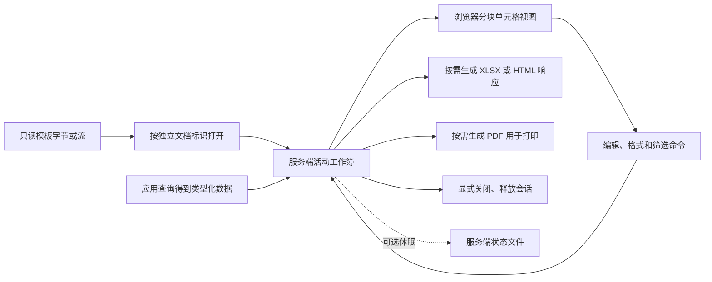

# DevExpress Spreadsheet 深入分析

日期：2026-10-30。目标为 `Z:\WellUnifiedReport\` 中的 ASP.NET Core Spreadsheet 21.1.12。用途是理解功能和资源模型，指导平台独立实现；没有修改产品代码、原项目或部署配置，没有执行目标程序集及业务查询。

**结论：用户要求应继续按 Spreadsheet 的单元格、区域、工作表和输出行为评估，不能默认降为普通列表。DevExpress 将共享模板、活动工作簿和导出文件分开；模板填充和临时编辑不必先生成磁盘 XLSX。其 Web 控件采用服务端工作簿与浏览器分块视图，仍有服务端内存、会话及可选休眠文件成本。** 借鉴功能与生命周期分层有价值，直接照搬原项目的缓存、目录和超时配置不适合当前需求。

## 1. 对象和证据边界

本轮核对业务源码、发布程序集 CIL 调用关系、嵌入 JavaScript 和官方公开接口。Z 盘开始短暂不可读，按用户要求重试后恢复；REA 解析出的实际路径为 `\\192.168.200.128\Unified\WellUnifiedReport\`。

| 发布产物 | SHA-256 | 身份与用途 |
| --- | --- | --- |
| DevExpress.AspNetCore.Spreadsheet.v21.1.dll | `77822e2994bffc376d1a57015a5b86bb2a8fc30d8bb53da23fb501c9e66070aa` | 21.1.12.0，MVID `b9f9629f-ca6e-40bb-9487-d65b225edb8f`；工作簿接入、会话、命令、客户端脚本 |
| DevExpress.AspNetCore.Core.v21.1.dll | `2e95d2a35824bea4edd508b83214fbe642f45df09707c09d82eec91749519f59` | 21.1.12.0，MVID `8072d7c6-d495-4005-a6db-a42b54f6a1d7`；文档管理、缓存持有、关闭及休眠文件 |
| WellUnifiedReport.dll | `9c18c0d7cb9b7d5fc757b18dbe2334983d8b169403285ba3b6b56542a60597b2` | 原项目控制器、启动配置接入和样例目录逻辑 |

REA 成功解析 Spreadsheet 程序集全部 318 个类型和 2999 个方法的静态成员信息。Core 的成员分析遇到 REA 64 MiB 元数据表示预算限制，改用本机 .NET SDK 的 PEReader/MetadataReader 检查指定类型与 CIL，不加载执行目标程序集。后者是独立静态证据，不伪装为 REA 已解析成功或真实运行结果。

## 2. 核心结构

这与“浏览器下载整个工作簿模型后独立计算”不同，也与“每次查询先在文件库创建 Excel 副本”不同。文件库持久化不是临时编辑的必要前提，活动可变状态仍不可省略。

### 浏览器只维护相关显示区域

21.1.12 内嵌 `TileHelper.js` 的 `onVisibleRangeChanged` 会计算可见范围、移除不可见块并更新加载范围；`getCellValueInfo` 从对应块查数据。块不存在时无法依靠该前端方法取得全表内容。`Spreadsheet.js` 中编辑同步通过请求处理器往返，并触发 BeginSynchronization/EndSynchronization。

因此“页面只显示几十行”和“服务器只持有几十行”不能画等号。分块显示有助于界面响应，但不直接证明服务器能容纳无限大工作簿。当前官方客户端接口说明也明确单元格读取受客户端缓存范围限制（[客户端 API](https://docs.devexpress.com/AspNetCore/js-DevExpress.AspNetCore.Spreadsheet.Spreadsheet)）。

### 工作簿才是编辑与输出的共同对象

21.1.12 `UpdateCellWebCommand.CustomExecuteImplementation` 调用单元格编辑提交控制器；`ApplyAutoFilterWebCommand` 将筛选条件应用到服务端模型。下载和打印随后读取同一工作簿，不是从当前可见 HTML 抓取数据。这解释了它为什么比普通列表更贴合临时 Excel 操作。

## 3. 用户需求逐项映射

| 需求 | 核实结果 | 平台需要补齐的业务规则 |
| --- | --- | --- |
| 空模板加载 | 原项目 `.Open(DocumentId, Xlsx, ContentAccessorByBytes)`；旧版程序集有字节和流入口 | 共享模板不可被用户编辑污染；模板身份和活动文档身份分开 |
| 查询结果填充 | 原项目 `WriteToFile` 实际取得当前 `spreadsheet.Document` 并修改 AB9；该动作本身没有写文件 | 真实查询、类型映射、整块导入、空值、旧数据区清除；原项目只做单格演示，没有完成通用查询填充 |
| 所有列头默认筛选 | 旧版存在 AutoFilter 的实际命令链；官方区域筛选需 Apply，Table 默认带过滤能力 | 模板初始化时定义数据区域及表头，刷新后调整到新范围；不是空白工作表天然每列都有筛选按钮 |
| 修改数据和格式 | 原截图、单元格更新及格式相关命令支持该交互方向 | 明确允许编辑范围、数据类型、区域操作、撤销重做以及最终输出一致性 |
| 排序筛选 | 围绕工作簿区域和表格处理，不局限于当前浏览器显示的块 | 表头不参与排序，筛选使用修改后值，隐藏行的下载和打印范围明确 |
| 重复查询 | 可以取得当前工作簿进行修改；原演示修改后整页重载 | 必须验证旧行、筛选、格式及撤销历史清除；不能假定同 ID 再 Open 会读取新字节 |
| 多人同时使用 | 不同文档 ID 可对应不同活动工作簿 | 租户/用户/页面绑定；同一用户两个标签也应独立；令牌和 ID 不能代替授权 |
| 下载 | 原项目 `SaveCopy` 到 MemoryStream 后返回 File 响应；内部下载命令也有内存流路径 | 输出前提交正在编辑的单元格并等待同步；不把内存缓冲误称为零资源成本 |
| 打印 | 旧版 PrintWebCommand.GetResult 将工作簿导成 PDF，再交客户端打开打印预览 | 纸张、方向、页边距、范围、重复表头与修改后内容需要真实验收 |
| 退出即结束 | 旧版具有显式关闭文档的链路 | 正常退出主动关闭；异常失联有期限和配额；不能只销毁浏览器控件 |

类型化批量填充可参考官方 Worksheet 导入能力，但这是接口参考，尚未在本地旧项目运行通用批量填充实验（[数据导入](https://docs.devexpress.com/OfficeFileAPI/13777/spreadsheet-document-api/examples/data-import-and-export/how-to-import-data-to-a-worksheet)）。默认过滤范围和表头语义参考[筛选说明](https://docs.devexpress.com/AspNet/115058/components/spreadsheet/data-presentation/filtering)，这篇说明不是对本地 Core 所有筛选交互的实测。

## 4. 重复查询最关键的陷阱

旧版 `ASPxSpreadsheet.Open(string, DocumentFormat, Func<byte[]>)`，token `0x06000064`，先调用 `ConnectToOpenedDocumentById`。若命中已有文档，分支直接返回；只有未命中才调用内容访问器读取新字节。流重载 `0x06000063` 同样如此。`ConnectToOpenedDocumentById`（`0x0600006c`）通过文档 ID 找到文档，再连接其 WorkSessionGuid。

**因此，同一个 ID 再 Open 新数据并不等于刷新。** 当前官方文档也明确指出缓存命中时忽略新内容（[打开文档](https://docs.devexpress.com/AspNetCore/404050/spreadsheet/document-management/open-a-document)）。

原项目的路径是 `WriteToFile → 当前工作簿改单格 → AJAX 成功 → window.location.reload()`；它依赖已有工作簿状态，并不是“保存文件后重开”。不能把此单格演示扩大为“生产查询无重载刷新已经完成”。

后续候选需要验证以下任一路径：

1. 复用本页面工作簿，在受控更新期间清空旧填充区域，批量写入新结果，重设表格/筛选和编辑历史，再同步显示。
2. 用模板建立新一代活动模型，切换成功后释放旧模型；切换失败保留可理解状态，同时限制短暂双份内存和旧请求回写。

这两条都是独立实现建议，并非已经运行通过的 DevExpress 接入代码。6→2→0 行、乱序查询、下载中刷新、编辑中刷新和撤销恢复旧数据都要单独验证。

## 5. 文档标识和多人隔离

DocumentId 用于文档查找和复用，WorkSessionGuid 用于请求定位活动会话。21.1.12 默认的 MultiCustomerCollaborationStrategy 按 DocumentId 查找会话；共享同一个文档标识可能进入同一个编辑对象。不能将模板 ID 或报表 ID直接当作所有用户共用的可写文档 ID。

建议语义是“一个共享只读模板＋每个打开页面一个独立活动工作簿”。这只要求独立可变状态，不必物理复制模板文件。若运行在服务器，页面身份还应绑定租户和当前用户并在每次操作检查；不能只相信客户端回传的 WorkSessionId。

原项目 `DirectoryManagmentUtils` 将样例目录放在 ASP.NET Session 内，使用请求路径判断是否更换目录。相同浏览器 Session、相同路径和相同文档名有复用相同 ID 的可能。**这不是已验证的同用户多标签隔离方案**，更不能当作平台租户授权边界。

## 6. 内存、磁盘与关闭

### 活动文档有进程内持有链

Core 21.1.12 静态分析确认：ServiceManager 的静态策略对象持有 sessionRepository，仓库持有 localSessionDictionary，字典持有活动会话。丢弃页面 DOM 不会自然消除这一服务器引用链。默认多客户策略的 CloseCustomerWorkSessions 为直接返回，也不能指望一个客户离开自动关闭共享文档。

当前官方文档将打开的文档描述为服务器内存文档，并要求应用显式控制关闭（[文档管理](https://docs.devexpress.com/AspNetCore/404049/spreadsheet/document-management)、[关闭文档](https://docs.devexpress.com/AspNetCore/404056/spreadsheet/document-management/close-a-document)）。这与旧版静态链路一致，但本轮没有测量其单文档内存量或并发人数。

### 显式关闭与休眠是两条不同路径

对已找到的活动文档：

`DocumentManager.CloseDocument → IDocumentInfo.Close → WorkSessionAdminTools.CloseWorkSession → WorkSessions.CloseWorkSession → CloseCore → Repository.Remove`。

Spreadsheet 的 `CloseCore` 进一步释放文档代理。仓库删除会移除本地字典项，并在相应休眠条件成立时调用存储删除。需要注意，这条链路不是“关闭浏览器即一定执行”。

另一个静态边界：旧版默认本地模式下，FindDocument 先查活动会话；已休眠并卸载出内存的文档可能无法仅凭 DocumentId 找回，CloseDocument 找不到时直接返回。因此不能承诺“对已经休眠的文档调用 CloseDocument 就一定删掉磁盘文件”，必须验证休眠后关闭路径，并保留存储级回收。此项是分支分析推论，尚未运行复现。

### 原项目主动启用了磁盘休眠

`Startup.cs` 明确配置：

- StoragePath 为应用目录下 `Data\HibernationStorage\`。
- Timeout 为 20 分钟。
- DocumentsDisposeTimeout 为 1 天。
- AllDocumentsOnApplicationEnd 为 true。

程序集链路为工作簿导出状态字节、生成休眠状态，再由 LocalFSOfficeWorkSessionStorage/WorkSessionStateFileSerializer 创建文件。文件按会话 GUID 命名，不一定有 `.xlsx` 后缀。只清理 XLSX 无法覆盖这一类状态文件。

唤醒路径读取和反序列化状态，不能由“文档回到内存”推断磁盘文件已经删除。存储清扫检查最后写入时间，且维护有调用节流；这些配置不能解释为“到第 20 分钟或第 1 天的瞬间必定删除”。官方将休眠作为内存文档转入存储的机制，相关当前版本默认值不替代本项目配置（[休眠说明](https://docs.devexpress.com/AspNetCore/404119/spreadsheet/document-management/hibernate-a-document)）。

### 原项目还有另一套样例文件复制

`DirectoryManagmentUtils.CreateNewDemoFolder → CopyDemoFiles` 会创建 `Data/<GUID>` 目录，并复制样例目录中的文档。`PurgeOldUserDirectories` 使用 5 分钟的 LastUsageTime 阈值，但检索到的业务调用发生在新建样例目录的分支，不能当成每页退出回收或持续后台清扫。

这套目录复制属于原应用样例管理，不能归因为 Spreadsheet 的字节加载必须复制文件。20 分钟休眠、1 天保留和样例目录 5 分钟阈值也是三种不同规则。

## 7. 下载与打印的具体链路

原应用 DownloadXlsx 取得当前 Spreadsheet，再 SaveCopy 到 MemoryStream 并返回文件响应；DownloadHtml 使用 ExportToHtml，选择当前工作表、UTF-8 和嵌入图片。SaveToBytes/SaveToStream 最后调用的 DocumentDatabaseMock.SaveDocument 在前轮已经确认为空，不代表普通编辑必须补成持久化保存。

21.1.12 内部 DownLoadCopyWebCommand.GetResult（`0x06000847`）也是 MemoryStream、SaveDocument、响应文件的调用链。PrintWebCommand.GetResult（`0x0600084d`）创建 PdfExportOptions，调用 ExportToPdf，再形成响应文件；客户端 Print 命令通过支持框架或新窗口加载它。**打印基于工作簿排版后的 PDF，不是截取可见单元格或整个业务页面。**

原项目自定义 AJAX 保存/下载仅传工作会话信息；本轮未证实其对尚未提交的单元格及尚未完成的同步做了完整等待。独立实现必须让“正在编辑的最后一个值”也进入输出。保留当前编辑结果的下载与重新取数据库原始值的导出，是不同用户动作。

## 8. 对平台方案的修正

保留三个对象，避免“临时副本”一词混淆：

| 对象 | 保存方式 | 生命周期 |
| --- | --- | --- |
| 报表/表格模板定义 | 持久化，发布修订共享只读 | 按配置管理，不随查询产生新版本 |
| 活动工作簿 | 浏览器模型，或受容量限制的服务端内存模型 | 每页独立；重复查询替换内容；退出销毁；不自动进入业务文件库 |
| 下载或打印产物 | 按需生成流；引擎必须落盘时使用有硬上限的临时区 | 按输出任务结束/过期回收；用户本机下载不受服务端退出清理影响 |

两类 Spreadsheet 引擎都值得验证：浏览器引擎减少服务端常驻编辑状态，但承担客户端内存、计算及文件兼容成本；服务端引擎配合分块显示更接近此次目标，但承担会话、模型、同步协议及输出成本。两者都不能单靠虚拟滚动或定时删除承诺规模化容量。

不建议从零重写 Excel 计算与文件兼容引擎。先选择满足交互和许可条件的成熟基础，再独立实现平台查询填充、隔离、刷新、资源控制和输出契约；当前没有选定具体新增依赖，也没有将 DevExpress 代码或程序集纳入平台实现。

本轮只确认“活动工作簿可以不等于持久文件”，没有证明“DevExpress 比现有 Office 少用多少资源”。普通 AppDataTable 仍可用于普通数据列表，但在没有等价交互验证前不作为本功能替代品。固定版式报表的预览、十类导出和高级控件沿用整体说明，不能把 XtraReport 的能力表当作 Spreadsheet 的能力表。

## 9. 剩余验证与证据索引

| 问题 | 状态 |
| --- | --- |
| 字节/流加载是否强制先落盘 | 已确认存在无需预先写模板文件的入口；不等于全部内部操作零磁盘 |
| 同 ID 新内容是否必定刷新 | 已由旧版分支证据否定 |
| 浏览器是否持有完整工作簿 | 已确认分块缓存模型；完整工作簿操作由服务端参与 |
| 编辑、筛选、下载和打印链路 | 已确认静态链路；未完成旧项目运行验收 |
| 模板填充生产查询、6→2→0、编辑历史清除 | 未实测；原项目只有单格修改演示 |
| 两人及同用户两页严格隔离 | 需要独立页面身份及真实运行验证；旧 Session 目录机制不能代替 |
| 崩溃、断网、休眠后关闭及删除失败 | 静态发现相关边界，仍需故障实验 |
| 大量报表和并发容量 | 未测；需要活动文档数、单文档大小、查询率、输出并发与内存/磁盘硬上限 |

主要 REA Evidence：

- `ev_e19ccd21cd4aca222cbce8a20ff7e98940220bbcf61966bf5e6c960e22b3c49c`：Spreadsheet 全部成员与调用关系。
- `ev_723394d53028e50f52fda302fb8433f2d0f94c2bf3302791e0eceaee75551391`：文档打开、请求定位及序列化相关类型。
- `ev_0612b643b1b04ca7c9a03a91d5deeb890c8bda79244684bac219ef1be5733eae`：工作会话、编辑、筛选、输出命令。
- `ev_e6cb22304d3b5959474e5421f9df4ccf2cab9cc107b12ae622e79e56cef75c6b`：ASPxSpreadsheet 公共打开入口。
- `ev_18f1a91a13293f78f7dabe8f26db2661d5ebfe18df3bc874a13774d9254bb7be`：原应用控制器、启动接入和目录管理。
- `ev_44e5eec7865e7c01e3afbc9266171538b6bdc81612d5329f22986d5d584885df`：Core 成员解析预算限制，不作为已解析成员证据。

完整 REA 包保存在工作区 `.plugin-research/wellunifiedreport/rea-evidence-spreadsheet-deep.json`。仓库忽略目录 [.run/devexpress-spreadsheet-deep](../../.run/devexpress-spreadsheet-deep) 保留四份经资源 SHA-256 核验的脚本及资源定位清单；[.run/devexpress-spreadsheet-lifecycle](../../.run/devexpress-spreadsheet-lifecycle) 保留独立只读分析器和 Core/Open 分支 IL JSON。这些仅是分析证据，不加入产品构建或提交供应商源码。

独立检查器的 [关键方法证据](../../.run/devexpress-spreadsheet-lifecycle/key-methods-evidence.json) 汇总 25 个方法；分析器 Program.cs 的 SHA-256 为 `13c127b1cdf1c6f9b7d93044c9b6359487a3757dc7bba7c13219a13d5c82c664`。这部分记录明确 `executedTarget=false`，不能替代运行验证。

嵌入脚本关键定位：Spreadsheet.js 的请求同步 1329 起、下载/打印 1379 起、公开打印 2817、销毁 2893；TileHelper.js 的可见范围变化 144 起、单元格值缓存 1066 起。所有方法 token 仅对上表指定 SHA-256/MVID 的程序集有效。

后续主控入口：[报表与临时查询表格整体说明](../implementation/details/PF09-报表与临时查询表格整体说明.md)。
