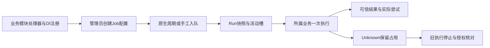

# PF07 后续业务 Job 接入

更新：2026-10-19。已核对当前实现；完整合同见[PF07规格V1.3](PF07-数据接口与页面规格.md)，现有真实样例为`SystemDataReconciliationTask`。接口可供后续业务接入，PF07整包验收及生产未测边界仍按[实施证据](../../evidence/PF-07.md)登记。

业务模块负责一次业务执行，PF07负责计划、排队、运行快照与管理操作。新增业务Job通常只需一个处理器类、一行DI注册，再从任务管理建立配置；不需要新建调度表或修改引擎队列。

## 1. 实现处理器

引用`IndustrialPlatform.SystemData.Contracts.Scheduler`中的`IScheduledTaskHandler`，实现目录声明、明确的参数校验和一次执行。处理器应无请求级可变状态，注册为singleton；调用所属业务模块已有的线程安全端口。

下面的`IInventoryReconciliation`代表业务模块自己的公开一次执行端口，示例不替该模块实现库存规则。

```csharp
using System.Text.Json;
using IndustrialPlatform.SystemData.Application.Scheduler;
using IndustrialPlatform.SystemData.Contracts.Scheduler;

public sealed class InventoryReconciliationJob(IInventoryReconciliation business)
    : IScheduledTaskHandler
{
    public SchedulerHandlerDto Definition { get; } = new(
        "inventory.reconcile", "库存对账", "核对库存业务数据。",
        "NoAutomaticRecovery", true, 300, false);

    public JsonElement ValidateParameters(JsonElement parameters)
    {
        if (parameters.ValueKind != JsonValueKind.Object
            || parameters.EnumerateObject().Count() != 1
            || !parameters.TryGetProperty("schemaVersion", out var schema)
            || !schema.TryGetInt32(out var version) || version != 1)
            throw SchedulerAdministration.Error(
                "SCHEDULER_PARAMETERS_INVALID", "参数仅允许schemaVersion=1。", 422);

        return parameters.Clone();
    }

    public async Task<ScheduledTaskResult> ExecuteAsync(
        TaskExecutionContext context, CancellationToken cancellationToken)
    {
        await business.ExecuteOnceAsync(context.TenantNId,
            context.OperationKey, cancellationToken);
        return new("Succeeded", "INVENTORY_RECONCILED", "库存对账完成。");
    }
}
```

`HandlerKey`必须稳定且唯一。参数只保存业务所需的明确字段，不放密码、连接串、任意SQL、脚本或动态URL。有业务参数时用明确DTO并拒绝额外字段，目录声明`ParametersEditable=true`后按业务补普通表单；现有通用配置页提供JSON输入，后端处理器校验始终是权威。

## 2. 注册并配置

在模块服务注册处加入：

```csharp
services.AddSingleton<IScheduledTaskHandler, InventoryReconciliationJob>();
```

部署后目录能发现该Handler。管理员进入“平台服务→任务调度→任务管理”，新建一个不同的Job NId，选处理器、填写参数与一个五字段Cron、时区、超时和尝试总上限，再启用。同一处理器允许多个Job配置，参数各自冻结到Run。HandlerKey和Job NId创建后不修改；修改计划/参数前先停用，接受过的Run继续按快照执行。

Scheduler部署节为`SystemData:Scheduler`，默认Enabled=false。启用需显式设置Enabled=true；初始化沿现有systemdata服务迁移，运行不会补建缺失原生存储。内建对账另有`ReconciliationMode=Legacy|Scheduler`，切换时先排空旧宿主再启动新模式，两个入口不能同时执行。

## 3. 返回结果和处理重试

| 项目 | 处理方式 |
| --- | --- |
| 成功 | 返回Succeeded及简短受控结果码/说明 |
| 明确业务失败且未产生未知影响 | 返回Failed；确需安全自动重试时设置Retryable=true |
| 无法确认副作用 | 返回Unknown；或让未处理异常进入Unknown，不自动重跑 |
| 合作取消 | 向业务端口传入CancellationToken并实际停止；不能把取消请求当作已经停止 |
| 业务防重 | 使用context.OperationKey在所属业务事务内防重；自动尝试和人工重试沿用同一键 |
| 租户和追踪 | 使用context.TenantNId/TraceId；不能从参数或页面取租户 |
| 超时 | 配合CancellationToken/DeadlineOn；不支持强杀线程 |

新处理器默认`NoAutomaticRecovery`、MaxAttempts=1。只有所属业务证明同一OperationKey可安全重复调用后，才声明`Idempotent`并允许1～5次总尝试；该值由代码决定，管理员不能自行选择“幂等”。所有尝试均计首次真实调用；队列争用等待不计次数。

结果摘要上限4KiB，Message≤1000字符，ResultCode≤64；SchemaVersion固定1，AffectedCount为十进制string。实际异常只给受控类型/结果码，不在管理页面返回堆栈。Handler自身日志和业务事务仍属于业务模块。

## 4. 自测与查看

至少验证参数拒绝、租户边界、成功与明确失败、重复OperationKey、合作取消，以及“调用后结果未知”保持占用。状态和实际尝试看运行记录；操作者配置/启停/触发/取消/重试/核对动作看既有“审计查询”（Producer=systemdata，Action以scheduler开头）。登录审计继续在Identity原有入口。


