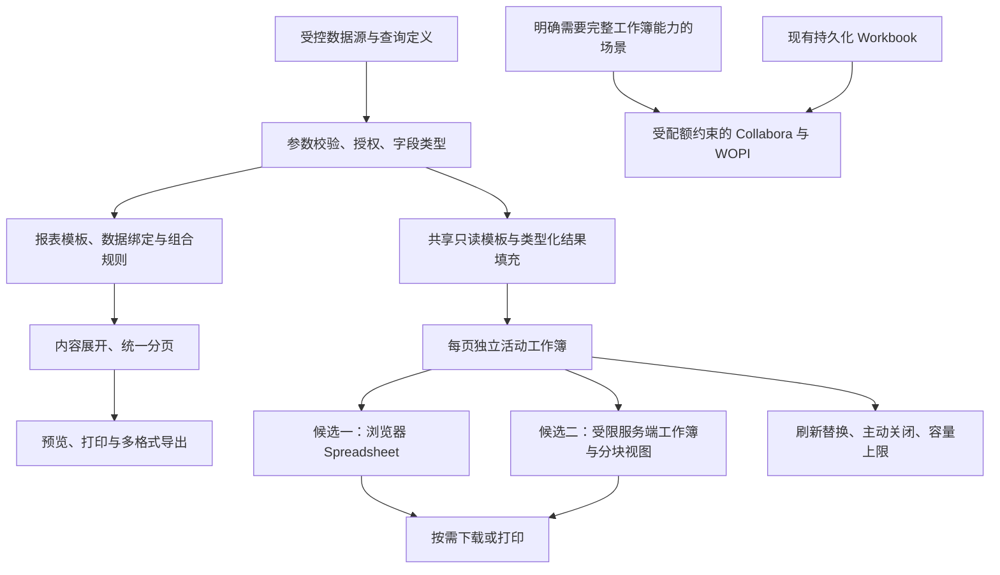

# PF09 报表与临时查询表格整体说明

日期：2026-10-30。面向后续开发主控，汇总 DevExpress 分析、临时 WOPI 实验、开源 Spreadsheet 两轮验证、候选横向评估及用户补充要求。本文确定功能范围、复用边界和验证状态；不表示新增功能已经进入产品代码。

**最新边界：以 DevExpress Spreadsheet 的单元格和工作表交互为功能基准，不能默认用普通查询列表替代。** 用户已明确要求多个报表入口、多人使用、重复填充及异常情况下资源可控。深入分析确认 DevExpress 21.1.12 采用浏览器分块视图和服务端活动工作簿，能够分离“编辑状态”和“持久化文件”；因此既不默认每页创建 WOPI 文件，也不预先认定 AppDataTable 已能满足需求。浏览器 Spreadsheet 与受限服务端工作簿均保留为候选，按功能、模板兼容和容量实测选型。详见 [Spreadsheet 深入分析](../../evidence/2026-10-30-DevExpress-Spreadsheet深入分析.md)。本轮没有进入产品实现。

当前取舍：固定版式报表继续沿平台内容流与分页链推进；临时查询表格优先比较 Univer 与 FortuneSheet；既有 Collabora/WOPI 保留文档编辑用途，并作为复杂模板和打印的对照。尚未决定替换内核，也未决定为所有查询增加 Office 会话。评估通过、契约补齐后才进入产品开发，不能把六行 CMP 样例的限制固化为通用产品限制。

## 1. 三类能力和各自用途

| 能力 | 用户目标 | 内容形态 | 保存与退出规则 |
| --- | --- | --- | --- |
| 固定版式报表 | 设计、查询、预览、打印、导出生产报表/电子记录 | 带、控件、表格、子报告、纸张、分页 | 模板及发布修订持久化；正式产物按既定规则保存，退出预览不删除正式记录 |
| 临时查询表格 | 查询结果直接进入线上表格，临时编辑、排序筛选、下载或打印 | 空白/预设表格模板 + 类型化查询数据 + 临时编辑状态 | 不因查询创建业务工作簿、副本或版本历史；正常退出查询页立即触发清理 |
| 持久化工作簿 | 用户管理已有 Excel 文件，编辑、保存、版本管理 | 有明确归属的工作簿及其版本/工作副本 | 延续现有 Workbook 生命周期；关闭编辑器不等于删除文档 |

车间流水、批记录及截图中的工单表均是业务样例，不限制通用组件的用途。三个入口可出现在同一业务模块，但必须让用户清楚当前操作对象和结果是否会保留。

**报表设计模板与 Excel 模板是不同模型。** 前者表达纸张及内容流，后者表达单元格、列类型、公式和数据区域。它们可以引用同一受控查询，不强制转换成同一种编辑器配置。

## 2. 共用基础与技术承接

- 继续使用现有 .NET / Studio：受控数据查询、字段定义、参数、权限、模板修订、任务与文件能力按原归属复用。
- 报表沿用 DataResolver、AssemblyPlanner、BandExpander、ContentFlow 和现有分页/渲染链。设计试运行和正式生成使用同一套展开与排版规则。
- 临时查询表格复用统一查询、权限和模板管理基础；编辑器按 Spreadsheet 行为选择。不按报表入口部署独立服务，不为每次查询建立持久化 Workbook 或历史版本。
- 当前前端已有 vxe-table 4.15.13 和 AppDataTable，可复用查询、主题和通用页面能力；它们不能按现状视作 Spreadsheet 的等价替代。单元格/区域编辑、格式、工作表与输出保真要专项验证，不能为了复用列表组件而削减用户要求。
- 活动工作簿可位于浏览器或受配额管理的服务器内存，二者都需要容量控制。服务端分块视图降低浏览器显示成本，不等于工作簿总成本消失。完整文档编辑另保留既有 Collabora/WOPI；已验证的查询路径会受控重载 Office iframe，不把它作为默认实现。
- 报表纸张设计、Spreadsheet 单元格编辑和 X6 流程画布分别保留自己的模型；可以共用权限、文件、字段引用及审计，不把某个编辑器强行扩展为另两个引擎。
- DevExpress 提供功能和交互参考；不将其内部实现、程序集或发布脚本复制到平台。新增第三方依赖时单独核实许可证与部署条件，本轮不作开源协议兼容性承诺。

### 2.1 平台独立实现方向

用户已明确：不再使用 DevExpress，结合现有平台独立实现。DevExpress 仅作为可见行为与功能需求的参考，不把其程序集、脚本、内部类型、通信协议或实现代码带入平台。实现依据是本平台的功能契约和验收样例；当前已进行隔离的开源内核 PoC，仍未进入产品编码。

建议采用“平台自研查询表格功能＋可替换的开源 Spreadsheet 内核”。模板配置、数据绑定、查询刷新、页面隔离、权限、生命周期及输出规则由平台掌握；单元格选择、输入、区域操作和需要的计算能力优先评估成熟开源实现。自行实现全部交互、公式计算和 XLSX 兼容也可行，但范围会显著超过本次查询表格需求，不作为当前推荐。

| 部分 | 与现有平台结合 | 需要补齐或验证 |
| --- | --- | --- |
| Studio 配置 | 复用现有编辑器外壳、模板修订、参数及字段绑定机制 | 表格模板中的工作表、单元格/区域、类型、样式、填充规则和默认筛选；报表带模型不能直接当工作簿模型 |
| 数据查询 | 复用 QueryDescriptor、字段类型和后端受控数据源/授权 | 查询结果到填充区域的映射、行标识、类型保真和大小上限；前端契约本身不替代后端授权 |
| 运行页面 | 在现有 Vue 应用内提供可复用 Spreadsheet 组件，多报表入口共用 | 编辑、区域选择/粘贴、格式、排序筛选、撤销重做、重复查询及退出销毁 |
| XLSX 下载 | 复用 .NET 输出接入与响应传输基础 | 现有 StreamingXlsxWriter 只写单工作表 inlineStr 文本，没有类型化数值、样式、合并和 AutoFilter；需扩展或另选文件生成基础，不能宣称已覆盖 Spreadsheet 输出 |
| 打印/PDF | 评估复用现有报表渲染、纸张与分页基础 | 将当前编辑快照映射成打印内容，保留列宽、格式、筛选范围和重复表头；临时输出不直接套用正式报表归档链 |
| Workbook/WOPI | 保留既有持久化文档用途 | 查询编辑器不强制经过文件导入、版本保存或 Office 会话；本次不迁移或替换已有文档编辑功能 |

资源目标下优先验证浏览器内 Spreadsheet：页面加载已发布模板定义，授权查询后填充当前页面工作簿，重复查询替换当前代次，关闭释放实例及数据。只有下载/打印时才按需调用输出；不为普通查询在服务器维持一个可写文件或完整编辑会话。此为技术建议，是否采用取决于实际模板、编辑体验和容量验证；若必须采用服务端引擎，则保留文档数、内存、历史与任务硬上限。

平台保存的业务配置应使用自己的参数、字段引用、填充区域、权限及输出契约。具体内核的工作簿快照可以通过版本化适配保存，不要求先设计一个覆盖全部 Excel 功能的通用中间模型；也不能让某个内核的私有会话 ID 成为平台模板身份。若需求包含真实 XLSX 模板导入，需要专项验证转换保真，不能用 JSON 列定义冒充任意 Excel 模板支持。

第三方依赖按具体包、版本和所需功能核对，不由项目首页“开源”推断所有能力可用。例如目前 Univer 官方的 XLSX 交换入口使用 `@univerjs-pro` 插件并要求转换后端（[官方导入导出说明](https://docs.univer.ai/guides/sheets/features/import-export)）；因此暂不把它确定为完整解决方案，也不默认引入商业转换服务。筛选、格式、实际 XLSX 下载和打印应一起验证后再定内核。

独立验证样例统一使用八列表格：空模板→填充→默认筛选→修改内容及格式→下载/打印→6→2→0 刷新→两人/同用户两页→退出与异常。每项保持用户原始要求，验证结果不足时报告缺口，不降为普通列表后宣称完成。

### 2.2 开源内核独立验证结果

2026-10-30 的独立样例使用 Univer 1.3.1 开源编辑、筛选和排序模块，搭配受限的 ExcelJS 下载适配和浏览器打印适配。未安装 DevExpress 或 `@univerjs-pro` 包，未使用 Workbook/WOPI 或商业转换服务；基础测试使用合成数据，真实平台仅验证到正常登录及选定报表修订读取。已通过空模板填充、八列表头筛选、真实键盘修改数值、样式与筛选 API、数值整行排序、6→2→0 刷新、双页及独立浏览器上下文隔离、XLSX 文件解析和打印 PDF 检查。详见 [开源 Spreadsheet 独立验证](../../evidence/2026-10-30-开源Spreadsheet独立验证.md)。

**方向可行，尚未完成正式选型。** 样例没有为查询生成服务器工作簿文件；每页只有当前编辑状态，刷新释放完整编辑器作用域再加载新结果，关闭销毁编辑器。这里的新模型是浏览器内存对象，不是用户担忧的文件副本。第二轮已验证现有 CMP 台账 XLSX 的六行受限导入、填充、公式重算、筛选及输出；不能据此宣称支持任意 XLSX 或动态行扩展。

第二轮已补齐值、空白、比较、AND/OR 和通配符筛选条件的 XLSX 导出，颜色筛选明确拒绝。堆快照定位到旧 Scene/Canvas 被长期服务缓存保留，完整释放作用域后相关对象不再随刷新累积；1000 次正常刷新测试 DOM/监听器稳定，但总堆仍有编译缓存等增长，不能宣称无限次运行内存恒定。主 JS 的体积、按需加载和真实多页容量仍需处理。

平台验证已通过用户正常登录、读取可选已发布报表和单个修订；两份当前可选报表分别因字段不匹配、固定版式类型不适用而被拒绝，尚未完成真实查询结果填入 CMP 的成功链路。模拟接口已验证字段映射、超量拒绝和取消，不代替真实权限、多账号与并发验证。固定版式报表及其十类导出、高级控件的范围保持第 3 节规定，不因本次表格 PoC 通过而视为完成。

### 2.3 内核横向评估与许可边界

以下为候选评估，不是运行排名。只有 Univer 有本轮指定样例的实测；不能给其他候选填写未经测量的内存数字，也不能从 Canvas、虚拟滚动或压缩包大小推断工作簿内存稳定。

| 候选 | 模板与输出路径 | 资源及平台适配 | 当前取舍 |
| --- | --- | --- | --- |
| Univer 开源核心 | 核心 Apache-2.0；官方 XLSX 交换和打印入口涉及 Pro。本轮自行适配 ExcelJS/JSZip，已验证指定 CMP 文件，未覆盖任意模板 | 浏览器持有模型，能嵌入 Vue；已定位旧画布保留问题并通过完整作用域释放规避，仍有总堆增长和包体积问题 | 保留主候选，评估重点转为模板往返、输出与长期资源成本 |
| FortuneSheet＋FortuneExcel | 编辑器与文件插件均 MIT；已有 XLSX/CSV 转换，FortuneExcel 同样依赖 ExcelJS/JSZip，不能预设比当前转换更保真；完整分页打印尚未核实 | 浏览器模型；官方主要示例为 React，现有 Vue 需封装宿主；多实例、撤销历史和释放待测 | 直接竞争候选，用同一套模板和资源测试比较 |
| Jspreadsheet CE | MIT；偏结构化输入表格，官方 CE 文档有基础公式和实验性文件接入，完整 Pro 能力不可算入 CE | 有 Vue 集成；复杂模板、跨表计算及大数据行为须锁定 CE 版本确认 | 简单录入场景备选，不优先承担通用模板 |
| Collabora Online / Calc | Online 主代码 MPL-2.0；已有 XLSX、PDF 与打印链路，实际模板保真待测；完整发行物还包含其他许可组件 | 服务端文档、缓存和渲染成本；可利用既有 WOPI，但必须验证独立临时文档生命周期 | 复杂文件与打印对照，保留既有持久化工作簿用途 |
| ONLYOFFICE Docs Community | AGPL-3.0，另有品牌和发行版本限制；已有办公文件与打印链路 | 需服务端转换、缓存及会话，不是免运维的浏览器组件 | 暂不优先新增第二套 Office 服务；需要时单独评估部署与许可 |

来源：[Univer 交换](https://docs.univer.ai/guides/sheets/features/import-export)与[打印](https://docs.univer.ai/guides/sheets/features/print)、[FortuneSheet](https://github.com/ruilisi/fortune-sheet)、[FortuneExcel 依赖](https://github.com/Corbe30/FortuneExcel/blob/main/package.json)与[许可](https://github.com/Corbe30/FortuneExcel/blob/main/LICENSE)、[Jspreadsheet CE 公式](https://bossanova.uk/jspreadsheet/docs/formulas)、[Collabora 文件转换](https://www.collaboraonline.com/document-conversion/)与[许可](https://github.com/CollaboraOnline/online/blob/master/COPYING)、[ONLYOFFICE 许可说明](https://helpcenter.onlyoffice.com/docs/faq/docs-community.aspx)。

Luckysheet 官方仓库已归档，不作为新建长期基础；x-spreadsheet 已声明迁移到 wolf-table，补齐完整工作簿与输出的范围较大；ReoGrid Web Lite 的行列上限及筛选、导出、打印的 Pro 边界不满足当前开源候选要求。不要把 ReoGrid .NET 桌面版能力等同于 Web Lite。[Luckysheet](https://github.com/dream-num/Luckysheet)、[x-spreadsheet](https://github.com/myliang/x-spreadsheet)、[ReoGrid Web 版本表](https://web.reogrid.net/docs/features/)。

平台发布协议仍有选择空间：MIT/Apache-2.0 通常不要求平台采用同一协议，但要保留适用声明并检查完整依赖；MPL 的公开义务主要落在受其覆盖的文件及修改；AGPL 的修改、衍生作品和网络交付义务需结合实际集成方式判断。不能仅凭“独立服务”排除义务，也不能泛称使用任一组件就必须公开整个平台。锁定版本时同时记录核心、插件、字体、图标和输出库的许可及 NOTICE，商业功能单列，不将其算作免费开源能力。[Apache 条款](https://www.apache.org/licenses/LICENSE-2.0)、[MPL FAQ](https://www.mozilla.org/en-US/MPL/2.0/FAQ/)。

### 2.4 可复用功能的归属与接入契约

复用以能力边界为单位，不把第一个 CMP 示例做成所有报表共用的业务实现，也不提前造一个覆盖全部 Excel 的新文件引擎。

| 能力归属 | 共用内容 | 独立保留内容 |
| --- | --- | --- |
| Studio 资源与运行外壳 | 资源身份、修订、参数、权限、菜单、错误和任务状态 | 报表带定义、Spreadsheet 模板、Workbook 文件分别保存 |
| 受控数据查询 | 数据集/查询修订、字段 Schema、数据范围、参数与限额 | 各模板的字段映射、集合路径、分组与填充区域 |
| 临时表格宿主 | 加载、填充、提交单元格编辑、刷新、捕获当前快照、销毁及能力检测 | 内核私有快照通过版本化适配封装，不成为业务资源身份 |
| 输出服务与适配 | 权限、范围、取消、错误、文件响应和必要资源配额 | 固定报表分页、表格文件交换、Office 文档打印各自实现 |

生产接入前至少明确：模板修订与格式、查询来源及修订、集合路径、字段类型到单元格/命名区域的映射、数据区增长规则、公式/固定区、可编辑范围、默认筛选、输出范围和容量限额。CMP 八字段和六行上限只属于当前夹具，不能写死到通用宿主。

已有固定版式报表不必先转换成 Query 报表才允许复用其授权数据源；可以在现有受控数据契约上为两种展示分别建立配置。当前样例只接受匹配字段的已发布 Query 报表，是验证适配的限制。生产方案不解析报表的渲染 HTML 作为查询数据，不绕过原数据授权，不为联调修改已有固定报表语义。

共享“可替换内核”只要求宿主与具体 SDK 有清楚边界，不要求第一期同时维护两个编辑器。内核或模板转换器升级后，对代表模板回归并固定适配版本；遇到不支持能力应在发布校验及运行诊断中指明，不能静默丢弃。

## 3. 固定版式报表

### 3.1 设计与数据绑定

设计器应覆盖纸张方向/边距、带结构、控件放置与属性、表格单元格、字段/表达式、参数、样式、预览和模板保存/发布。沿用既有草稿与固定发布修订规则，不用显示名称或可变业务编码代替模板身份。

实际模板以表格、主从明细、分组标题、页眉页脚、表达式和页码为主，应先保证这些基础能力可用。文本或表格变高后，带和后续内容正确跟随，不能覆盖下一块内容。

报表的查询、字段绑定和表达式均通过受控契约执行；浏览器不直接连接数据库，不允许外部数据执行任意脚本。

### 3.2 组合、子报告和电子记录

- 简单组合：按现有规格保留子报告纸张/方向等属性，明确独立分页与全局页码策略。
- 电子记录动态组合：按真实工单、工序和业务记录决定包含哪些子报告，支持顺序、条件、参数映射、重复实例及空数据策略。
- 所有电子记录实例先展开成连续内容流，再按母版分页；不默认将每个工序先导成整页 PDF 再拼接。
- 条件不满足、成功但无数据、必需数据缺失、模板缺失和取数失败分别诊断。空子报告不留下标题、占位框或空白页。
- 单报表、WholeReport 子报告及 BandSubtree 入口继续遵守既有行上下文/祖先映射规则，不能每条明细重复整份主报告。

精确行为以 [报表分页与追溯运行规则](PF09-报表分页与追溯运行规则.md) 为准。

### 3.3 预览与打印

| 功能 | 完整要求 |
| --- | --- |
| 页面模式 | 单页查看、连续全部页查看；大量页面按需加载，不无界堆积渲染内容 |
| 跳页 | 首页、上一页、下一页、末页，输入/选择页码，显示当前页及总页数 |
| 缩放 | 加减、比例、适应页宽/整页；查看缩放不改变纸张和最终分页 |
| 搜索 | 当前页内容快速查找，命中数、前后定位与高亮；若另提供整份报告搜索，应明确范围，不能默默跨页 |
| 打印 | 打印全部、打印当前物理页；使用报告输出路径，不打印整个业务页面 |
| 状态 | 生成中、失败、取消、过期、权限变化有可理解反馈，不能显示旧内容冒充新结果 |

DevExpress 原控件搜索的是整份报告，本平台“当前页”要求需要明确实现。当前预览 iframe 有隔离限制，应通过受控文本/定位信息或受评审的通信协议支持搜索；不能随意取消隔离。

### 3.4 十类导出

全部保留为功能范围：**PDF、XLS、XLSX、RTF、DOCX、MHT、HTML、文本、CSV、图像**。截图中是 DOCX；图像还需明确 PNG/JPEG 等具体选项及多页打包方式。

| 输出目标 | 实现边界 |
| --- | --- |
| 固定版式 PDF / 图像 | 页范围、纸张、页序、字体、图片、目录/页码一致；图像定义分辨率 |
| 可编辑 RTF / DOCX | 明确连续文档或保留页布局策略，验收允许的重排差异 |
| 表格 XLS / XLSX | 区分报表版式映射与数据型导出，保证文件格式真实、字段类型正确 |
| HTML / MHT | 明确资源内嵌/打包规则，下载后不依赖过期预览 URL |
| 文本 / CSV | 明确列序、编码、分隔、转义和类型格式，不承诺图片及纸张版式 |

现有平台有 PDF/HTML/XLSX 相关链路；不能由菜单存在推断所有格式已经实现。需要“控件 × 格式”支持矩阵，明确保留可编辑结构、输出静态图形或不适用的处理。未完成格式不得只换文件扩展名返回成功。

### 3.5 高级控件

| 控件 | 功能与关键边界 |
| --- | --- |
| Character Comb | 每个字符占一个格子；校验中文、间距、溢出和跨格式结果 |
| 行 | 指线条 XRLine，不是表格行；支持方向、粗细和线型 |
| 形状 | 图形类型、填充、边框、角度；现有 Box 不代表完整形状库 |
| 条形码 | 码制、值校验、尺寸、静区、文字；须打印后真实扫码 |
| 图表 | 按 Chart 理解用户所说的“图标”；类别/数值/系列、坐标轴、图例及空值规则。若指静态图标则使用图片资源能力 |
| Gauge | 实际值、目标值、范围与刻度，处理空值和越界 |
| Sparkline | 单元格附近的小型趋势图，明确序列顺序、缺失值与统一尺度 |
| 数据透视表 | 行/列维度、度量、聚合、小计/总计和溢出；打印交叉表不自动等同 Excel 原生透视对象 |
| 子报表 | 固定模板修订、参数映射、条件、顺序、上下文与重复展开 |
| PDF Content | 引入固定 PDF 内容，定义页面尺寸、方向、页序与全局页码，不假定内部文本能像明细带重排 |
| PDF Signature | 可视签名区域与证书签名分开；签字图片不等于有效 PDF 签名 |
| 表的内容 | 原中文资源指 Table of Contents，即目录；基于标题/书签层级和最终页码生成 |
| 普通表格 | 单元格、合并、边框、类型、重复表头、长行续排；与目录、数据透视表分开建模 |

以上类型均在目标 21.1.12 程序集中找到，但这不代表平台已实现，也不代表旧项目实际业务模板都用过。PDF Content / Signature 等属于新增扩展范围，须补齐现有契约后实现，不将它们混入原电子记录内容流规则。

### 3.6 报表一致性与正式产物

设计预览、正式生成和临时表格输出分别遵守自己的合同，不能为了统一接口改变生命周期。已有设计预览直接返回 HTML、无需 Jobs/Files 归档且无固定有效期的规则保持；正式生成继续按发布修订、任务与文件确认链执行。必要中间文件释放和任务容量限制不等于为预览新增固定过期时间。详细行为以[分页与追溯运行规则](PF09-报表分页与追溯运行规则.md)及[接口与配置合同](PF08-PF09-接口与配置合同.md)为准。

| 注意点 | 生产行为及验收要求 |
| --- | --- |
| 数据时点 | 一次生成内的判空、明细、分组、汇总和目录共用已采集数据；多来源记录各自时间与一致性，不能把收到响应的时间冒充业务发生时间或事务快照 |
| 版本固定 | 固定根模板、子模板、查询依赖、参数和排序，记录渲染/字体等资源版本；运行中发布新模板不改变正在生成的内容 |
| 输出一致 | 同一报告运行派生多格式输出时复用该次数据与定义；若确实重新取数，应作为新运行/新数据时点呈现，不能冒充同一结果的另一种格式 |
| 正式记录 | 临时表格修改不自动成为正式生产数据或已归档记录；将来若允许另存、提交或签署，必须有独立明确的业务动作、校验、授权及来源说明 |
| 失败与重试 | 超时、取消、缺页、必需数据缺失不得标成功；重试和重复点击不得无意生成多份正式产物，沿现有任务与幂等合同执行 |
| 再现与追溯 | 正式产物保留必要的运行、模板、来源、资源及内容摘要；仅保存查询条件不能保证以后重新查询得到相同历史内容。按既有快照/归档策略保存，不为临时查询另建持久结果库 |

### 3.7 排版、导出和高级控件的组合边界

- 字体与测量：设计显示缩放不改变物理尺寸。中文字体、替代字体、数字格式、时区和换行规则必须在渲染环境明确；缺字或替代字体导致分页变化时要可诊断。嵌入或分发字体前核对许可，不能依赖开发机已安装字体保证服务器输出。
- 长内容与分页：覆盖长备注、合并单元格、跨页表格、重复表头、组尾汇总和混合方向。搜索定位使用最终页面的文本与坐标；当前页打印以最终物理页号为准，不使用虚拟列表索引。
- 目录与页码：目录条目、书签和页码引用必须在分页稳定后解析；目录自身改变页数时采用有次数上限的布局收敛流程，不生成旧页码或无限重复排版。
- 子报表与聚合：验证数据关联键、稳定排序、汇总作用域及空值；不能通过多对多连接重复累计数量，也不能将金额/体积在显示前的四舍五入误当业务计算规则。查询次数和展开深度沿已有预算限制。
- PDF 内容与签名：外部 PDF 的读取需独立资源授权及大小/页数限制；字体、加密、损坏和不支持结构应明确失败。目录、合并、页码及水印等会改变内容的步骤应在正式数字签名之前完成；后续修改若需要增量签署，另定签名验证合同。签字图片、可视签名框和证书签名分开验收。
- 控件与格式：为每个已支持控件列出目标格式的“原生可编辑结构 / 静态呈现 / 不支持”，与功能状态分开。图表或 Gauge 输出为图片要说明；CSV 无法承载图形；原生 Excel 透视表与打印交叉表不是同一交付物。格式不能表达要求时明确诊断，不静默丢控件。
- 文件规则：XLS 与 XLSX 的行列及格式能力不同，超限不可只改扩展名；HTML/MHT 资源必须有可用的打包策略，图像输出明确多页打包及分辨率。下载文件经独立解析或目标应用打开验证，PDF/图像另核对页数与视觉内容。

## 4. 临时查询表格

### 4.1 为什么重新评估

原路线证明了 Office 可以完成填充、编辑和刷新，但每个独立编辑文档仍需服务器承载内容、编辑会话、锁及缓存。把 XLSX 从磁盘改放内存只改变资源位置；增加定时删除任务也不能消除会话成本。普通查询不应以“所有关闭通知和清理任务一直成功”为稳定运行的前提。

容量需要分别计算：报表定义数量、同时打开的页面数、查询到达率、每份结果的行列数/字节数、同时导出/打印的任务数。未打开的报表入口只需要定义和配置，不能预建用户文档。多个菜单应指向同一个可复用运行页，由报表定义决定参数、授权查询、列类型、模板、编辑范围和输出规则。

| 路线 | 合适场景 | 主要成本与边界 | 当前建议 |
| --- | --- | --- | --- |
| 浏览器结果表格 | 以类型化表数据为主，编辑、排序、筛选和有限格式调整 | 浏览器数据内存、后端查询及按需输出；不是任意 Excel 文件编辑器 | 仅适用于已明确接受普通列表能力的场景 |
| 浏览器 Spreadsheet 引擎 | 单元格区域、公式、多工作表及更丰富格式 | 浏览器计算/内存、模板兼容性、导出保真和具体版本/插件许可 | 本功能主要候选，不直接预选库 |
| 服务端活动工作簿＋分块视图 | 接近 DevExpress Web Spreadsheet 的交互与输出模型 | 服务端模型、同步协议、会话生命周期和容量；不要求每次查询预先生成磁盘文件 | 本功能另一主要候选，需成熟引擎和容量验证 |
| Collabora / WOPI | 必须保留完整工作簿交互、文件兼容或已有文档编辑 | 服务端文档、编辑会话、缓存、锁、关闭和回收；需独立容量预算 | 保留既有工作簿用途，不默认用于所有查询 |

用户确认需要 Spreadsheet 级交互，应比较浏览器 Spreadsheet 与“服务端活动工作簿＋浏览器分块视图”。后者不必在每次查询时生成磁盘文件，但需编辑协议、工作簿计算和生命周期能力，不能认为现有 .NET 导出器自然具备这些能力。

“空模板填充”是用户行为，不必意味着每次生成 XLSX 文件。纯表格模板可以保存列头、类型、列宽、格式、标题及数据区配置，页面加载后填入查询结果。如果模板必须是可任意编辑的真实 XLSX，不能擅自改成列配置后宣称等价，需要按具体模板选择后两条路线。

### 4.2 浏览器承载候选的页面行为

`打开页面 → 加载共享模板定义 → 授权查询 → 将类型化结果填入本页面 → 临时编辑/排序/筛选/格式调整 → 按需下载或打印 → 关闭并销毁本页面状态`。

用户操作默认不回写来源业务数据、不修改模板、不归档结果。服务器返回受控查询数据后，不为普通页面持续保留一个可写工作簿；浏览器只保留当前结果和有限编辑历史，不在 localStorage、IndexedDB 或持久化状态插件中自动保存业务结果。

- 所有数据列头默认可筛选，按数值、日期、枚举和文本类型提供相应行为；表头不参与数据排序。导出 XLSX 时另行维护真实 Table / AutoFilter 范围。
- 保留数值、日期、文本编码及前导零；临时编辑应受列类型和允许编辑范围约束。格式调整至少覆盖约定的列宽、对齐、数字/日期显示、字体及颜色，并验证输出一致，不能只做到修改内容。
- 重复查询替换本页面当前结果，清除旧编辑、旧行、旧筛选及隐藏状态；0 行保留表头。展示格式按模板重置，只有明确约定的视图偏好可以保留。
- 有未导出的编辑时，重新查询或明确关闭页面允许用户下载、放弃或取消；浏览器崩溃不承诺恢复临时编辑。
- 查询使用页面内递增代次和取消机制，旧响应不能覆盖新结果；成功替换前应标明加载状态，失败不能把旧结果冒充新查询结果。
- 编辑值和样式绑定稳定行标识与字段，不能绑定排序后的视觉行号。没有业务主键的汇总结果也要有本次查询内稳定行标识。
- 开放编辑的有界结果集在浏览器内完成排序和筛选，操作基于当前编辑值；不在编辑后静默重新查原始数据库而丢失修改。

### 4.3 浏览器承载候选的隔离与退出

同一模板定义可供多人只读复用。A 页保存自己的结果数组和编辑状态，B 页保存自己的结果数组和编辑状态；同一用户两个页也各自独立。它们不共享可写数据对象，不需要为此复制两份服务器 XLSX，也不需要相互加编辑锁。

服务器仍逐次校验租户、身份、报表权限和查询范围。浏览器状态分开不能替代数据授权；共享缓存如以后确有需要，应单独设计授权键和容量边界，本轮不默认增加查询结果缓存。模板中也不能混入上一次用户填充的数据。

退出在这里表示撤销请求、销毁表格实例、释放数据引用、撤销 Blob URL，并清除该页面临时状态；不等同于操作系统立即擦除内存。应用内多标签及 KeepAlive 也要处理真正的关闭事件，不能无限缓存关闭页面。仅切到别的仍打开的标签页不自动丢弃编辑，打开页数和每页结果容量需要有限额。

浏览器崩溃不产生本路线的服务端临时工作簿遗留；已经发出的数据库查询、导出或打印任务仍要有独立超时、取消和资源上限，不能只依赖页面关闭通知。

### 4.4 数据量和下载打印必须一起设计

浏览器持有数据也有上限。虚拟滚动只减少渲染量，不消除数据内存；必须测量结果字节、列数、单元格长度、格式与编辑历史的成本，包含刷新时新旧结果短暂并存的峰值。

- **有界可编辑结果**：在明确行数/字节限额内完整加载本次结果，支持全结果编辑后的筛选和排序。超过限制时提示缩小查询条件或转为大数据浏览/导出，不静默截断。
- **大数据浏览**：服务端分页、筛选、排序并显示总量和当前范围；不能把当前页当完整工作簿。若要同时支持跨页编辑、按修改值全局排序及一致快照导出，需要另行设计受控结果工作区，不能宣称仅靠无状态分页已解决。
- **下载当前编辑结果**：基于页面当前数据、样式和明确的筛选/范围生成文件；可在浏览器生成，或发送受大小限制的内容给后端转换并直接返回响应。不能重新查询原始数据后忽略临时修改，也不能把页面提交的结果当可信业务数据写回数据库。关闭/重新查询前明确处理进行中的输出。
- **导出全量原始查询**：单独按授权参数在服务器查询并流式输出，显式说明不含页面临时编辑；这是独立输出动作，不能替代上一项。重新查询取得的是新的数据时点，不能假装等于用户刚才看到的快照。
- **打印**：基于当前编辑结果、列宽、范围、纸张方向和重复表头生成打印视图，或按需调用报表输出；不打印整个管理页面。虚拟表格的可见 DOM 不能代表所有待打印行，必须单独验证分页和全部指定内容。

通用查询表格的输出与第 3 节固定版式报表的十类导出分开验收；共享底层转换能力，不承诺所有格式天然保留 Excel 的公式和编辑结构。

### 4.5 必要临时资源的硬边界

默认查询路径减少服务器临时资源，不承诺整个报表系统永远没有临时文件。PDF 渲染、复杂文件转换、异步大导出和明确采用 Office 的场景仍可能需要中间内容；这些资源必须有边界：

| 控制点 | 要求 |
| --- | --- |
| 创建前 | 校验用户/租户并发、任务大小、队列长度及全局容量；限制需在并发下有效，不能先创建后统计 |
| 执行中 | 查询、渲染、Office 文档分别有超时和内存/文件容量限制；取消后不能继续无限产生结果 |
| 存储位置 | 临时区与正式文档分离，并有实际硬容量限制或等效存储约束；不能与系统盘无界竞争空间 |
| 正常结束/退出 | 关闭访问和写入，主动释放；若用户已明确发起独立后台任务，按该任务的既定生命周期处理 |
| 异常退出 | 过期时间、清扫、启动扫描等兜底；租约只解决识别失联，不代替资源上限 |
| 删除失败/清理停止 | 监测残留数量、字节和最老年龄，达到水位停止接收新的相关任务并提示；不能靠重试无限排队 |

关键验收是：**故意停止回收、制造删除失败或客户端崩溃后，资源仍被已设上限约束，新任务可以被拒绝，不能拖垮整个系统。** 暂存结果、缓存和成功/失败日志都要有各自保留范围；不将完整结果反复写日志。

具体限制值须根据目标并发与数据规模测量后确定，本次不编造可支持人数或按任意分钟数保证容量。

### 4.6 与既有 Workbook 的边界

现有 StudioWorkbooks 导入/保存会写文件和版本记录，不进入普通临时查询路径。需要完整 Office 能力时才复用其编辑服务和 WOPI 协议基础；若该场景仍是临时文档，必须单独设计存储适配、独立文档身份/锁、查询代次、关闭、旧写入拒绝和资源配额，不能将所有用户指向一份可写模板。

现有 CheckFileInfo 返回 DisablePrint=true、DisableExport=true。Office 场景须分别确定下载/打印权限，不能通过全局解除限制影响受控文档。

当前实验使用 CODE。官方将其定位为开发测试版本，并不推荐用于需要稳定支持的生产环境；正式 Office 部署与支持方式应独立评估，不能从两用户实验推导企业并发能力（[官方说明](https://www.collaboraonline.com/faqs/)）。当前本地 vxe-table 基础包 LICENSE 为 MIT，[官方仓库](https://github.com/x-extends/vxe-table)也列出该许可；具体插件、增强功能与引入版本仍分别核对，不能把基础包许可扩展为整个方案的开源兼容结论。

### 4.7 模板兼容与数据正确性

模板验收依次检查“能打开 → 能正确填充和编辑 → 能重算 → 能导出后再次打开”。四项分别记录，不能把导出文件中保留的规则说成浏览器已支持交互。统一选取 CMP 台账、多页合并表头及跨表公式模板，覆盖以下内容：

| 项目 | 需要明确的行为 |
| --- | --- |
| 字段与类型 | 使用稳定字段标识映射，不按中文列标题或位置猜测；长编号/前导零保留文本，高精度数值明确精度和舍入，日期区分纯日期与带时区时间；null、空文本和 0 不混用 |
| 扩行与缩行 | 明确数据区域是否允许插行，公式相对/绝对引用、合并、命名区域、汇总行、验证、条件格式、Table 和打印区域如何随行数变化；收缩后清除旧尾行及附属范围 |
| 公式与重算 | 固定公式区域默认受保护，开放用户公式时明确范围；编辑、粘贴和排序后的公式依赖正确，下载前等待本轮计算完成，不输出旧缓存值。跨表引用、命名区域及不支持函数分别测试 |
| 筛选与合计 | 所有结果列默认有筛选；说明汇总是全部结果合计还是可见行合计，不因隐藏明细而误解 SUM。导出保留条件与隐藏状态，不能用筛选箭头代替条件 |
| 合并与排序 | 数据区整行关联保持；合并表头不参与排序。若数据区存在跨行合并而内核无法安全排序，应在模板校验中限制该组合并明确提示 |
| 工作簿对象 | 多表、冻结、批注、图片、图表、透视对象、数据验证、条件格式、打印区域等逐项列支持度；当前 CMP 六行适配不构成这些功能的通用承诺 |
| 外部能力 | 宏、外部链接取数、嵌入对象不因导入而自动执行；需要此类能力时另定范围。查询返回的文本即使以等号开头也不得被自动当公式执行；CSV/XLSX 的文本与公式编码按字段类型处理 |

原始只读模板不能夹带上一位用户的结果、隐藏业务明细或公式缓存中的敏感样例；新模板发布应检查可见和隐藏区域。编辑保护用于交互约束，不替代服务器对业务数据的授权和校验。

### 4.8 输出语义、权限与资源计量

正式界面必须让用户辨认以下动作：

| 动作 | 数据来源 | 内容边界 |
| --- | --- | --- |
| 下载当前编辑结果 | 已提交编辑并完成计算的当前页面快照 | 明确全部当前结果或筛选可见行；选择全部并保留隐藏行时，文件仍包含隐藏数据 |
| 打印当前编辑结果 | 同一时刻的编辑快照 | 明确工作表/区域、筛选范围及纸张设置；打印视图不是原始业务记录的认证副本 |
| 导出全量原始查询 | 后端重新授权执行或已有受控快照 | 不包含页面临时修改；明确数据时点，按独立输出任务限额执行 |
| 正式生成或归档 | 发布的报告配置及规定数据来源 | 沿正式报表流程，不能由临时 XLSX 下载自动升级 |

服务端取数、转换、任务查询及正式文件下载分别校验当前授权。客户端筛选/隐藏列不是脱敏，已下载到浏览器的数据不能靠撤权收回；对已经授权提供的本地数据，也不能承诺只隐藏打印按钮就能阻止复制或系统打印。需要禁止下载或严格受控呈现的报表，应在发布时选择符合该约束的运行方式。

输出开始时提交最后一个正在编辑的单元格、等待本轮重算并捕获不可变快照；随后发生的修改不混入同一输出。重复刷新、模板切换、取消、关闭及内核销毁均需代次校验；不仅旧查询响应，迟到的模板解析、公式计算和文件转换也不得重新挂载已关闭页面或覆盖新结果。

资源验收同时记录稳态和峰值：查询 JSON、工作簿模型、撤销历史、渲染缓存、公式依赖、导出器模型、ZIP/Blob、Worker 与打印页。每页编辑历史及打开页数有上限，下载 Blob 和打印 iframe 用后释放；重复打开打印预览不能无限保留快照。完整卸载时取消任务并解除事件/观察器引用，不只移除 DOM。

服务端报表、表格转换和 Office 任务分别计量并发、队列、内存、临时字节和最老残留年龄，按租户及全局预算准入；慢查询或大文件不能无界挤占其他用户。审计与性能记录保存来源、范围、行数、耗时和错误摘要，避免记录密码、令牌或完整结果。是否完全在浏览器生成的下载可被服务器审计，要按实际能力说明，不能把一次前端事件当作不可否认的下载凭证。

## 5. 验证状态和实现状态

各路线分别记录，不将 WOPI 的结果套给 Univer，也不将样例通过扩大为产品验收。以下状态截至 2026-10-30。

| 对象与验证项 | 已确认范围 | 尚未确认范围 |
| --- | --- | --- |
| DevExpress 预览、导出及高级控件 | 原部署产物和接口的静态证据 | 平台十类导出和高级控件逐项实现状态，须另查当前产品证据 |
| DevExpress Spreadsheet 21.1.12 | 服务端模型、分块视图、命令、下载/PDF、休眠及关闭的静态链路 | 原项目真实查询刷新和容量运行验收 |
| WOPI 空模板、编辑、下载、刷新 | 合成数据八列筛选、编辑后下载、6→2→0 通过；同页受控重载 Office 编辑器 | 无重载填充和生产级通用模板 |
| WOPI 两个模拟用户与关闭 | 两份编辑隔离，A 刷新不改 B；跨会话令牌返回 401；实验显式关闭释放 | 真实租户授权、大规模容量及完整异常退出回收 |
| WOPI 打印 | 本轮未取得成功证据 | 不能借用 Univer 的打印结果标为通过 |
| Univer 基础交互与页面隔离 | 空模板、八列筛选、键盘数值编辑、格式、排序、6→2→0、双页及独立浏览器上下文通过 | 正式平台导航/KeepAlive、真实多账号权限、各种关闭与恢复情形 |
| Univer XLSX 与打印 | 值、基本格式、受支持的筛选条件及隐藏行可独立解析；基础打印 PDF 已检查；CMP 打印视图已核对 | 颜色筛选导出、复杂模板、多页精确分页及物理打印机 |
| Univer 真实 CMP XLSX | 指定六行文件导入、填充、公式重算、编辑、导出及刷新通过；原文件未改 | 动态扩行、任意模板；验证/条件格式下载保留不代表浏览器完整支持 |
| Univer 生命周期与规模 | 原画布保留链已定位并规避；1000 次刷新无相关对象线性累积；基础样例做过 1000/10000 行单次探测 | 正常模式总堆仍增长，长期运行、复杂公式、多页并发及导出峰值未完成容量验收 |
| 平台真实接入 | 用户正常登录、读取已发布目录和选定修订、不匹配校验通过 | 当前两份可选报表分别字段不匹配、固定版式不适用，真实查询成功填入 CMP 尚未跑通；目录只取前 20 项，不能据此断言没有其他报表 |
| 模拟接口契约 | 字段映射、超量拒绝和取消通过 | 不证明真实查询权限、生产数据及服务器取消链 |
| FortuneSheet 等候选 | 官方文档、仓库、许可证横向评估 | 未做本机同条件模板、打印和内存实测，不给出性能排名 |
| 产品与实验边界 | 本轮仅评估、文档和既有独立样例；未改产品代码，未提交/推送；样例在忽略目录 | `127.0.0.1:19382` 为实验入口，可用性取决于本机服务；不作为产品菜单或正式部署 |

## 6. 后续工作的顺序与完成标准

1. **完成同条件评估**：Univer 与 FortuneSheet 使用相同模板、数据、交互和资源测量；现有 Collabora 作为复杂文件及打印对照。先闭合匹配字段的真实平台查询成功链路，保留原有不匹配拦截。当前仍是独立验证，不开发产品。
2. **确定范围与契约**：按第 2.4、3.6、4.7、4.8 节明确模板能力、字段映射、修订、输出语义、权限、资源限额及内核许可；扩展项写回精确接口/配置合同后再派遣，不能只凭本文直接猜接口。
3. **闭合两条基础用户流程**：固定报表设计/绑定/预览/正式生成/打印；临时表格查询/筛选/编辑/下载/打印/退出。两条能力分别验收，表格内核未定不改变既有报表分页规则。
4. **完善报表排版与组合**：长表格、重复表头、子报告连续排版、分组和页码；设计预览与正式输出使用相同算法，固定同一运行的数据和资源。
5. **按控件和导出矩阵扩展**：逐项实现高级控件、剩余格式、PDF 内容/签名及目录，保留全部需求；先使分页、内容和目录稳定，再进入正式数字签名，不把占位菜单伪装成已支持。
6. **以故障和容量决定上线范围**：除正常退出外，覆盖回收停止、删除失败、输出取消及多页面反复打开关闭；Office 另测锁、迟到写入和失联。给出实测可支持范围和超限行为，不以两用户或单次万行探测代替。

验收至少保留：输入样例、模板修订、期望数据/页序、实际下载文件与打印结果、会话隔离和清理证据。两名用户验证只能证明该实验隔离路径成立，不给出生产并发容量承诺。

### 6.1 共用验收样本与证据

| 场景 | 必须核对的结果 |
| --- | --- |
| CMP 台账及动态行数 | 标题、十列布局、八个输入字段、公式、Table/筛选、冻结、验证、条件格式；原六行及扩行、缩行、零行，确认无旧尾行和旧引用 |
| 多页复杂模板 | 合并表头、长中文、重复表头、页眉页脚、打印区域、分页、方向；重新打开下载文件并比较打印结果 |
| 跨表与数据类型 | 跨表公式、命名区域、长编号/前导零、高精度数值、日期时区、空值与错误值；公式与缓存值分别验证 |
| 临时修改及输出范围 | 编辑最后一个单元格后立即下载、筛选后合计、全部/可见行输出、导出期间继续编辑；不丢修改、不混入另一个时点 |
| 多入口与隔离 | 两个报表、两个真实账号、同账号两个页；一页刷新、排序、关闭不影响另一页，后端越权请求被拒绝 |
| 生命周期 | 乱序响应、快速切模板、重复开关页、KeepAlive、刷新/注销/崩溃、取消后迟到计算或输出；无旧状态复活 |
| 资源 | 同版本固定构建，预热后测连续刷新与开关页、数据增长、重复下载/打印；同时记录 JS 堆、DOM/监听器、浏览器进程、服务端内存/临时磁盘及峰值，不只看一个计数 |
| 固定报表组合 | 缺少数据与查询失败分别处理；子报告无空白占位、汇总不重复、页码与目录一致、当前页搜索和打印正确 |
| 十类导出与高级控件 | 每项有真实文件及已声明的结构/静态化结果；条码打印后扫码，签名用验证器检查，未支持项明确诊断 |
| 故障限额 | 清扫停止、磁盘水位、删除失败、渲染未停止、队列饱和时按已定规则拒绝或结束，保留必要证据且不无界重试 |

内存结论区分“旧对象泄漏已修复”“预热缓存增长”“输出瞬时峰值”和“长期容量已通过”。浏览器和服务端分别测量，不能跨硬件、模板、构建模式或功能范围直接比较 MB。单个候选失败时记录具体能力缺口和修复成本，不用取消用户所需功能换取通过。

### 6.2 产品开发前尚需闭合的取舍

- 明确首批真实模板及必需能力：是否需要多表、跨表公式、图片/图表/透视对象、数据验证与条件格式在浏览器可编辑，以及打印保真程度；分别列首期验收和后续扩展，未验收能力不对外声称支持。
- 明确业务规模：典型/最大结果、同时打开页面、刷新频率、输出并发及低配置终端；以测量确定限制值，并衔接已有查询/报表预算，不另设冲突的一组默认值。
- 明确导出默认范围、汇总是否随筛选变化、模板是否允许结构修改，以及不支持特性的拒绝/受提示降级策略；不得静默丢格式、公式或数据。
- 比较全生命周期维护成本：适配代码、模板回归、引擎升级、字体与文件库许可、商用扩展或 Office 运维；选中一个默认内核后再接产品，不预先维护多套同等实现。

## 7. 相关文档

- [开源 Spreadsheet 独立验证](../../evidence/2026-10-30-开源Spreadsheet独立验证.md)：两轮样例、筛选导出、堆保留链、CMP 文件、平台联调范围及真实证据位置。
- [Spreadsheet 深入分析](../../evidence/2026-10-30-DevExpress-Spreadsheet深入分析.md)：21.1.12 工作簿、分块视图、会话、输出与生命周期证据，以及对上轮路线判断的修正。
- [第一轮 DevExpress 评估](../../evidence/2026-10-30-WellUnifiedReport-REA评估.md)：原项目模板存储、组合逻辑和 Spreadsheet 接入事实。
- [第二轮 DevExpress 评估](../../evidence/2026-10-30-WellUnifiedReport-REA第二轮.md)：预览调用链、导出格式和高级控件逐项证据。
- [临时查询表格可行性实验](../../evidence/2026-10-30-临时查询表格-WOPI可行性验证.md)：模板填充、默认筛选、编辑下载、双会话与退出边界。
- [分页与追溯运行规则](PF09-报表分页与追溯运行规则.md)、[数据模型与生命周期](PF08-PF09-数据模型与生命周期.md)、[接口与配置合同](PF08-PF09-接口与配置合同.md)：原有精确生产契约。新增临时会话和控件/格式扩展须与其衔接，不能将本文范围汇总当成所有新接口已经设计完成。
