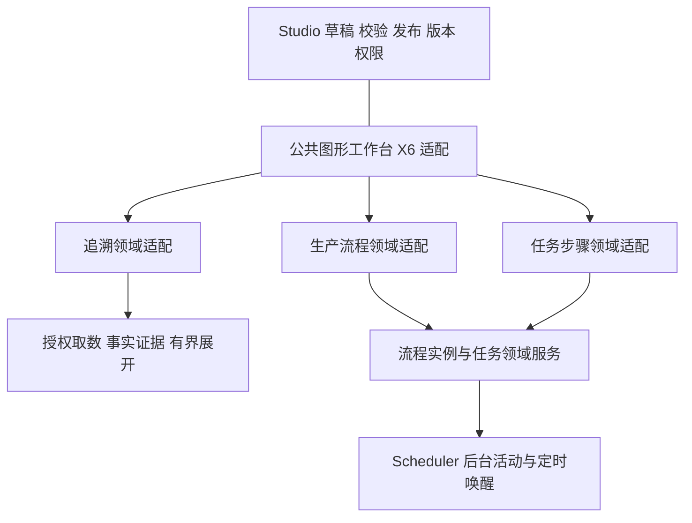

# Studio 公共图形工作台与流程复用架构

更新：2026-10-29。目标读者：PF-09 追溯开发主控、公共 Studio 能力维护者、后续生产流程与任务开发主控。

**目标：以 X6 + 现有 Vue / .NET / Studio 建设可复用的图形编辑和运行展示能力，由 PF-09 追溯首先落地，后续生产流程定义、流程监视和任务步骤继续复用。**

**状态：用户已确认技术方向及四阶段实施顺序；本轮交付架构与实施输入文档，尚未开始图形能力编码、依赖安装或 PoC。** 本文不是“X6 已准入”“追溯已实现”或“生产流程引擎已交付”的证据。

技术方向：Vue 3 / TypeScript / 现有 Studio 编辑外壳，X6 图形适配，现有 .NET 应用与领域边界。精确 X6 发行版本、插件集合、布局算法和性能仍由第二阶段核验锁定。

文档归属：补充[实施12](../12-Industrial%20Platform%20Dashboard%20Report开发实施方案.md)中 TASK-PF09-011～014 的公共能力架构。原任务编号、一个 PF 工作包及阶段内连续推进方式不变；不另造一套 PF 任务账本。

## 1. 主控开工先确认什么

### 1.1 已确认的决定

1. 使用 X6，沿现有 .NET / Studio 技术体系实现，不移植 ComfyUI 的前后端。
2. 借鉴 ComfyUI 的节点、端口、拖线、选择、缩放和属性联动等交互；不复制其代码、改写后的代码片段、UI 资产或专有实现。
3. 公共图形能力独立于 Traceability 业务目录和权限；追溯是第一个消费者，后续生产模块消费同一能力。
4. 共用图形交互、定义生命周期入口和运行展示；追溯查询与生产流程推进分别拥有领域语义。
5. 按“公共合同 → 双领域复用 PoC → PF-09 011～014 → 后续生产模块接入”的顺序推进。
6. 保持平台自身许可证的选择空间；OP 文档用于理解业务行为，不导入 OP 代码、内部模型或图片资产。

### 1.2 适用关系与唯一维护源

| 内容 | 权威入口 | 本文如何使用 |
| --- | --- | --- |
| 跨任务协作、共享文件、真实页面验证 | [长期协作约定](../../agents/开发协作与页面统一约定.md) | 沿现有单写、稳定交接与按影响验证方式 |
| 模块与宿主边界 | [蓝图32](../../blueprint/32-Industrial%20Platform%20Service%20Host与内部模块边界.md) | 公共组件不等于新 Service Host；禁止跨模块直读 Repository |
| 追溯配置、API 与身份 | [接口与配置合同 §7](PF08-PF09-接口与配置合同.md#7-tracemodel配置与-api) | 保留已有 TraceModel，公共图层通过适配消费 |
| 资源、修订与部署数据 | [数据模型与生命周期](PF08-PF09-数据模型与生命周期.md) | 复用 Studio 自有资源、修订、授权；不新建通用事实图数据库 |
| 追溯展开、证据与详情 | [运行规则 §5～7](PF09-报表分页与追溯运行规则.md) | 保留有界 BFS、多重证据边、Partial 和当前页明细语义 |
| 页面、验收及技术候选 | [页面与验收规格 §6～9](PF08-PF09-页面与验收规格.md) | 复用 B24～B29、B41、B44、B45 及 X6 候选核验要求 |
| 平台原生、独立及外部 MES | [双模式适配与按需部署](PF08-PF09-双模式适配与按需部署.md) | 单装追溯不强制安装 Report、Office 或未来生产模块 |
| 后续工艺流程目标 | [蓝图21 §11](../../blueprint/21-低代码配置平台设计.md)、[后续设计](../../blueprint/后续设计.md) | 记录后续需求，不当作已有流程引擎 |

本文新增公共复用约束，不重新定义追溯取数协议。若第一阶段需要调整现有字段，必须同步修改相应权威合同及兼容说明，不能让两份文档各自维护不同 schema。

### 1.3 当前实现基线

以下为 2026-10-29 只读核查结果，接手时须重新确认当前代码，不能用本文覆盖后续实现。

| 已有能力 | 可复用部分 | 当前缺口 |
| --- | --- | --- |
| StudioResource / StudioRevision / Publishing | 草稿、不可变发布修订、依赖与来源锁定、并发控制、审计 | 发布器资源白名单尚无 TraceModel；不能只加前端菜单就称已接入 |
| StudioAuthorization | 当前主体、租户、功能权限和资源 grant | 新领域仍须完整登记 Design / Publish / Run 等适用权限 |
| StudioEditorShell / history | 工具栏、侧栏、选择及撤销交互 | 仍耦合 LayoutNode 树和 CSS 缩放；接 X6 需要窄适配 |
| Dataset / Binding / 文件门面 | 授权取数、参数映射、受控文件访问 | 追溯消费端与图形定位需新增；不可在公共图层执行 SQL |
| ReferenceData 状态机 | 状态定义与允许转换的校验 | 不持有生产任务的当前状态，也不负责业务事务和流程推进 |
| Scheduler / RuntimeSupport Jobs | 后台处理、状态、取消、受控重试和执行不确定性处理 | 当前 OneShot 白名单限定报表处理；不是通用流程编排器 |
| 前端工程 | Vue 3、TypeScript、Pinia、Element Plus 和既有构建体系 | 当前 package.json 未引入 X6；版本与插件待 PoC 锁定 |

核查入口：[StudioPublishing](../../../src/backend/src/Services/PlatformStudio/IndustrialPlatform.PlatformStudio.Application/Publishing/StudioPublishing.cs)、[StudioPorts](../../../src/backend/src/Services/PlatformStudio/IndustrialPlatform.PlatformStudio.Application/StudioPorts.cs)、[StudioEditorShell](../../../src/frontend/src/components/studio/shared/StudioEditorShell.vue)、[共享模型与历史](../../../src/frontend/src/components/studio/shared/model.ts)、[Scheduler 实施范围](../10-Industrial%20Platform%20Scheduler%20Platform%20Health开发实施方案.md)。

## 2. OP 与 ComfyUI 分别提供什么参考

### 2.1 OP 的三层业务概念

| 层次 | 原文事实 | 本项目采用的设计原则 |
| --- | --- | --- |
| 业务流程 BPFlow | 流程模板、流程定义及修订、运行 WorkProcess 分开；用户任务关联任务定义；调用活动关联子流程定义 | 定义与实例分离，运行绑定明确修订和依赖版本 |
| 业务任务 Task | TaskDefinition 产生 Task；任务有参数、状态、设备、执行 UI 和完成条件；RepeatTask 产生新的迭代实例 | 任务是独立业务实体，一个定义节点可能对应多次执行 |
| 操作步骤 StepFlow | 步骤定义、运行步骤、转换、UIType / UISource、初始步骤和取消跳转分别表达 | 任务内部步骤导航有自己的适配，不能直接当作宏观生产流程 |

用户手册第 333～376 页说明 BPMN 2.0 流程对象、网关、循环、子流程、参数绑定和可执行性检查；第 380～386 页说明运行监视、多实例和暂停语义；第 388～413 页说明任务序列、重复执行和状态机。

BPFlow 参考文档的 `GetJSONWorkProcessDesign` 分别返回 `Model` 与 `Tokens`，支持“定义图 + 运行覆盖显示”的分离思路。参考文档中标注 INTERNAL / TEMPORARY 的内部实体只作概念证据，不作为本项目公开合同。完整来源定位见 §11。

### 2.2 ComfyUI 的可借鉴范围

借鉴节点搜索与拖入、端口连线、连接反馈、画布缩放平移、选择与属性联动、撤销重做、保存重开和运行状态提示。交互应沿平台主题、语言、快捷键和现有编辑器习惯统一。

ComfyUI 的模型计算 DAG、节点缓存、Python 插件加载和执行队列不作为本项目执行模型。追溯允许事实环与多重边；生产流程需要持久化等待、人工动作和多次执行，不能通过套用计算 DAG 获得这些语义。

### 2.3 选定路线与未采用路线

| 路线 | 结论 |
| --- | --- |
| 每个业务各建一套图编辑器 | 不采用；未来流程、任务和追溯容易复制交互与修复 |
| 公共 X6 工作台 + 领域适配 + 各自执行服务 | 用户已选定；复用实际共同能力，保留业务边界 |
| 本轮先建设覆盖所有领域的统一工作流 / DAG 引擎 | 不纳入 PF-09；会把追溯查询、生产事务和后台执行混在一起，且缺少完整生产契约 |

## 3. 分层和所有权



| 层 | 拥有的职责 | 不应拥有的职责 |
| --- | --- | --- |
| 公共图形层 | 节点 / 端口 / 边呈现，选择，拖拽，连接反馈，折点，视口，布局调用，诊断定位，只读显示 | SQL、工单推进、库存事实、审批决定、任务权威状态 |
| 领域适配层 | 节点目录、属性编辑、连接规则、定义到视图映射、领域命令与诊断映射 | 绕过服务器授权，直接写其他领域表 |
| Studio 生命周期 | 资源、草稿、修订、依赖校验、发布、资源授权与并发控制 | 自动成为所有领域执行引擎 |
| 追溯服务 | 有界 BFS、来源授权、稳定身份、证据、多重边和部分结果 | 根据设计连线生成消耗事实 |
| 未来流程 / 任务服务 | 实例推进、活动、等待、分支汇合、任务生命周期、恢复与审计 | 由浏览器负责持久化推进，或让画布直接修改业务状态 |
| Scheduler | 执行已登记活动、超时唤醒和后台基础设施 | 决定生产下一工序，拥有工单、库存或任务业务事实 |

生产领域可沿现有模块化宿主部署；本架构不要求先拆微服务、不新增第二套 Scheduler。后续使用公共前端能力也不应被迫安装 Traceability 后端。

## 4. 公共合同的设计边界

本节冻结语义边界；接口名称和示意字段用于第一阶段细化，不是已经发布的 DTO。第一阶段须给出完整字段类型、必填/空值、诊断、版本兼容和样例后，才能派遣相应生产代码。

### 4.1 三类数据分别管理

| 数据 | 例子 | 写入及持久化规则 |
| --- | --- | --- |
| 领域定义 | 追溯对象与关系映射；流程活动、条件和参数绑定 | 领域模型拥有，由受权编辑与发布入口维护 |
| 显示布局 | 节点位置、尺寸、端口显示、边折点 | 可随设计修订保存；运行中临时拖动仅改本次视图 |
| 运行投影 | 实际对象、证据、活动状态、执行次数、错误及时间 | 服务端结果转为只读显示，不能回写定义或参与设计撤销 |

现有 TraceModel 的 `objects / relations / layout / limits` 保持原合同。X6 的序列化数据可以用于适配内部，不直接充当跨版本后端执行协议；不要求所有领域保存成同一种任意 `data` JSON。

领域定义和布局应能分别校验，保存时保持一致快照。只移动节点不改变关系查询，删除节点则必须同时处理关联定义、布局与诊断，并构成一次完整撤销操作。

### 4.2 最小适配能力

| 能力 | 输入 / 输出语义 | 必须满足 |
| --- | --- | --- |
| 定义投影 | 领域定义 → 稳定节点、端口、边及显示属性 | 公共图层不导入追溯、生产实体类；未知类型明确诊断 |
| 编辑命令 | 加入 / 删除 / 连线 / 改属性 / 改布局 → 新定义和布局 | 一次用户动作一次原子编辑，失败保留原草稿 |
| 连接与发布校验 | 拟连接或完整定义 → 错误 / 警告 / 定位 | 前端即时反馈；后端重新校验可执行性与引用 |
| 属性与详情 | 选中对象 → 对应面板、字段和详情引用 | 切换选择不写历史；异步结果须归属原选择 |
| 运行投影 | 结果快照或受控增量 → 节点 / 边覆盖显示与实例列表 | 定义、运行实例、查询世代和结果版本相互匹配 |
| 受权操作 | 用户动作 + 目标身份 + 版本 + 幂等依据 → 领域服务结果 | 公共组件只提交意图，成功与状态以服务器为准 |

不在第一版建立任意脚本上传、动态程序集加载或远程插件市场。节点由工程中明确登记的领域适配提供；参数、条件和动作消费现有受控能力，后续表达式能力另行定义类型、单位和执行边界。

### 4.3 身份和连线不能混用

- 定义身份：资源、修订、定义节点与定义边的稳定 ID。改名称、移动位置不改变 ID。
- 追溯运行身份：完整业务对象身份及证据边身份，沿接口 §7 和运行规则 §5.2。
- 流程运行身份：流程实例、活动实例、任务实例、定义节点引用、迭代和执行尝试分别表达。一次失败重试与业务返工循环不是同一概念。
- 连线至少在领域上区分事实关系、控制流和数据绑定。控制流决定何时推进，数据绑定决定值从哪里来；两者不能通过一条无类型的边隐式混用。
- 公共组件允许领域声明环、多重边、端口方向和连接限制。不能在公共底层统一规定“所有图无环”或“同端点只能有一条边”。

### 4.4 运行投影与浏览器生命周期

运行投影需要表达来源范围、采用的定义修订、查询/实例身份、响应版本、观察时间、节点与边、局部错误和完整性信息。追溯的 Partial / Unknown / 来源观察时间继续按原合同，不强制套用任务的 Running / Completed。

一个定义节点关联多次活动时，图上给出有规则的汇总提示，详情列出每个实例、迭代、尝试和结果。汇总颜色不能抹掉过去失败，也不能把某次完成误标为全部完成。

前端应丢弃旧查询、旧选择和旧实例的迟到回包；增量丢失或版本不连续时允许重新取得受权快照。轮询或推送方式在第一阶段确定最小实现，不为复用强制新建事件总线。切换租户、模型、实例或卸载页面时清理订阅、监听器和图实例。

### 4.5 版本与受权执行

- 已发布定义修订不可变。流程启动时固定定义及所引用任务 / 子流程版本；修改“当前版本”只影响后续按该入口创建的实例。
- 草稿预览与正式实例分开，不能把未发布样例直接提升为正式生产执行。
- 迁移在途实例必须作为未来独立能力定义校验、影响和审计，不能在发布新版时自动替换。
- 图中的操作按钮依据服务端能力显示；服务器仍检查当前权限、业务状态、并发版本和幂等键。客户端禁用按钮不能替代授权。
- 暂停、取消、中止、跳过、重试和补偿分别设计。特别说明是否等待在途活动、是否传播子流程、如何处理设备动作；“页面状态已变”不等于物理动作已停止。
- 后台任务至少要处理重复投递、重复完成、乱序消息、进程重启和受理结果不确定；不宣称对外部设备或系统天然 exactly-once。

## 5. 编辑与运行页面如何复用

### 5.1 共同页面结构

```text
顶部：返回 / 资源与版本 / 撤销恢复 / 校验 / 保存发布（按模式显示）
左侧：领域节点目录、结构或查询起点
中央：图形画布；视口工具独立分组
右侧：当前节点/边的属性，或运行实例/证据详情
诊断区：错误、警告、Partial 原因；可定位到对应节点、边、字段
```

设计、预览、运行监视三种模式共用图形适配。运行模式的移动和缩放只影响视图；“完成任务”等领域动作有独立授权入口，不与编辑节点混用。追溯仍按既有规格在当前页模态打开文件或外链，返回后保留图位置和选择。

### 5.2 现有编辑壳的改造限制

只抽出图形所需的窄契约，不为了接 X6 重写低代码、看板和报表。保留既有工具栏、侧栏、本地化、主题与保存状态；树形 LayoutNode 和图形节点分别适配。

视口只由一个控制者管理：不能在 X6 已缩放的画布外再套一层 CSS 缩放。撤销也只保留一条权威历史：图形与属性修改属于同一次领域编辑；不得让 X6 History 和 Studio History 各自推进。具体接法在 PoC 中证明，不预设两套历史自动同步。

文本输入时不误触删除/撤销快捷键；侧栏关闭后能重新打开；选中不产生脏状态；保存失败保留草稿；并发冲突明确提示而不静默覆盖。

大图优先使用轻量节点和边，复杂表单按选中状态挂载到属性面板。节点内控件按真实业务需要和性能证据接入，不能把千个节点都实现为完整重型表单。

## 6. 追溯与未来生产必须保留的差异

### 6.1 PF-09 追溯不变量

1. 起点来自授权 Dataset；`collectionPath`、rowKey 和完整身份显式配置。起点和续查凭证仍按接口 §7 签名、5分钟有效，并在消费时重验当前权限；报表预览取消期限的调整不适用于追溯凭证。
2. 对象身份包含租户、来源、工厂、对象类型和业务键；不同工厂同编码不能合并。
3. 正反向 TraversalBinding 显式配置和验证；反向查找不能颠倒实际业务箭头。
4. 去重查询键包含节点、关系、方向和来源观察范围；同端点不同证据保留多条边。遇环只停止重复展开，不删除真实关系。
5. Genealogy 与设备 / 质量 Context 分开；“使用同设备”不能推出物料流入。
6. 沿既定深度12、1000节点、3000边、30秒预算及允许的请求限制展开，取消及迟到结果分别处理；截断和部分失败明确返回 Partial，不能显示为完整。
7. 设计连线只定义取数规则，不生成生产事实。源系统没有包装级记录时不能补造包装链。
8. 明细、文件和外链重新校验权限；复用当前页模态及来源嵌入策略，不绕过 CSP 或自动跳新页。

### 6.2 未来生产执行的独立输入

生产主控需要补齐 ProcessDefinition、TaskDefinition、ProcessInstance、ActivityInstance、TaskInstance、等待/事件及转换记录的领域合同。表与迁移按其真实所属模块设计，不能因为它们都能画图而塞进通用图形表。

最低语义范围包括：开始/结束、顺序、条件分支、并行汇合、人工任务、受控自动活动、等待、超时、失败恢复、循环与子流程。每种元素只有语义、持久化、处理器和验收齐备后才作为正式可用节点开放。

任务输入输出需要类型、方向、来源、空值、数量与单位规则；关联工单、工序、设备和批次采用所属模块公开合同。流程服务决定推进，生产/库存等模块继续拥有业务事实和事务。

### 6.3 BPMN 标准边界

OP 手册明确采用 BPMN 2.0，并提供 BPMN 文件导入；本项目[现有蓝图21](../../blueprint/21-低代码配置平台设计.md)只提出“类似 BPMN”，尚未选定兼容范围或执行引擎。

X6 负责图形编辑与显示，不自动提供 BPMN XML、网关 Token、事件和执行语义。当前按自有类型化领域合同实现，并保留独立格式转换边界；本轮不承诺 OP 文件或任意 BPMN 文件无损导入。

生产阶段如要求互操作，主控须先确定支持的 BPMN 元素、XML 往返、扩展属性、未支持元素的报错策略及执行一致性，再决定自有执行内核与现有引擎的取舍。不得在 PF-09 中提前绑定某工作流引擎。

## 7. 技术准入、许可和代码落点

### 7.1 候选核验

X6 官方仓库[许可证为 MIT](https://github.com/antvis/X6/blob/master/LICENSE)，保留版权和许可声明。正式接入按实际发行物核对版本、插件、传递依赖、图标和字体，不以主分支 LICENSE 代替锁包证据，也不在本文替平台选定最终开源协议。

按[页面规格 §8～9](PF08-PF09-页面与验收规格.md)产出 `candidate-lock.json`：name、version、packageIntegrity、sourceCommit、licenseFiles、transitiveLicenses、artifactSha256、distributionMode、testEvidence。未知字段如实标未取得；PoC 未通过不能标生产准入。

不引入 ComfyUI / OP 源码、资产、原始手册或反编译输出到产品发行包。原文留在获授权的知识库/本地研究材料中，仓库只保留必要的行为总结和来源定位。后续选用流程引擎需要单独检查其许可及交付方式。

### 7.2 建议落点与允许修改范围

以下是第一阶段用于细化的建议路径；未列为“现有”的文件不是已创建的产品代码。最终文件清单在派遣前按当前树确认。

| 位置 | 责任 |
| --- | --- |
| `src/frontend/src/components/studio/graph/`（新增） | 公共图形契约、X6 适配、图形工作台、视口、诊断和运行覆盖显示；不导入追溯实体 |
| `src/frontend/src/components/studio/shared/`（现有） | 编辑壳及历史的窄适配，保留既有消费者行为 |
| `src/frontend/src/components/studio/trace/`、对应 `pages/pc/studio/trace/`（新增） | TraceModel 适配、节点/关系属性、起点和运行页面 |
| PlatformStudio 的 Contracts / Domain / Application / Infrastructure / Api（现有工程） | TraceModel 验证、资源生命周期接入、授权取数与追溯应用服务；不另起宿主 |
| 前端 API / routeNames / studioRoutes、本地化、后端权限/导航/初始化 | 形成平台原生与独立 Studio 的实际可达入口 |
| 前端组件/领域/浏览器测试、PlatformStudio 后端测试 | 双领域复用夹具、序列化与交互、追溯算法和权限边界 |
| 未来生产领域模块 | 生产定义、任务、实例及持久化执行；不在本轮创建空壳工程 |

公共图形层先留在现有前端工程，形成明确导入边界；不为复用立即拆 npm 包。未来只有真实独立构建/发布需求才抽包。生产样例是验证夹具，不注册为正式菜单或可执行产品功能。

## 8. 任务依赖与实施顺序

```text
阶段一：公共合同、页面模式与领域边界细化
    ↓
阶段二：同一组件的追溯 + 生产样例 PoC，锁定 X6 与适配方式
    ↓
阶段三：PF09-011 → PF09-012 → PF09-013 → PF09-014 适用集成
    ↓
阶段四：后续生产定义、流程实例、任务和步骤接入
```

这四阶段是实施顺序，不是四个新 PF 或四次强制提交。完整工作包按既有方式派遣、连续推进与稳定交接。C4 的研发顺序按页面规格 §1.1 的 C3 研发交接解释；人工验收按用户已确定节奏后置，不把 Office 未准入变成追溯的代码或安装依赖。本轮不判断 C3 交接条件已完成，也不关闭其未测项；C4 自身技术准入和 C5 适用集成条件仍须满足。

### 8.1 阶段一：确定公共合同

| 字段 | 内容 |
| --- | --- |
| 状态 | 顺序已确认；本文提供架构输入，具体接口细化待执行 |
| 目标 | 让开发者知道公共层与领域层各自保存什么、调用什么，避免重复造编辑器 |
| 输入文档 | 本文 §1～7、接口 §7、数据规格、页面规格、实际共享编辑壳 |
| 依赖 | 核对最新源码和 WIP；复用已有 Studio 公开能力 |
| 允许修改范围 | 本文及现有权威合同的相关章节、最小页面线框；本阶段不接入产品依赖 |
| 预期输出 | 类型/必填/空值/版本规则、领域适配接口、编辑事务与历史方案、运行投影样例、诊断定位、具体文件清单；逐项标注追溯现有字段与新增字段 |
| 验证与证据 | 用追溯多重边/循环、生产并行/重复检验两个纸面样例走通保存、投影、选择和版本关系；确认无需公共组件直接引用领域模型 |
| 结果回写 | 本文及对应字段/API规格；记录未冻结的 PoC 项，不伪造接口实现 |
| 提交策略 | 沿当前用户授权和仓库流程，不为细化单独强制提交 |

### 8.2 阶段二：双领域复用 PoC

| 字段 | 内容 |
| --- | --- |
| 状态 | 待实施；本轮尚未安装或验证 X6 |
| 目标 | 用同一套实际组件证明跨领域复用与关键交互、性能可行 |
| 输入文档 | 第一阶段合同、本文 §5/7/9、页面规格 §8～9 |
| 依赖 | 公共合同可核验；独立 PoC 环境和固定输入，避免修改用户调试数据 |
| 允许修改范围 | 隔离 PoC、候选锁定记录和夹具；通过核验前不写为产品正式准入 |
| 预期输出 | 一个 X6 适配、同一个图形工作台、两个领域适配/夹具；候选物料、结果、实际限制与最小接入变更 |
| 验证与证据 | 追溯样例含多父、多证据边和环；生产样例含分支/并行、重复任务及多实例覆盖；保存重开、属性/图形单步撤销、缩放后拖线、只读模式、资源清理和大图测量 |
| 结果回写 | candidate-lock、测试证据、第一阶段合同及已有候选表；明确模拟运行仅验证展示，不代表流程推进/持久化通过 |
| 提交策略 | 按现有候选准入流程处理；不保留两套正式图引擎或演示专用分叉组件 |

生产 PoC 可用固定的“领料 → 称量 → 并行加工/检验 → 汇合 → 放行”定义，并为检验注入两次迭代结果，展示失败与成功实例。返工次数和任务推进由夹具明确给出；不能以浏览器动画证明真实生产执行。

生产流程夹具不替代 C4 的“流程批次链 + 离散序列号装配链”两套追溯场景；前者证明跨领域组件复用，后两者证明追溯核心不绑定单一行业。

### 8.3 阶段三：PF-09 正式落地

| 字段 | 内容 |
| --- | --- |
| 状态 | 011～014 尚未实施；原任务卡继续管理范围和结果 |
| 目标 | 工程师配置追溯模型，用户从真实授权起点展开并在当前页查看事实证据 |
| 输入文档 | 实施12 的 011～014、既有追溯规格、本公共架构及通过的 PoC 结果 |
| 依赖 | 第一阶段细化、第二阶段适用准入、C0 公开合同及当前研发前置 |
| 允许修改范围 | §7.2 的公共图形/追溯消费端及原任务卡允许范围；共享编辑壳由主控协调单写 |
| 预期输出 | 011 起点与来源；012 节点/关系设计；013 查询/布局/证据详情；014 已选模块集成和编辑体验 |
| 验证与证据 | 既有 A02/A03/A12/A13、B24～B29/B41/B44/B45 及适用 D 项；补充 §9 复用验收，不替代原验收 |
| 结果回写 | 原任务卡、PF-09 evidence、CURRENT 与受影响权威规格；实现、自测、用户确认、未测分别记录 |
| 提交策略 | 当前用户授权及仓库门禁；不逐卡拆派遣或提交，不裹入其他 WIP |

014 是已选模块的适用集成；单装追溯不等待未选产品安装。产品总包仍按原规格汇总四部分，本文不把 014 改成“完整生产引擎验收”。

### 8.4 阶段四：后续生产模块接入

| 字段 | 内容 |
| --- | --- |
| 状态 | 已纳入架构路线；生产详细规格、开发派遣及验收尚未完成 |
| 目标 | 固定版本的流程定义生成实例，任务按规则执行，监视器显示真实状态和历史 |
| 输入文档 | 已交付公共合同、本文 §6.2/6.3、生产业务规格、任务及设备公开合同 |
| 依赖 | 流程/任务/等待的持久化与事务设计、BPMN 范围决定、处理器与真实业务边界齐备 |
| 允许修改范围 | 所属生产/流程/任务模块及公共组件的确有需要的兼容扩展；不修改追溯事实语义 |
| 预期输出 | 定义与任务管理、固定修订实例、持久化推进、步骤界面、运行监视及异常处置 |
| 验证与证据 | 并行汇合、人工等待、重启恢复、重复/乱序消息、版本切换、重试与返工、暂停/取消传播和授权；真实设备动作单独验收 |
| 结果回写 | 后续生产实施方案和证据；公共合同变化及追溯回归范围同步记录 |
| 提交策略 | 后续实际工作包规定，不由本架构文档自动启动生产实现 |

## 9. 完成标准与验证映射

以下 GX 编号只用于本补充文档的验收定位，不是新任务卡，也不替代原 A/B/D 验收编号。

| 编号 | 场景 | 通过条件 |
| --- | --- | --- |
| GX-01 | 切换追溯与生产样例 | 复用同一个图形组件与 X6 适配；新增节点/属性/连接规则只改领域适配，不复制工作台 |
| GX-02 | 编辑、保存、重开、撤销 | 结构和布局一致；图形/属性复合动作一次撤销；选择、缩放与运行刷新不污染草稿历史 |
| GX-03 | 循环与多重边 | 追溯真实环和同端点多次证据均保留；生产限制由其适配决定 |
| GX-04 | 模型版本与运行多实例 | 新版不替换旧运行定义；同一节点多次任务可逐次查看，状态不互相覆盖 |
| GX-05 | 迟到回包与页面退出 | 快速切换起点/模型/实例后旧结果不覆盖；卸载后无残留图实例和订阅 |
| GX-06 | 授权和只读模式 | 运行拖动不改定义；非法操作由服务端拒绝；当前权限撤回后不继续展示不可见内容 |
| GX-07 | 原编辑器回归 | 低代码、看板、报表受影响路径的选择/属性/撤销/缩放/保存保持正确，不双重缩放或抢快捷键 |
| GX-08 | 大图和资源消耗 | 沿原规格 4核/8GiB 基准、1000节点/3000边，30秒内完整或明确 Partial；固定 fixture 跑5次，记录 P50/P95、峰值内存与取数/布局/渲染耗时 |
| GX-09 | 平台与独立装配 | 原生与独立 Studio 均可发现和打开追溯；未安装 Report/Office/生产模块时仍可运行适用追溯链 |
| GX-10 | 未来真实执行 | 服务重启、重复完成、乱序通知、等待到期、在途取消和版本更新后行为符合领域合同；仅在阶段四验收 |

GX-08 中允许明确 Partial 不等于允许偷偷删减测试数据。另行核对完整 1000/3000 图形夹具的显示和交互；未完成、失败和超时如实登记，不能用隐藏节点或仅测缩略图声明通过。

文档整理只检查引用、字段一致性、任务映射和 diff。后续源码变化按[长期约定 §7](../../agents/开发协作与页面统一约定.md)验证；后端先新鲜 Release build，再执行 Release `--no-build` 测试。前端核对当时 package.json 的 typecheck、lint、适用单测、build / build:studio 及真实浏览器关键链。未受影响且有有效快照的证据复用，不机械重跑全部检查。

## 10. 执行记录与下一阶段交接

### 10.1 当前执行记录

| 日期 | 范围 | 结论 | 尚未完成 |
| --- | --- | --- | --- |
| 2026-10-29 | ComfyUI 本地 REA、现有 Studio/.NET 源码与 IMA OP 原文评估 | X6 + 现有体系可作为复用路线；用户确认四阶段顺序；本文完成主控交接设计 | 公共接口细化、X6 实际包准入、双领域 PoC、追溯实现与性能、生产执行 |

本记录不修改此前报表、看板的交付与未测状态。研究材料也不等于产品测试证据。

### 10.2 接手主控的执行清单

- [ ] 读取最新 CURRENT、PF-09 工作包与通用协作约定，核对当前代码和共享文件写入者。
- [ ] 先完成阶段一字段/接口/页面模式/具体文件清单；对已有 TraceModel 只做必要兼容扩展。
- [ ] 实施一个候选适配和两个领域样例，取得实际锁包、许可、交互和性能证据。
- [ ] 把 PoC 结论回写权威规格，再按原 011～014 连续推进适用范围。
- [ ] 交付公共能力时给出两个消费者的实际用法、扩展步骤及不应跨越的执行边界。
- [ ] 将生产实例/任务/设备等未实施范围明确交给后续主控，不把演示状态当成真实执行。

交接记录沿现有紧凑格式：范围、源码快照、改动清单、验证命令/结果/证据、未测项、所有权交接。公共组件变化须指出受影响消费者；保存/执行合同变化须记录兼容策略。主控负责消除文档冲突，不让执行者在新旧规则之间自行猜测。

下一阶段的输入应至少包括：稳定公共接口及 schema 版本策略、X6 candidate-lock、双领域夹具与通过/失败/未测表、TraceModel 适配示例、共享编辑壳兼容说明、定义与运行投影样例、权限/部署边界、生产待细化清单。

## 11. 原文与研究证据定位

IMA 原文位于个人知识库 `ima_kb_QvcctWdF` 的“西门子OP2307”目录（folder ID：`folder_7487855605598871`）。先按目录找原文件，再查以下章节/锚点；不要求后续主控重新阅读整套资料。

| 原文件 | 精确定位 | 用途 |
| --- | --- | --- |
| `OpcenterEXFN_UserManual_CN.pdf` | 第333～376页；380～386页；388～413页 | 流程定义、BPMN对象、版本、运行监视和任务状态 |
| `Siemens.SimaticIT.BPFlow.BPFlow.BPPOMModel.html` | `h_DataModelProcessDefinition`、`h_DataModelWorkProcess`、`h_PublicCommandsSetExecutable`、`h_ReadingFunctionsGetJSONWorkProcessDesign` | 定义/实例、可执行校验、Model/Tokens分离 |
| `Siemens.SimaticIT.Task.Task.TSPOMModel.html` | `h_DataModelTaskDefinition`、`h_DataModelTask`、`h_PublicCommandsRepeatTask`、`h_PublicCommandsSetTaskStatus` | 任务定义/实例、重复任务和状态转换 |
| `Siemens.OpcenterEX.PR.StepFlow.StepFlow.PRPOMModel.html` | `h_DataModelStepFlowDefinition`、`h_DataModelStepDefinition`、`h_DataModelStep`、`h_PublicCommandsCreateStepFlowFromStepFlowDefinition` | 任务内步骤与界面导航 |

本机原文副本和 SHA-256 清单：`D:\Code\Industrial Platform\.plugin-research\pf09-op-graph\source-manifest.json`。用户手册 SHA-256：`cefd3d5c63b8ccb560f361056edb79dcdf2c4d6e305fe8c82183b5065c32049e`。其他主控可从上述 IMA 位置重新读取，不依赖此机绝对路径。

ComfyUI 核查对象为用户本机 `D:\Application\ComfyUI`，后台 0.30.2、前端发行包 1.47.12。REA 证据留在本机 `C:\Users\DONG\.codex\visualizations\2026\10\29\01a187d1-d51e-7b61-8083-3606aef85877\pf09-comfyui-rea-evidence.json`；结论只覆盖所检查静态文件与观察，不代表全部代码覆盖或性能验证。继续开发无需依赖 ComfyUI 服务在线。
